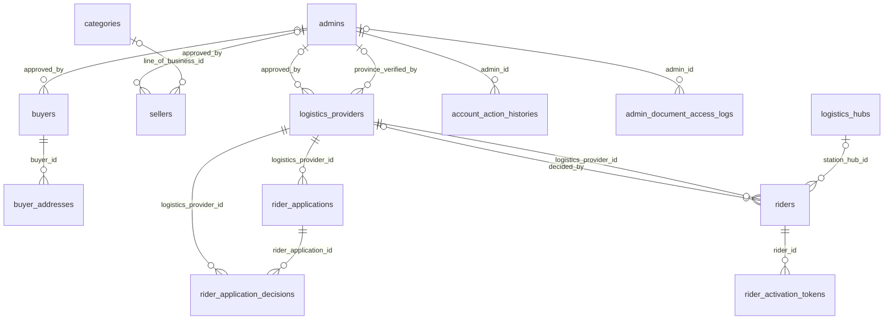
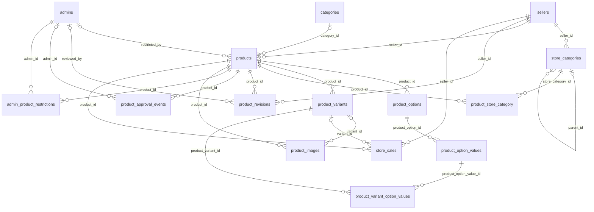
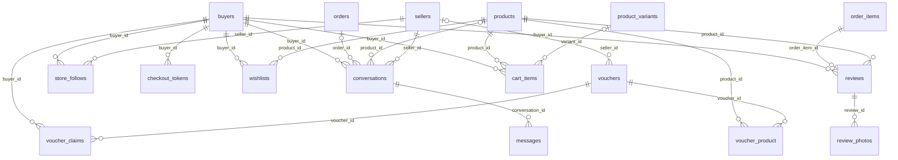
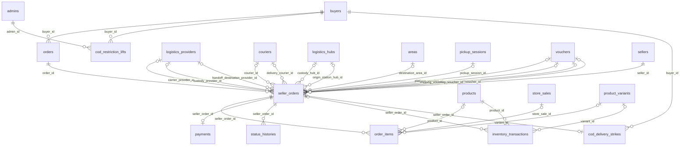
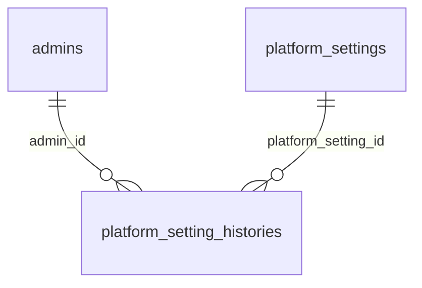

# Database migrations

One migration file per table, in the order the tables can be created (a table always comes after the tables it points to).
Each file shows the table's columns, primary key, indexes and its foreign keys, so you can read a table in one place.

- **Tables:** 97 (plus 8 Laravel framework tables built by the three `0001_01_01_*` files).
- **Foreign keys:** 218.
- Files are numbered `2026_01_01_000101` upwards; the number only fixes the build order. The file name says which table it creates.

## How to read the diagrams below

`parent ||--o{ child` means one parent has many children. `|o--` means the parent is optional (the foreign key can be empty). `||--o|` means one-to-one. The label is the foreign key column.

## Identity

Accounts and sign-in. Four kinds of people sign in separately (admin, buyer, seller, delivery company) and a company employs riders.

| File | Table | What it is for | Belongs to |
|---|---|---|---|
| `2026_01_01_000101_create_admins_table.php` | `admins` | Platform staff who approve accounts, products and money movements. | - |
| `2026_01_01_000102_create_password_reset_tokens_admins_table.php` | `password_reset_tokens_admins` | Forgot-password links for admins. | - |
| `2026_01_01_000103_create_password_reset_tokens_buyers_table.php` | `password_reset_tokens_buyers` | Forgot-password links for buyers. | - |
| `2026_01_01_000104_create_password_reset_tokens_sellers_table.php` | `password_reset_tokens_sellers` | Forgot-password links for sellers. | - |
| `2026_01_01_000105_create_password_reset_tokens_logistics_table.php` | `password_reset_tokens_logistics` | Forgot-password links for delivery companies. | - |
| `2026_01_01_000106_create_personal_access_tokens_table.php` | `personal_access_tokens` | Login tokens for the mobile and API apps. | - |
| `2026_01_01_000113_create_buyers_table.php` | `buyers` | Customers who place orders. | `admins` |
| `2026_01_01_000114_create_sellers_table.php` | `sellers` | Shop owners, with their business details and store profile. | `admins`, `categories` |
| `2026_01_01_000115_create_logistics_providers_table.php` | `logistics_providers` | Delivery companies. One account per company. | `admins` |
| `2026_01_01_000116_create_account_action_histories_table.php` | `account_action_histories` | Log of admin suspend and reactivate actions on accounts. | `admins` |
| `2026_01_01_000117_create_admin_document_access_logs_table.php` | `admin_document_access_logs` | Record of which admin viewed an uploaded ID or permit. | `admins` |
| `2026_01_01_000120_create_buyer_addresses_table.php` | `buyer_addresses` | Delivery addresses a buyer has saved. | `buyers` |
| `2026_01_01_000121_create_rider_applications_table.php` | `rider_applications` | People applying to become a rider, waiting for the company to approve them. | `logistics_providers` |
| `2026_01_01_000137_create_riders_table.php` | `riders` | Individual drivers who work for a delivery company. | `logistics_providers`, `logistics_hubs` |
| `2026_01_01_000138_create_rider_application_decisions_table.php` | `rider_application_decisions` | History of each approve, reject or resubmit decision on a rider application. | `logistics_providers`, `rider_applications` |
| `2026_01_01_000154_create_rider_activation_tokens_table.php` | `rider_activation_tokens` | One-time links a newly approved rider uses to set a password. | `riders` |



## Catalog

What sellers sell: products, their variants (size or color), photos, shelves and sale prices, plus the admin approval trail.

| File | Table | What it is for | Belongs to |
|---|---|---|---|
| `2026_01_01_000107_create_categories_table.php` | `categories` | The fixed platform categories (Books, Electronics, ...). | - |
| `2026_01_01_000122_create_store_categories_table.php` | `store_categories` | A seller's own shelves for organising the shop; a shelf can sit inside another. | `store_categories`, `sellers` |
| `2026_01_01_000123_create_products_table.php` | `products` | Things for sale. | `categories`, `admins`, `sellers` |
| `2026_01_01_000139_create_product_options_table.php` | `product_options` | An option of a product, such as "Color". | `products` |
| `2026_01_01_000140_create_product_variants_table.php` | `product_variants` | One buyable combination of option values, with its own stock and price. | `products` |
| `2026_01_01_000141_create_product_store_category_table.php` | `product_store_category` | Join table: which seller shelf each product sits on. | `products`, `store_categories` |
| `2026_01_01_000142_create_product_revisions_table.php` | `product_revisions` | Edits a seller made to a live product that wait for admin review. | `products`, `admins`, `sellers` |
| `2026_01_01_000143_create_product_approval_events_table.php` | `product_approval_events` | History of admin approval decisions on a product. | `admins`, `products` |
| `2026_01_01_000144_create_admin_product_restrictions_table.php` | `admin_product_restrictions` | Admin blocks placed on a product. | `admins`, `products` |
| `2026_01_01_000155_create_product_images_table.php` | `product_images` | Product photos, optionally tied to one variant. | `products`, `product_variants` |
| `2026_01_01_000156_create_product_option_values_table.php` | `product_option_values` | The choices of an option, such as "Red" and "Blue". | `product_options` |
| `2026_01_01_000157_create_store_sales_table.php` | `store_sales` | Sale prices on products or variants for a period. | `products`, `sellers`, `product_variants` |
| `2026_01_01_000161_create_product_variant_option_values_table.php` | `product_variant_option_values` | Join table: which option values make up each variant. | `product_option_values`, `product_variants` |



## Storefront

What a buyer does around buying: cart, wishlist, vouchers, following shops, reviews, chat.

| File | Table | What it is for | Belongs to |
|---|---|---|---|
| `2026_01_01_000108_create_newsletter_subscribers_table.php` | `newsletter_subscribers` | Email addresses subscribed to the newsletter. | - |
| `2026_01_01_000124_create_vouchers_table.php` | `vouchers` | Discount codes from the platform or a seller. | `sellers` |
| `2026_01_01_000125_create_store_follows_table.php` | `store_follows` | Buyers following a shop. | `buyers`, `sellers` |
| `2026_01_01_000126_create_checkout_tokens_table.php` | `checkout_tokens` | One-time tokens that stop a checkout being submitted twice. | `buyers` |
| `2026_01_01_000145_create_wishlists_table.php` | `wishlists` | Products a buyer saved for later. | `buyers`, `products` |
| `2026_01_01_000146_create_voucher_product_table.php` | `voucher_product` | Join table: which products a voucher applies to. | `products`, `vouchers` |
| `2026_01_01_000147_create_voucher_claims_table.php` | `voucher_claims` | Which buyer claimed which voucher. | `buyers`, `vouchers` |
| `2026_01_01_000148_create_conversations_table.php` | `conversations` | A chat thread between a buyer and a seller. | `buyers`, `orders`, `products`, `sellers` |
| `2026_01_01_000158_create_cart_items_table.php` | `cart_items` | What a buyer currently has in the cart. | `buyers`, `products`, `product_variants` |
| `2026_01_01_000159_create_messages_table.php` | `messages` | Individual chat messages. | `conversations` |
| `2026_01_01_000184_create_reviews_table.php` | `reviews` | A buyer's review of an item they bought. | `buyers`, `order_items`, `products` |
| `2026_01_01_000193_create_review_photos_table.php` | `review_photos` | Photos attached to a review. | `reviews` |



## Orders

One checkout becomes one order, split into one parcel (seller_order) per seller. Everything about a parcel hangs off seller_orders.

| File | Table | What it is for | Belongs to |
|---|---|---|---|
| `2026_01_01_000127_create_orders_table.php` | `orders` | One checkout by a buyer. | `buyers` |
| `2026_01_01_000128_create_cod_restriction_lifts_table.php` | `cod_restriction_lifts` | Admin lifting a buyer's cash-on-delivery restriction. | `admins`, `buyers` |
| `2026_01_01_000165_create_seller_orders_table.php` | `seller_orders` | One parcel: the part of an order that comes from one seller. The hub of the whole database. | `logistics_providers`, `couriers`, `logistics_hubs`, `areas`, `orders`, `pickup_sessions`, `vouchers`, `sellers` |
| `2026_01_01_000166_create_order_items_table.php` | `order_items` | The products inside a parcel, with price and variant saved at purchase time. | `products`, `seller_orders`, `store_sales`, `product_variants` |
| `2026_01_01_000167_create_payments_table.php` | `payments` | The cash-on-delivery amount due for a parcel. | `seller_orders` |
| `2026_01_01_000168_create_status_histories_table.php` | `status_histories` | Every status change of a parcel, and who made it. | `seller_orders` |
| `2026_01_01_000169_create_inventory_transactions_table.php` | `inventory_transactions` | Every increase or decrease of stock. | `products`, `seller_orders`, `product_variants` |
| `2026_01_01_000170_create_cod_delivery_strikes_table.php` | `cod_delivery_strikes` | Strikes recorded against a buyer who refuses a cash-on-delivery parcel. | `buyers`, `seller_orders` |



## Logistics network

The delivery companies' physical and business setup: hubs, coverage areas, riders and couriers, partnerships and allowed routes.

| File | Table | What it is for | Belongs to |
|---|---|---|---|
| `2026_01_01_000129_create_logistics_hubs_table.php` | `logistics_hubs` | A company's province hubs and the station hubs under them. | `logistics_hubs`, `logistics_providers` |
| `2026_01_01_000130_create_transfer_couriers_table.php` | `transfer_couriers` | Drivers who carry parcels between hubs (not delivery riders). | `logistics_providers` |
| `2026_01_01_000131_create_logistics_provider_links_table.php` | `logistics_provider_links` | Partnership from one delivery company to another (one direction per row). | `admins`, `logistics_providers` |
| `2026_01_01_000132_create_logistics_shipping_rates_table.php` | `logistics_shipping_rates` | A company's shipping price per zone. | `logistics_providers` |
| `2026_01_01_000133_create_seller_shipping_providers_table.php` | `seller_shipping_providers` | Which delivery companies a seller has switched on. | `logistics_providers`, `sellers` |
| `2026_01_01_000149_create_logistics_hub_location_changes_table.php` | `logistics_hub_location_changes` | History of changes to a hub's address. | `logistics_hubs` |
| `2026_01_01_000150_create_areas_table.php` | `areas` | Barangays a station hub covers. | `logistics_providers`, `logistics_hubs` |
| `2026_01_01_000151_create_courier_accounts_table.php` | `courier_accounts` | Mobile-app login for a transfer courier. | `transfer_couriers` |
| `2026_01_01_000152_create_transport_connections_table.php` | `transport_connections` | Allowed hub-to-hub routes by ROAD, SEA or AIR. | `logistics_hubs`, `logistics_providers` |
| `2026_01_01_000160_create_couriers_table.php` | `couriers` | A rider's work record inside a company (one per rider). | `areas`, `logistics_providers`, `riders` |
| `2026_01_01_000162_create_area_courier_table.php` | `area_courier` | Join table: which areas each rider serves. | `areas`, `couriers` |

```mermaid
erDiagram
  logistics_hubs |o--o{ logistics_hubs : parent_hub_id+logistics_provider_id
  logistics_providers ||--o{ logistics_hubs : logistics_provider_id
  logistics_providers ||--o{ transfer_couriers : logistics_provider_id
  admins |o--o{ logistics_provider_links : approved_by
  logistics_providers |o--o{ logistics_provider_links : destination_consented_by
  logistics_providers ||--o{ logistics_provider_links : destination_provider_id
  logistics_providers |o--o{ logistics_provider_links : origin_consented_by
  logistics_providers ||--o{ logistics_provider_links : origin_provider_id
  logistics_providers |o--o{ logistics_provider_links : rejected_by
  admins |o--o{ logistics_provider_links : revoked_by
  logistics_providers ||--o{ logistics_shipping_rates : logistics_provider_id
  logistics_providers ||--o{ seller_shipping_providers : logistics_provider_id
  sellers ||--o{ seller_shipping_providers : seller_id
  logistics_hubs ||--o{ logistics_hub_location_changes : logistics_hub_id
  logistics_providers ||--o{ areas : logistics_provider_id
  logistics_hubs |o--o{ areas : station_hub_id
  transfer_couriers ||--o| courier_accounts : transfer_courier_id
  logistics_hubs ||--o{ transport_connections : destination_hub_id
  logistics_providers |o--o{ transport_connections : operating_provider_id
  logistics_hubs ||--o{ transport_connections : origin_hub_id
  areas |o--o{ couriers : area_id
  logistics_providers ||--o{ couriers : logistics_provider_id
  riders |o--o| couriers : rider_id
  areas ||--o{ area_courier : area_id
  couriers ||--o{ area_courier : courier_id
```

## Logistics operations

A parcel on the move: saved route, hub-to-hub batches, hand-offs between companies, pickups, deliveries, incidents, returns and losses.

| File | Table | What it is for | Belongs to |
|---|---|---|---|
| `2026_01_01_000153_create_manifests_table.php` | `manifests` | A batch of parcels moving between two hubs of the same company. | `logistics_hubs`, `logistics_providers`, `transfer_couriers` |
| `2026_01_01_000163_create_pickup_sessions_table.php` | `pickup_sessions` | A rider's pickup run at one seller. | `couriers`, `logistics_providers`, `sellers` |
| `2026_01_01_000171_create_parcel_routes_table.php` | `parcel_routes` | The saved path a parcel must follow through the hubs. | `logistics_hubs`, `seller_orders` |
| `2026_01_01_000172_create_manifest_items_table.php` | `manifest_items` | The parcels inside a manifest. | `manifests`, `logistics_hubs`, `seller_orders` |
| `2026_01_01_000173_create_parcel_handoffs_table.php` | `parcel_handoffs` | A parcel passed from one delivery company to a partner company. | `logistics_provider_links`, `logistics_hubs`, `logistics_providers`, `seller_orders`, `transfer_couriers` |
| `2026_01_01_000174_create_parcel_handoff_exceptions_table.php` | `parcel_handoff_exceptions` | Problems found when no partner could take a parcel. | `logistics_providers`, `admins`, `seller_orders` |
| `2026_01_01_000175_create_pickup_attempts_table.php` | `pickup_attempts` | Each try to collect a parcel. | `riders`, `seller_orders` |
| `2026_01_01_000176_create_delivery_assignments_table.php` | `delivery_assignments` | History of delivery rider assignments for a parcel. | `couriers`, `seller_orders` |
| `2026_01_01_000177_create_delivery_proofs_table.php` | `delivery_proofs` | The proof photo taken when a parcel is delivered. | `couriers`, `riders`, `seller_orders` |
| `2026_01_01_000178_create_incidents_table.php` | `incidents` | Reported problems with a parcel (missing, damaged). | `seller_orders` |
| `2026_01_01_000179_create_inventory_exceptions_table.php` | `inventory_exceptions` | Parcels found missing from a station count. | `seller_orders` |
| `2026_01_01_000180_create_parcel_returns_table.php` | `parcel_returns` | A buyer return and its whole lifecycle. | `couriers`, `admins`, `logistics_hubs`, `logistics_providers`, `sellers`, `seller_orders` |
| `2026_01_01_000181_create_parcel_loss_cases_table.php` | `parcel_loss_cases` | A lost parcel and who is liable. | `logistics_providers`, `seller_orders` |
| `2026_01_01_000185_create_parcel_route_rereoutes_table.php` | `parcel_route_rereoutes` | Record of a parcel's route being replaced. | `incidents`, `parcel_routes`, `seller_orders` |
| `2026_01_01_000186_create_manifest_audit_logs_table.php` | `manifest_audit_logs` | Audit trail of manifest actions. | `manifest_items` |
| `2026_01_01_000187_create_transfer_courier_assignments_table.php` | `transfer_courier_assignments` | Which transfer courier carried which manifest or hand-off. | `logistics_providers`, `manifests`, `parcel_handoffs`, `transfer_couriers` |
| `2026_01_01_000188_create_incident_events_table.php` | `incident_events` | The steps taken on an incident. | `incidents`, `admins` |
| `2026_01_01_000189_create_parcel_return_events_table.php` | `parcel_return_events` | The steps of a return. | `parcel_returns` |
| `2026_01_01_000190_create_parcel_loss_adjustments_table.php` | `parcel_loss_adjustments` | Later corrections to a loss payment. | `parcel_loss_cases` |

```mermaid
erDiagram
  logistics_hubs ||--o{ manifests : destination_hub_id+logistics_provider_id
  logistics_providers ||--o{ manifests : logistics_provider_id
  logistics_hubs ||--o{ manifests : origin_hub_id+logistics_provider_id
  transfer_couriers |o--o{ manifests : transfer_courier_id
  couriers ||--o{ pickup_sessions : courier_id
  logistics_providers ||--o{ pickup_sessions : logistics_provider_id
  sellers ||--o{ pickup_sessions : seller_id
  logistics_hubs ||--o{ parcel_routes : destination_hub_id
  logistics_hubs ||--o{ parcel_routes : origin_hub_id
  seller_orders ||--o| parcel_routes : seller_order_id
  manifests ||--o{ manifest_items : manifest_id
  logistics_hubs |o--o{ manifest_items : recovered_hub_id
  seller_orders ||--o{ manifest_items : seller_order_id
  logistics_provider_links |o--o{ parcel_handoffs : logistics_provider_link_id+origin_provider_id+destination_provider_id
  logistics_hubs ||--o{ parcel_handoffs : receiving_hub_id+destination_provider_id
  logistics_hubs ||--o{ parcel_handoffs : sending_hub_id+origin_provider_id
  logistics_providers ||--o{ parcel_handoffs : destination_provider_id
  logistics_providers ||--o{ parcel_handoffs : origin_provider_id
  seller_orders ||--o{ parcel_handoffs : seller_order_id
  transfer_couriers |o--o{ parcel_handoffs : transfer_courier_id
  logistics_providers ||--o{ parcel_handoff_exceptions : origin_provider_id
  admins |o--o{ parcel_handoff_exceptions : resolved_by
  seller_orders ||--o{ parcel_handoff_exceptions : seller_order_id
  riders ||--o{ pickup_attempts : rider_id
  seller_orders ||--o{ pickup_attempts : seller_order_id
  couriers |o--o{ delivery_assignments : courier_id
  seller_orders ||--o{ delivery_assignments : seller_order_id
  couriers |o--o{ delivery_proofs : courier_id
  riders |o--o{ delivery_proofs : rider_id
  seller_orders ||--o| delivery_proofs : seller_order_id
  seller_orders ||--o{ incidents : incident_seller_order_id
  seller_orders ||--o{ inventory_exceptions : seller_order_id
  couriers |o--o{ parcel_returns : collection_courier_id
  admins |o--o{ parcel_returns : fault_set_by_admin_id
  logistics_hubs |o--o{ parcel_returns : origin_hub_id
  logistics_providers |o--o{ parcel_returns : origin_provider_id
  sellers |o--o{ parcel_returns : received_by_seller_id
  seller_orders ||--o| parcel_returns : seller_order_id
  logistics_providers |o--o{ parcel_loss_cases : logistics_provider_id
  seller_orders ||--o| parcel_loss_cases : seller_order_id
  incidents |o--o{ parcel_route_rereoutes : incident_id
  parcel_routes ||--o{ parcel_route_rereoutes : new_route_id
  parcel_routes ||--o{ parcel_route_rereoutes : original_route_id
  seller_orders ||--o{ parcel_route_rereoutes : seller_order_id
  manifest_items |o--o{ manifest_audit_logs : manifest_item_id
  logistics_providers ||--o{ transfer_courier_assignments : logistics_provider_id
  manifests |o--o{ transfer_courier_assignments : manifest_id
  parcel_handoffs |o--o{ transfer_courier_assignments : parcel_handoff_id
  transfer_couriers ||--o{ transfer_courier_assignments : transfer_courier_id
  incidents ||--o{ incident_events : incident_id
  admins |o--o{ incident_events : resolved_by_admin_id
  parcel_returns ||--o{ parcel_return_events : parcel_return_id
  parcel_loss_cases ||--o{ parcel_loss_adjustments : parcel_loss_case_id
```

## Finance

Where the cash goes: cash on delivery, remittances, settlements, payouts, debts and refunds.

| File | Table | What it is for | Belongs to |
|---|---|---|---|
| `2026_01_01_000109_create_financial_references_table.php` | `financial_references` | Registry that stops a payment reference being used twice. | `financial_references` |
| `2026_01_01_000118_create_allocation_policy_approvals_table.php` | `allocation_policy_approvals` | Admin approval of how money is split when three or more companies handle a parcel. | `admins` |
| `2026_01_01_000134_create_logistics_remittances_table.php` | `logistics_remittances` | A company's payment of collected cash to Zefanya. | `admins`, `logistics_providers` |
| `2026_01_01_000135_create_origin_share_payouts_table.php` | `origin_share_payouts` | Zefanya paying the origin company its 40% share. | `logistics_providers`, `admins` |
| `2026_01_01_000136_create_seller_payout_requests_table.php` | `seller_payout_requests` | A seller asking to withdraw money. | `admins`, `sellers` |
| `2026_01_01_000164_create_rider_payouts_table.php` | `rider_payouts` | Payments a company made to a rider. | `couriers`, `logistics_providers` |
| `2026_01_01_000182_create_rider_earnings_table.php` | `rider_earnings` | What a rider earned for a pickup or delivery. | `couriers`, `logistics_providers`, `pickup_sessions`, `rider_payouts`, `seller_orders` |
| `2026_01_01_000183_create_parcel_provider_allocations_table.php` | `parcel_provider_allocations` | Records of each company that handled a parcel when three or more did. | `logistics_providers`, `allocation_policy_approvals`, `seller_orders` |
| `2026_01_01_000191_create_cod_remittances_table.php` | `cod_remittances` | Cash a rider collected and the company must pass on. | `logistics_providers`, `couriers`, `admins`, `logistics_remittances`, `origin_share_payouts`, `payments`, `seller_orders` |
| `2026_01_01_000192_create_logistics_return_charges_table.php` | `logistics_return_charges` | Return shipping fees charged to a company. | `logistics_providers`, `parcel_returns`, `seller_orders`, `admins` |
| `2026_01_01_000194_create_seller_settlements_table.php` | `seller_settlements` | A seller's money for one delivered parcel. | `cod_remittances`, `admins`, `payments`, `sellers`, `seller_orders` |
| `2026_01_01_000195_create_platform_refund_expenses_table.php` | `platform_refund_expenses` | Refund costs the platform paid. | `admins`, `parcel_returns`, `payments`, `parcel_return_events`, `platform_refund_expenses`, `seller_orders` |
| `2026_01_01_000196_create_seller_payout_allocations_table.php` | `seller_payout_allocations` | Join table: which settlements a payout request pays. | `seller_payout_requests`, `seller_settlements` |
| `2026_01_01_000197_create_seller_debts_table.php` | `seller_debts` | Money a seller owes after refunds on paid-out earnings. | `sellers`, `seller_orders`, `seller_settlements` |

```mermaid
erDiagram
  financial_references |o--o| financial_references : reuses_id
  admins ||--o{ allocation_policy_approvals : admin_id
  admins |o--o{ logistics_remittances : decided_by_admin_id
  logistics_providers ||--o{ logistics_remittances : logistics_provider_id
  logistics_providers ||--o{ origin_share_payouts : logistics_provider_id
  admins ||--o{ origin_share_payouts : paid_by_admin_id
  admins |o--o{ seller_payout_requests : decided_by_admin_id
  sellers |o--o| seller_payout_requests : pending_seller_id
  sellers ||--o{ seller_payout_requests : seller_id
  couriers ||--o{ rider_payouts : courier_id
  logistics_providers ||--o{ rider_payouts : logistics_provider_id
  couriers ||--o{ rider_earnings : courier_id
  logistics_providers ||--o{ rider_earnings : logistics_provider_id
  pickup_sessions |o--o{ rider_earnings : pickup_session_id
  rider_payouts |o--o{ rider_earnings : rider_payout_id
  seller_orders ||--o{ rider_earnings : seller_order_id
  logistics_providers ||--o{ parcel_provider_allocations : logistics_provider_id
  allocation_policy_approvals |o--o{ parcel_provider_allocations : policy_approval_id
  seller_orders ||--o{ parcel_provider_allocations : seller_order_id
  logistics_providers |o--o{ cod_remittances : confirmed_by_id
  couriers ||--o{ cod_remittances : courier_id
  admins |o--o{ cod_remittances : destination_paid_by_admin_id
  logistics_providers ||--o{ cod_remittances : logistics_provider_id
  logistics_remittances |o--o{ cod_remittances : logistics_remittance_id
  origin_share_payouts |o--o{ cod_remittances : origin_share_payout_id
  payments ||--o| cod_remittances : payment_id
  admins |o--o{ cod_remittances : reconciled_by_admin_id
  seller_orders ||--o{ cod_remittances : seller_order_id
  logistics_providers ||--o{ logistics_return_charges : logistics_provider_id
  parcel_returns ||--o{ logistics_return_charges : parcel_return_id
  seller_orders ||--o{ logistics_return_charges : seller_order_id
  admins |o--o{ logistics_return_charges : settled_by_admin_id
  cod_remittances ||--o| seller_settlements : cod_remittance_id
  admins |o--o{ seller_settlements : paid_by_admin_id
  payments ||--o{ seller_settlements : payment_id
  sellers ||--o{ seller_settlements : seller_id
  seller_orders ||--o| seller_settlements : seller_order_id
  admins ||--o{ platform_refund_expenses : admin_id
  parcel_returns ||--o{ platform_refund_expenses : parcel_return_id
  payments |o--o{ platform_refund_expenses : payment_id
  parcel_return_events ||--o| platform_refund_expenses : refund_event_id
  platform_refund_expenses |o--o| platform_refund_expenses : reverses_id
  seller_orders ||--o{ platform_refund_expenses : seller_order_id
  seller_payout_requests ||--o{ seller_payout_allocations : seller_payout_request_id
  seller_settlements ||--o{ seller_payout_allocations : seller_settlement_id
  sellers ||--o{ seller_debts : seller_id
  seller_orders ||--o| seller_debts : seller_order_id
  seller_settlements |o--o{ seller_debts : seller_settlement_id
```



## Platform

Admin-managed settings, in-app notifications and the staff audit trail.

| File | Table | What it is for | Belongs to |
|---|---|---|---|
| `2026_01_01_000110_create_platform_settings_table.php` | `platform_settings` | Admin-editable settings (platform name, pickup windows, rider rates). | - |
| `2026_01_01_000111_create_notifications_table.php` | `notifications` | In-app notifications for any kind of account. | - |
| `2026_01_01_000112_create_operations_audit_logs_table.php` | `operations_audit_logs` | Staff audit trail for sensitive operations. | - |
| `2026_01_01_000119_create_platform_setting_histories_table.php` | `platform_setting_histories` | History of every settings change. | `admins`, `platform_settings` |



## Special relationships worth knowing

- **One-to-one:** a parcel (`seller_orders`) has one `payments`, one `parcel_routes`, one `delivery_proofs`, one `parcel_returns`, one `parcel_loss_cases` and one `seller_settlements`. Each `couriers` row belongs to exactly one `riders` row.
- **Many-to-many (through a middle table):** `area_courier`, `product_store_category`, `voucher_product`, `product_variant_option_values`, `seller_payout_allocations`.
- **Tables that point at themselves:** `logistics_hubs` (a station's parent province hub), `store_categories` (a shelf inside a shelf), `financial_references`, `platform_refund_expenses`.
- **"Who did it" columns** (`actor_type` + `actor_id`, `received_by_type` + `received_by_id`, ...) can point at an admin, buyer, seller, company or rider, so they cannot be real foreign keys and the database does not enforce them.

## Compatibility with the old migrations

- `2026_01_01_000000_verify_old_migration_history` stops a database that ran only part of the 183 old migrations. A fresh database, or one that ran all of them, passes.
- Every table file starts with `if (Schema::hasTable(...)) return;`, so a database built by the old migrations is left exactly as it is, and the old rows stay in the `migrations` table.
- Every `down()` does nothing on such a database, so a rollback can never drop its tables.
- `2026_11_15_000000_drop_*` (two pending clean-ups) are kept separate and untouched in behaviour.
- The old `pending/` folder is gone. Its two migrations (refund policy column, courier mobile accounts) are now part of
  `create_parcel_returns_table` and `create_courier_accounts_table`; the originals are archived in `tests/Support/LegacyMigrations/`.
- The backfill logic of six old migrations is kept in `tests/Support/LegacyMigrations/`.
