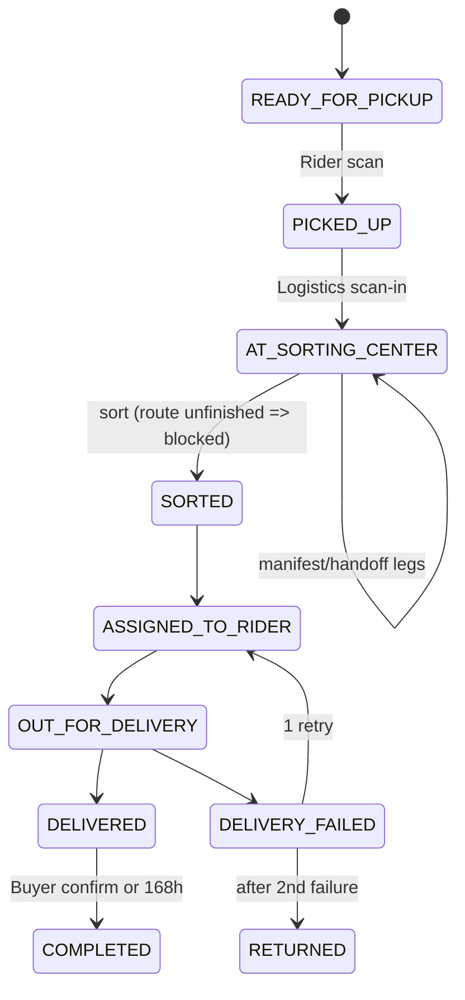
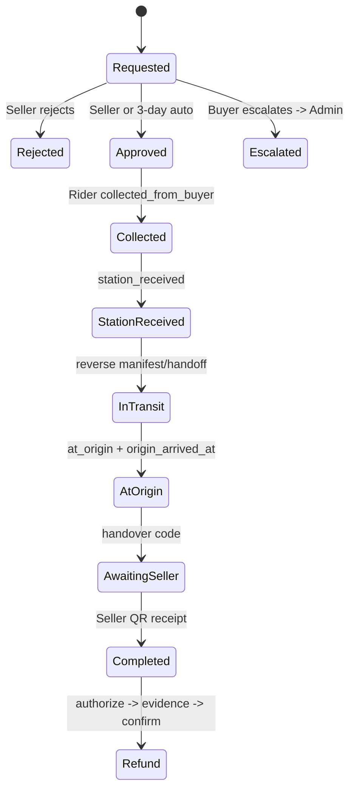

# Zefanya — Complete Logistics, Returns & Financial Architecture Audit

**Date:** 2026-11-14 · **Project:** `C:\ProjectEcommerce\WebZefanya` · **Mode:** audit only (no application code, database, migration, commit, deploy or stash performed by this audit)

Evidence labels used throughout:

- **CODE** — I opened the source and cite `file:line`.
- **DB** — read-only `SELECT` against a MySQL database (live `Zefanya`, or the separate demo copy `zefanya_ninja_demo` where stated).
- **DOC** — stated in `docs/*.md` or a prior audit; *not* re-verified in code in this session.
- **TEST** — a test I ran in this engagement (results from earlier in this session are quoted exactly; I did **not** re-run the outbound/linehaul test suites for this audit).
- **WEB** — public competitor/legal pages; third-party commentary is labelled as such.
- **UNKNOWN / NOT TESTED / BLOCKED** — stated explicitly; never inferred as "works" or "broken".

---

## 0. Environment boundaries (Phase 0)

| Fact | Evidence | Consequence |
|---|---|---|
| `zefanya.shop` is served from the **local working tree** (a `php` process on port 8000 behind the `Cloudflared` Windows service). | A read-only GET of `https://zefanya.shop/buyer/pages/contact` returns the *uncommitted* wording ("Question About an Order?") that differs from `HEAD` (`git diff resources/views/Buyer/Pages/contact.blade.php`). | Any local edit can be live immediately. "Uncommitted" ≠ "not deployed". |
| The refund **custody rule** and the single-Admin notice I added earlier (`ParcelReturn::refundCustodyProblem()` `:96`, `refundNormalPathBlocker()` `:134`, `refundStepActors()` `:144`, `refundHandledByOneAdmin()` `:155`, `_refund-policy.blade.php`) are therefore **already live**. | Same probe + the files are in the served tree. | Read-only impact check: 1 open financial return (#3, not approved → already needed an exception), 1 historical refund (untouched, `refund_policy_version` NULL), 0 pending authorizations. No live workflow is newly blocked today. Recorded as finding **F-01**. |
| Live DB `Zefanya` has `parcel_returns.refund_policy_version` (migration applied earlier at the owner's request). | DB | Refund policy path is active on live. |
| Working tree has ~354 uncommitted changes (branch `webzefanya-live`) including an unrelated product-approval feature. | `git status --short \| wc -l` = 354 | Cannot isolate "the refund patch" from the live tree without a branch; see F-18. |
| `C:\ProjectEcommerce\CLAUDE_GRAPH_WORKFLOW.md` does **not exist**; `graphify-out/` contains only `cache/`. | `ls` | Graphify was not used; every claim here is checked against source. |
| Workspace `CLAUDE.md` lists `web/` and `mobile/`; neither exists (real repos: `WebZefanya`, `Zefanya-integration`, `Zefanya`). | `ls C:\ProjectEcommerce` | Stale doc (already in project memory). |

**Actions this audit did and did not take.** Read-only: file reads, `SELECT`s on three databases, web research, one public GET. **Not done:** edits to application code or `public/`, writes to any database, migrations, commits, pushes, stashes, resets, branch switches, live transactions. The only file created is this document. **BLOCKED** verifications (would touch live data): placing real orders for the four routes, seeding Cavite/Cebu providers into `Zefanya`, any COD/refund write. An isolated plan is in §18.

**Live data snapshot (DB, read-only).** One operational provider: *Ninja Express* (id 18, Laguna) with 1 Province Hub (*Laguna Sorting Center*, Santa Cruz) + 30 Station Hubs; 62 active `ROAD` connections (60 touch the province hub, 2 are direct `Los Baños ↔ Bay`); **0** `logistics_provider_links`; 7 `seller_orders` (2 completed, 2 delivered, 1 out for delivery, 2 cancelled), each with 1 `parcel_route`; **0** handoffs, 2 manifests, 2 returns. Another approved provider (*davao logistics*, id 27) has **no hubs**. The separate demo DB `zefanya_ninja_demo` has Cebu (provider 26, 53 stations, Liloan 14 areas), Batangas, Bulacan, Metro Manila, Davao, 24 provider links (20 ACTIVE), and `ROAD 414 / SEA 5 / AIR 5` connections — but **no Cavite provider** anywhere.

---

## 1. Executive summary

Zefanya is considerably more complete than a typical capstone marketplace. Routing is **data-driven** (graph of hubs + explicit `TransportConnection`s with ROAD/SEA/AIR, BFS path search), cross-provider movement uses QR/OTP-verified handoffs, returns have a real physical custody chain, COD cash is tracked rider → company → platform, and refunds now require authorization → evidence → Admin confirmation. Many hard problems (concurrency, idempotency, centavo integer money, audit logs) are handled.

The audit's honest conclusion: **Flows 1 and 2 (Los Baños→Los Baños, Los Baños→Bay) are supportable on live data today. Flows 3 and 4 are not supportable on live data and Flow 3 as specified (Silang, Cavite) is unsupported even in the demo.** Beyond data, Flow 4 needs capabilities that do not exist (third-party linehaul carrier, declared value/insurance, zone-based pricing). The largest cross-cutting risks are (1) **local edits are live** (F-01), (2) a **flat marketplace shipping fee** that ignores distance and mode (F-02), (3) **no append-only parcel-custody or financial journal** (F-05, F-14), and (4) **return/refund timelines with no deadline or inaction escalation** (F-06) against Philippine consumer law (F-07).

Top recommendations (details §19): stand up a staging copy and a release flag (F-01); decide the pricing model before any Flow 3/4 launch (F-02/F-15); extend — not replace — the connection/manifest model with an *external carrier* record for inter-island (F-03); add an append-only custody-event table and a financial journal *projection* before any full ledger (F-05/F-14); add inaction timers for returns/refunds (F-06). I recommend **against** a new Rider account type, a new hub tier, or a full double-entry rewrite for the capstone.

---

## 2. Current architecture map

```
Buyer ─checkout─▶ Order ─▶ SellerOrder(parcel) ─▶ ParcelRoute(legs JSON)
                              │  custody_provider_id / custody_hub_id  (mutable pointer)
Seller ─mark-ready─▶ pickup window/session ─▶ Logistics assigns Pickup Rider (manual only)
Rider ─pickup─▶ Station (AT_SORTING_CENTER) ─sort─▶ SORTED ─assign─▶ Delivery Rider ─▶ Buyer
                 │ same provider, other hub:   Manifest (batch, TransferCourier record)
                 │ other provider:             ParcelHandoff (QR + OTP verification)
                 └ per leg: TransportConnection{ROAD|SEA|AIR, operating_provider_id}
Return: ParcelReturn (+events) ─ buyer collection ▶ station ▶ reverse manifest/handoff ▶ origin station ▶ Seller (QR handover code)
Money:  COD: Rider ─▶ Company (CodRemittance) ─▶ Zefanya (LogisticsRemittance, Admin confirm)
        Origin share (40% of fee, cross-provider) ─ Admin pays origin (OriginSharePayout)
        Seller: SellerSettlement ─▶ SellerPayoutRequest ─▶ Admin pays (manual)
        Returns: seller_debts, logistics_return_charges, platform_refund_expenses; refund = manual bank transfer + evidence
```

Key code anchors (CODE): routing `app/Services/Logistics/RoutePlannerService.php:46` (`planRoute`), `:121` (`crossProvinceDestination`), `:171` (`findPath`, BFS); transport model `app/Models/Logistics/TransportConnection.php:24-30`; manifests `ManifestService.php:51` (`create`), `:981` (`operationalHub`); handoffs `ParcelHandoffService.php:102,187`; returns `ParcelReturnService.php:91,133,209,248,270,292,555,613,1175,1311`; COD `CodRemittance.php:23`; pricing `ShippingRateService.php:54,65`; inventory `StationInventoryService.php` (read-only derived rows); API `routes/api.php:121-160`; Rider web `routes/rider.php:24-60`; schedules `routes/console.php:20-44`.

---

## 3. Four outbound flows

Legend: ✔ code-verified, ◐ doc-reported only, ✖ not present.

### Flow 1 — Los Baños → Los Baños (same municipality)

Documented path ◐: Seller *Request Pickup* → Logistics assigns + confirms Pickup Rider (manual only, `docs/4-Flow.md §7`) → Rider confirms pickup → Logistics *to-sorting-center* → *sort* → *assign-delivery* → Rider delivers (OTP/photo) → COD to company. ✔ Planner: same station ⇒ route with **no legs** (`RoutePlannerService.php:78-90`; test `test_shared_station_hub_plans_a_route_with_no_legs`, `Phase4MultiLegRoutingTest.php:571`).

| Question | Finding |
|---|---|
| Is a station always necessary? | Currently yes: three manual Logistics actions (scan-in, sort, assign) even when pickup and delivery are in the same barangay cluster ◐. |
| Direct vs station-based | **Keep the station** (custody boundary, COD handover point, failed-delivery return point, inventory). Reduce clicks instead: one *Receive & sort* action when route has no legs. Direct door-to-door would remove the only place a parcel is scanned by someone other than the rider (higher shrinkage/COD risk). Recommendation = Option B (refactor the actions, keep the model). |
| Who owns the parcel | Rider (pickup) → provider/station (custody pointer) → Delivery Rider → Buyer ◐. |
| Same Rider both legs? | Technically separate assignments (`pickup` vs `delivery` rows) so possible; guarded by area/weight/job-limit checks (`CourierAssignmentService::manualRiderBlockReason` `:743`) ✔. |
| Fees | Flat fee (F-02). Same provider ⇒ no origin share (`CodRemittance::isCrossProvider` `:63`). |
| Failed pickup/delivery | Pickup failure is a rider web action (`rider/pickups/{id}/report-failure`); 2 delivery attempts then return ◐. |

### Flow 2 — Los Baños → Bay (municipality to municipality)

Live DB: both stations belong to provider 18 under the same province hub, **and a direct `Los Baños ↔ Bay` ROAD connection exists** (connections #7/#8). BFS therefore yields a 1-leg station-to-station route; the province hub is **not** required (test `test_consecutive_connected_hubs_form_a_route_without_province_hub_transit` `:579`). However, 60 of 62 live connections are hub-and-spoke through *Laguna Sorting Center*, so most other station pairs will route via the hub.

| Question | Finding |
|---|---|
| Hub required? | No — only an explicit connection. BFS minimizes **hop count**, not cost/time (`findPath` `:171-232`). |
| Who creates/approves transfers | Provider staff create a **Manifest** for hubs of *their own* provider (`ManifestService::create` `:51`, `operationalHub` `:981`). No Admin approval step ✔. |
| Who transports | A **TransferCourier** — a no-login record (name, vehicle, plate) assigned to the manifest (`TransferCourier.php`, `TransferCourierService::assignToManifest` `:97`); required before dispatch by default (`config/transfers.php`). |
| Evidence | Dispatch/receive verified by QR/OTP at hubs (`ParcelHandoffVerification`) ◐; batch reconciliation, partial receipt and `StuckTransferService` exist ◐. |
| Distinct Riders? | Yes: transfer courier ≠ pickup/delivery Rider. They have no mobile/API surface (F-09). |
| Gap | `ManifestService::create` does **not** check that a `TransportConnection` exists between the chosen hubs (no `TransportConnection` reference in the file); routing enforcement lives in route execution. See F-12. |

Recommendation: keep direct station links where volume justifies; make BFS weighted (distance/hours/cost) so a 1-hop expensive link doesn't beat a cheaper path (F-13).

### Flow 3 — Los Baños → Silang, Cavite (province to province)

Planner path: `crossProvinceDestination` (`:121`) tries partner providers (`ParcelHandoffService::serviceableLinks` `:102`) then any approved, province-verified provider covering the barangay; each provider change needs an **active directed partnership** (`logistics_provider_links`).

- **Live DB:** no Cavite provider, **0 links** ⇒ checkout correctly refuses (route cannot be planned). **BLOCKED / data-missing**, not a defect.
- **Demo DB:** providers exist for Bulacan, Metro Manila, Batangas, Davao, Cebu; **none for Cavite** ⇒ the specified Silang flow cannot even be demonstrated. Finding **F-04**.
- 40/60: `CodRemittance::ORIGIN_SHARE_PERCENT = 40` (`:23`), frozen per parcel by `snapshotAllocation()` (`:90`) — origin gets 40% of the *shipping fee*, destination keeps 60% (`kept_shipping_minor`). **Verified in code**; applies to eligible two-provider routes only.
- 3+ providers: `ProviderAllocationService` records the chain "with no amount; amounts need an Admin-approved policy" (file header) ⇒ **REQUIRES POLICY** (F-15).
- **Independent assessment of 40/60 (policy not changed):** with today's flat fee (₱50 for the first 2 kg + ₱20/kg, `config/buyer.php:26-30`) the split is ₱20 origin / ₱30 destination for a ≤2 kg parcel. Origin performs pickup, station handling and the line-haul *to* the handoff; destination does hub receipt and last-mile (usually the costliest, and where COD risk sits). The ratio is defensible as a simple rule but is **independent of distance, weight, mode and who actually runs the linehaul**; a fixed percentage of a flat fee will under-reward a provider that carries a long leg. Keep 40/60 until the fee model is decided (owner decision, §16).

### Flow 4 — Los Baños → Liloan, Cebu (inter-island)

Supported *structurally* in the demo DB: Cebu provider 26 covers Liloan (14 areas), `SEA`/`AIR` connections exist (e.g. Metro Manila Province Hub → Cebu Province Hub, Batangas Port Gateway → Cebu Province Hub), and `config/transfers.php` has longer overdue limits for SEA (72 h) and AIR (48 h). **Not supported live** (no Cebu provider/links). What exists vs what an inter-island flow needs:

| Requirement | Present? | Evidence |
|---|---|---|
| Hub-to-hub SEA/AIR leg | ✔ labelled mode on `TransportConnection` | `TransportConnection.php:24-30` |
| Third-party carrier (ferry/shipping line/airline) as an entity | ✖ — `operating_provider_id` references a `LogisticsProvider` (defaults to the origin hub's provider) | `TransportConnection.php:55-57` |
| Carrier waybill/vessel/flight ref, port handoff proof | ✖ | no such columns/tables (`manifests`, `parcel_handoffs` only) |
| Declared value / insurance / fragile-prohibited by mode | ✖ — grep finds none (only `Product.restriction_reason`, `Product.php:137`) | `grep declared/insurance` |
| Zone/mode-based fee | ✖ — flat fee for every route (F-02) | `ShippingRateService.php:54-70` |
| Weather/cancel/reschedule of a sailing | ✖ (generic overdue flag only; "overdue is never lost") | `docs/4-Flow.md §13b`, `config/transfers.php` |
| Loss liability across ≥3 parties | ◐ custody-based rule exists (sender before receiver's scan, receiver after); compensation = merchandise subtotal (`ParcelLossService`, `docs §13b`) | no carrier party |

**Dedicated module or extension?** Compare:

| Option | What | Effort | Risk | Verdict |
|---|---|---|---|---|
| A Retain | Treat a sea/air leg as a Logistics provider's own connection | none | cannot record carrier, waybill, port handoff, declared value; liability untraceable | acceptable only for a demo |
| **B Extend** | Add an *external carrier* record (name, contact, reference/booking no.), carrier-leg fields on the manifest/handoff (booking ref, vessel/flight, cargo-acceptance and port-release scans), optional declared value, mode-specific fee | Medium | reuses custody, QR/OTP and overdue logic | **Recommended** |
| C Redesign | Separate linehaul subsystem with carrier accounts, tendering, settlement | Large | high; not justified at current volume | future |

---

## 4. Four return flows

Existing return mechanics (CODE): buyer request (`requestByBuyer` `:91`; window `buyerReturnDeadline` `:61` = delivery + 168 h via `AutomaticBuyerReceiptService::WAIT_HOURS` `:18`), Seller decision within 3 days else auto-approve (`ParcelReturn::SELLER_DECISION_DAYS = 3` `:19`, `autoApproveOverdue` `:532`), Logistics assigns a collection Rider (`assignBuyerCollection` `:555`), Rider confirms collection with tracking number (`confirmBuyerCollection`), station hand-in (`receiveFromBuyerCollection` `:613`), reverse transport by manifest/handoff (`direction='return'`), origin confirmation + handover code, Seller QR receipt (`receiveBySeller` `:1311`), then Admin refund (authorize `:209` → evidence `:248` → confirm `:270`/`recordRefund` `:292`).

Reverse routing rules (DOC `docs/4-Flow.md §13a`): a return needs a **reverse** partnership (a forward partnership never authorizes a return) or a per-parcel Admin `authorizeReverseRoute`; same-provider returns use internal transport. `ParcelReturnService::reverseHandoff` `:1175` is the cross-provider hand-back.

| Return | Designed path | Verdict |
|---|---|---|
| R1 Los Baños → Los Baños | Buyer → Return Rider → (station) → Seller. Buyer-collected returns **always** pass `collected_from_buyer` then `station_received` (the only route in `ParcelReturnService`, `:555-640`). | Same-provider path ✔. A "direct Rider→Seller" route for buyer returns **does not exist**; Lazada's published *Direct Return to Merchant* policy shows marketplaces use direct returns for some cases (WEB, page not retrievable in this session; title only). Recommend an **optional** direct route for same-barangay-cluster, high-trust Sellers (policy decision), never the default. |
| R2 Los Baños → Bay | Buyer(Bay) → Bay Station → Los Baños Station (reverse manifest) → Seller | Supported by same-provider manifests. Return manifests skip route-feasibility checks by design (`RoutePlannerService::requireAvailableDeparture` skips when `hasActiveReturn()`); `ManifestService` has no connection check (F-12). NOT TESTED against live data. |
| R3 Silang → Los Baños | Destination station → hub → hub (reverse handoff) → origin station → Seller | BLOCKED (no Cavite provider/links). Code path exists. |
| R4 Liloan → Los Baños | + reverse SEA/AIR | BLOCKED; planner/reverse-connection checks for sea legs are not enforced for returns (F-12); same carrier gaps as Flow 4. |

### Return case matrix (who acts / custody / money / evidence / if nobody acts)

| Case | Next actor | Custody | Financial responsibility | Evidence | If nobody acts |
|---|---|---|---|---|---|
| Eligibility / buyer request | Buyer (≤7 days) | Buyer | — | reason, photos | window closes (policy conflict F-07) |
| Seller approve/reject | Seller | Buyer | fault defaults Seller on approval (`docs §8`) | decision + reason | **auto-approve after 3 days** ✔ (`AutoApproveOverdueReturnsCommand` scheduled `console.php:24`) |
| Return pickup assignment | Logistics | Buyer | Seller pays return trip when seller-fault | — | **nothing** — no timer, escalation or Buyer remedy (F-06) |
| Buyer unavailable | Rider reports failure; max attempts then Admin (`reportCollectionFailure`, `authorizeCollectionRetry`) | Buyer | none | failure reason/notes | escalates to Admin after limit ✔ |
| Station receipt | Logistics | Provider | — | `station_received` event ✔ | no timer (F-06) |
| Cross-provider handoff | receiving provider | sender until receiver scan ✔ | custody-based | QR+OTP | overdue flag only |
| Seller receipt / refuses | Seller (QR code), else dispute `disputeReceiptBySeller` → Admin | Logistics until Seller scan | Admin decides | photos/note | handover code expires in 10 min; **no deadline for a Seller who never shows up** (F-06) |
| Condition / restock | Seller | Seller | stock restored only when `resellable` | condition + config flag | — |
| Wrong item / missing accessories / partial return | **not modeled** — a return is whole-parcel; partial refund is an amount only (`refund_reason` required if less than collected) | — | Admin | note | — |
| Lost return parcel | Admin (`closeAsLoss`, `ParcelLossService`) | last scanner | compensation = merchandise subtotal; no stock/commission change | incident | — |
| Seller no longer operates | **not modeled** (UNKNOWN; no suspension-with-active-shipments rule found) | — | — | — | — |
| Refund authorization / evidence / confirm | Admin/Super Admin only (`ReturnController::authorizeFinancialDecision` `:24`) | — | payer frozen at authorization | proof (JPG/PNG/PDF ≤5 MB), reference, recipient | **no refund deadline** (F-06/F-07) |
| Early refund exception | Admin with documented basis + private proof | — | seller/logistics/platform payer | `refund_exception_basis`, note ≥10 chars | — |
| Refund dispute after completion | `voidRefund` reopens; no Buyer-facing dispute flow after completion | — | — | audit log | — |
| Statutory rights | Terms say statutory rights not limited; operational window is 7 days (policy review §4.1) | — | — | — | **OWNER/COUNSEL DECISION** |

---

## 5. Hub and station design

Current model (CODE `LogisticsHub.php:21-23,115-128`): `province_hub` (Main Sorting Hub) and `station_hub` (Municipality, requires a parent province hub of the *same* provider). Station-to-station connections are allowed regardless of parent (`TransportConnection` only needs two eligible hubs).

**Is two tiers sufficient?** Yes for the four requested routes. A third tier (regional/gateway) is not needed: demo data already models ports as hubs ("Batangas Port Gateway", "Davao Port Gateway") on the same two-tier schema. Don't add tiers; add **attributes** (capacity, cut-off time, port flag, cost/hours on connections).

**Inventory/custody integrity (CODE).** Station inventory is **derived and read-only** (`StationInventoryService.php`: "one row per parcel, never a count of history events"), from the pointer pair `seller_orders.custody_provider_id/custody_hub_id`, un-received manifest items and in-transit handoffs. This is a good design for "no duplicate parcel inventory", and it models "conflicting transport records: investigate" as a visible row. Invariant `Total = Inside + Inbound` is a *view* rule, not a stored one.

Weaknesses:
- **F-05:** custody is a **mutable pointer** (written in ≥9 services: `ManifestService`, `ParcelHandoffService`, `ParcelReturnService`, `ParcelLegService`, `ParcelLossService`, `ParcelIncidentService`, `SellerOrder`, two controllers). History is reconstructed from `status_histories`, manifests, handoffs, `parcel_return_events`, `incident_events`. There is **no single append-only `parcel_custody_events` table**, so "who held it when" and "is any parcel permanently trapped" need multi-table joins and cannot be asserted by one invariant query. Event-based inventory, current location, custody history and operational queue status are *not* modeled separately.
- Parcels trapped in a status are surfaced by overdue/incident jobs, not by a generic stale-parcel monitor (`routes/console.php`: only receipts, returns auto-approval, pickup windows, overdue transfers, overdue preparation).

Migration path (Option B): add `parcel_custody_events` (append-only, written inside the same transactions that move the pointer, FK to parcel/provider/hub/actor/evidence ref), backfill nothing (no fabricated history), run a nightly reconciler that compares the pointer with the last event and reports drift. Keep `StationInventoryService` as the read model.

---

## 6. Station-to-station transfers

| Aspect | Today | Gap / note |
|---|---|---|
| Same provider, different municipality | Manifest batch with Transfer Courier, dispatch + receive scans, partial receipt, recovery, `StuckTransferService` ◐ | manifests do not validate a connection (F-12) |
| Same-municipality branches | not distinguished; same station ⇒ no manifest (`ManifestService.php:57`) | fine |
| Cross-provider | `ParcelHandoff` request → accept/reject → verifyScan → dispatch → receive (QR+OTP) ✔ (`ParcelHandoffService`) | provider acceptance has no SLA timer |
| Direct vs hub-routed | BFS by hop count | add weights (F-13) |
| Wrong station / unauthorized receipt | receipt requires expected hub + provider, verification token bound to hub (`ParcelHandoffVerification`, `ManifestService.php:626,746`) ✔ | — |
| Missing/extra parcels | partial manifest receipt + exception records ◐ | liability assignment for shortages across providers not defined (policy) |
| Rerouting | `RouteExecutionService::previewReroute/rerouteFromCurrent` `:251,271` ✔ | — |

---

## 7. Rider and transport operations

| Role today | Account | Surface |
|---|---|---|
| Pickup / Delivery / Return-pickup Rider | one `Rider` + `Courier` record; tasks differ by assignment | Web: pickups, return-pickups, deliveries, scan, money, waybill (`routes/rider.php:24-60`). API (`routes/api.php:131-160`): jobs, earnings, scan/verify, deliver, failed, incidents, pickup-confirm, start, availability |
| Station Transfer courier | `TransferCourier` (no login) | provider web only |
| Inter-provincial / external transport | none | — |

**Recommendation:** keep **one Rider account with authorized task categories**; do not create new account types. For transfer couriers, optionally allow a Rider account to be *linked* to a TransferCourier (login later), not a new role.

**Web/API inconsistency (F-09, CODE):** the web Rider portal has return-pickup collect/failed (`rider.php:38-40`), pickup failure (`:36`), stop finish (`:34`), money (`:56`), waybill (`:45`); the Sanctum API has none of these. The Flutter app itself (`Zefanya-integration/mobile`) was **not audited** (NOT TESTED; project rule: Laravel only).

Offline/interrupted operation, location privacy and route sequencing: UNKNOWN (not found in the Laravel API; may exist in Flutter).

---

## 8. Complete COD and money flow

Parcel movement and money movement are separate; the table gives **owes → holds → receives → liability changes → settlement evidence**.

| Stage | Who owes | Who holds | Who receives | Liability changes when | Evidence | Code |
|---|---|---|---|---|---|---|
| A. COD collection | Buyer | Delivery Rider | — | rider records collection (`recordCodCollection`) | OTP + delivery proof; `collected_at/amount` | `Payment` model |
| A2. Rider → Company | Rider | Rider | Company | Company confirms cash received (`CodRemittanceService::confirmReceipt` `:30`); shortage keeps Rider/reason, **never auto-deducted** | receipt + shortage record | `CodRemittanceService` |
| A3. Company → Zefanya | Company | Company | Zefanya | Company submits `LogisticsRemittance` (`:335`), Admin confirms (`:404`) or rejects (`:470`) | reference, confirmed amount | `LogisticsRemittanceService` |
| A4. Origin share (cross-provider) | Zefanya | Zefanya | Origin company (40% of fee) | Admin `payOriginShare` (`:171`); reversible (`reverseOriginPayout` `:501`) | reference | `OriginSharePayout` |
| A5. Destination share | Zefanya | Zefanya | Destination company (60%) | Admin `payDestinationShare` (`:291`) | reference | — |
| B. Seller | Zefanya | Zefanya | Seller | settlement prepared after remittance recovered; Seller requests payout; Admin pays manually | `seller_settlements`, `seller_payout_requests`, allocations | `SellerSettlementService`, `SellerPayoutRequestService` |
| B2. Commission | Seller | Zefanya | Zefanya | rate snapshot at order finalization (10%, 5% for orders finalized before 2026-11-08, `docs §8`) | `commission_finalized_at` | `CommissionFinalizationService` |
| C. Return trip | Zefanya | Zefanya | collecting company | Seller-fault return completes ⇒ `logistics_return_charges` (`return_trip`); settled by Admin | reference | `ReturnChargeService` |
| C2. Failed delivery | Zefanya (2× fee) / Seller debt | — | carrier | `failed_delivery` charge | — | `ReturnChargeService` |
| D. Refund | Payer (Seller/Logistics/Platform) | Zefanya/Company (COD cash) | Buyer | authorization (frozen payer) → evidence → Admin confirm (`:209/:248/:270`); void reopens | proof + reference + verification note | `ParcelReturnService` |
| D2. Platform-funded | Zefanya | — | Buyer | `platform_refund_expenses` (one per refund event) | refund event | `bookPlatformExpense` |
| E. Lost parcel | Liable custodian | — | Seller | Admin confirms; compensation = merchandise subtotal, no stock/COD/commission movement | adjustments are signed rows | `ParcelLossService` |

Preserved rules confirmed in code/docs: no automatic Rider-earnings deduction for COD shortages (`CodRemittanceService.php:22-28`); delivery is not proof of payment (collection recorded separately).

**Is current accounting sufficient?** For a capstone with manual settlement: yes in integrity terms (integer centavos, locks, idempotent confirmations — verified for refunds by 4 MySQL concurrency tests this session). It is **not** a ledger: money is spread over ≥15 purpose-built tables (`cod_remittances`, `logistics_remittances`, `origin_share_payouts`, `rider_earnings`, `rider_payouts`, `seller_settlements`, `seller_payout_requests`, `seller_debts`, `logistics_return_charges`, `platform_refund_expenses`, `parcel_loss_cases/adjustments`, …); there is no journal, no account chart, no company-level statement table. Prior audit 1.16 covers reporting integrity (DOC).

Option comparison: **A** retain; **B** add an **append-only financial journal as a projection** (`financial_entries`: entry id, event type, debit-account, credit-account, amount_minor, party, source row, actor, evidence ref) written in the same transactions, used for provider statements, reconciliation reports and exports — *without* rewriting existing tables; **C** full double-entry rewrite. **Recommend B**; C is not justified before real money volume, and claiming the current tables are a double-entry ledger would be wrong.

Refund-specific observations (CODE): refund requires recorded COD collection (`authorizeRefund` `:219`) but **not** completed remittance — COD cash may still be with the Rider/Company when Zefanya refunds; policy text says remittance remains a separate obligation (F-16 notes the exposure). Refund recipient and reference are free text (prior audit 1.7: unverified destination). The custody/receipt gate and single-Admin notice are covered in the earlier refund verification (TEST this session: `RefundPaymentPolicyTest` 42/42, `RefundPolicyPhysicalReturnTest` 49/49; MySQL `PhysicalReturnConcurrencyTest` 7/7, `Rule05ReturnCompletionConcurrencyTest` 2/2, `LogisticsConcurrencyTest` 2/2, `RefundPaymentPolicyConcurrencyTest` 4/4, `PlatformRefundConcurrencyTest` 8/8, `ReturnDecisionConcurrencyTest` 9/9).

---

## 9. Return-refund policy assessment

| Item | Existing approved policy | Current implementation | Recommended | Owner decision |
|---|---|---|---|---|
| Return window | (policy page says 7 days) | 168 h from delivery | align with RA 7394 implied warranty/ITA remedies; keep 7 days for *change-of-mind/not-as-described* convenience returns but add a longer defect/warranty path | **Yes — counsel** |
| Seller decision time | 3 days | auto-approve at 3 days | consider 2 days (Shopee: 2 days, auto-accept if no response — WEB help.shopee.ph) | Yes |
| Refund deadline | none | none | publish a committed deadline after counsel review; add overdue queue + escalation | **Yes** |
| Refund before Seller receipt | exception only (documented) | exception requires basis + proof | keep; add per-Admin monthly cap for platform-funded exceptions | Yes |
| Return trip cost | Seller pays on Seller-fault; Logistics on transit damage | frozen at original flat fee | revisit with fee model | Yes |
| Commission recognition on refund | seller keeps rest less commission | implemented (`returnBreakdown`) | — | — |

Legal context (WEB): RA 11967 (Internet Transactions Act of 2023) makes the online merchant primarily liable and imposes platform responsibilities; secondary commentary disagrees on section numbers and deadlines, so **only the LawPhil statute text and IRR should be relied on** ([LawPhil RA 11967](https://lawphil.net/statutes/repacts/ra2023/ra_11967_2023.html); commentary: [NDV Law](https://ndvlaw.com/obligations-and-remedies-of-online-consumers-under-the-internet-transactions-act-of-2023/)). Not legal advice; see the existing counsel checklist in `POLICY_REVIEW_2026-11-11.md §4`.

---

## 10. Multi-provider and inter-island assessment

- 2 providers: 40/60 on shipping fee — verified (CODE).
- 3+ providers: chain recorded, **no amounts** ⇒ the typical *Laguna → Metro Manila → Cebu* chain has no settlement rule (REQUIRES POLICY, F-15).
- Partnerships are **directed** and Admin-approved (`logistics_provider_links`; live count 0, demo 24 with 4 REVOKED).
- Provider acceptance/rejection exists, but no deadline/auto-reroute if a provider ignores a handoff.
- Inter-island: see §3 Flow 4 table; recommendation = Option B (extend).

---

## 11. Lazada / Shopee benchmark

Verified public statements are marked; everything else is *inferred* or not claimed. I make **no claim that Zefanya is better than either**.

| Area | Zefanya now | Marketplace practice (source) | Gap / better approach | Measure |
|---|---|---|---|---|
| Returns | 7-day window, Seller 3 days, auto-approve | Shopee: seller must respond within 2 days; no response ⇒ auto-approved; partial-refund offer with 1 day to answer; Shopee mediates disputes; refund after returned item is checked ([Shopee Help Center](https://help.shopee.ph/portal/4/article/81230-[Return-Refund]-What-happens-after-a-seller-receives-my-return%2Frefund-request%3F)). Window: 15 days Mall / 7 days non-Mall per one help-center table, other articles differ, so verify the current page before quoting ([search result](https://help.shopee.ph/portal/4/article/81231-[Return-Refund]-How-do-I-raise-a-return/refund-request)). Lazada: return/refund coverage shown per item under *Service details*; third-party guides report 7–15 days (not authoritative) | Zefanya lacks a **partial-refund offer without return** and a Buyer-facing dispute step after approval | median days request→refund; % requests escalated |
| Direct returns | none | Lazada publishes a *Direct Return to Merchant* policy (page could not be retrieved; title only: [Lazada PH community](https://community.lazada.com.ph/article/direct-return-to-merchant-policy-553500-hc)) | optional direct route (policy) | return-leg cost per parcel |
| Refund transparency | statuses: authorized → evidence submitted → confirmed; Admin note | Shopee: processing 7–9 working days stated in help center (search summary) | add a published deadline + Buyer-visible timer | % refunds within promised time |
| Tracking | custody-based tracking summary (`RouteExecutionService::trackingSummary` `:111`) | not verified | show custody owner and next step ✔ already; add ETA | — |
| Seller tools / payouts | manual payout requests | not verified | show payout schedule + deduction breakdown | payout dispute count |
| Rider/COD clarity | `rider/money`, shortage records | not verified | — | unmatched COD remittances |
| Support/disputes | Admin Complaints module = "Soon" placeholder (`POLICY_REVIEW §5`) | Shopee mediates disputes (above) | ship minimal Buyer/Seller dispute queue (maps to ITA redress duty) | time to resolution |

Real competitive advantage candidates (genuine, not copies): **transparent custody timeline** (Zefanya already records who physically holds the parcel — a marketplace-visible strength), **provider-neutral multi-carrier routing** with verified QR/OTP handoffs, and **cash-accountability tooling** (shortage records without automatic rider deduction). These are cheaper to extend than to invent.

---

## 12. Findings (Phase 10 inventory)

Classification: **CF** confirmed functional bug, **MF** missing functionality, **AW** architectural weakness, **UX**, **OL** operational limitation, **PG** policy gap, **TG** environment/test gap, **FE** future enhancement. "Mig" = DB migration needed.

| ID | Class | Pri | Workflow / roles | Root cause & evidence | Consequence | Recommended design | Components | Mig | Complexity |
|---|---|---|---|---|---|---|---|---|---|
| F-01 | OL/TG | **P0** | all / Admin, owner | Live site = local working tree (probe §0). Custody rule + Admin notice already live. | Unreviewed edits reach production; "no new restrictions" can't be guaranteed | Separate git worktree/branch + staging DB; production serves a clean checkout; add config flag `returns.require_station_custody` (default off) | deploy process; `config/returns.php`; `ParcelReturn::refundNormalPathBlocker` | No | S |
| F-02 | AW/PG | **P0 before Flows 3–4** | checkout, finance / Buyer, providers | `ShippingRateService::resolveRate` (`:54-57`) returns `fixedRate()` for every zone; company cards ignored; `config/buyer.php:26-30` ₱50 first 2 kg + ₱20/kg | Inter-island/cross-province parcels priced like local; 40/60 split of a flat fee; return trip frozen at the same fee | Zone × mode rate card (reuse `logistics_shipping_rates` table that already exists) with Admin-approved marketplace defaults | `ShippingRateService`, `CheckoutCarrierService`, `LogisticsShippingRate` | Maybe (rate zones) | M |
| F-03 | MF | **P1** | Flow 4, 4R / Logistics, Admin | `TransportConnection.operating_provider_id` → `LogisticsProvider` only; no carrier/booking/declared-value fields | Cannot document ferry/air custody, port handoff, insurance; liability untraceable | External-carrier record + carrier-leg fields on manifest/handoff; declared value optional | `TransportConnection`, `Manifest`, `ParcelHandoff`, new `ExternalCarrier` | Yes | M |
| F-04 | TG/OL | **P1** | Flows 3–4 / owner | DB: live has 1 operational provider, 0 links; demo has no Cavite provider | Specified routes unavailable; cannot demo Silang | Seed isolated demo: Cavite provider + links; keep live untouched until approved | demo seeders (isolated) | No | S |
| F-05 | AW | **P1** | all custody | pointer pair written in ≥9 files; no append-only custody table | no single source for "who held it when"; drift undetectable | `parcel_custody_events` + nightly pointer-vs-event reconciler | new model/service; touch services listed | Yes | M |
| F-06 | MF/PG | **P0** (consumer protection) | Returns, refunds / Buyer, Logistics, Seller, Admin | `routes/console.php:20-36` has no job for unassigned return collection, uncollected approved return, Seller non-receipt, or unpaid authorized refund; no refund deadline | Buyer can wait indefinitely with no remedy | Inaction timers + Admin queue + Buyer-visible due date; auto-escalate | scheduled commands, `ParcelReturn` due-date columns | Yes | M |
| F-07 | PG | **P0** | returns / owner, counsel | 7-day window (`WAIT_HOURS=168`) vs RA 7394/ITA (policy review §4.1) | possible non-compliance | counsel review; separate defect/warranty path | policy pages; `canBuyerRequest` | Maybe | M |
| F-09 | MF/UX | P1 | Rider mobile | web has return-pickup/failure/stop/money/waybill; Sanctum API lacks them (`routes/rider.php` vs `routes/api.php:131-160`); Flutter NOT audited | mobile Rider cannot perform return pickups | add API endpoints mirroring services (no new logic) | `Api/Rider/*` | No | M |
| F-10 | AW | P2 | refunds / Admin | refund recipient/reference free text (audit 1.7) | cannot verify destination | optional buyer-supplied destination captured at request; Admin compares | request flow | Yes | M |
| F-12 | AW | P1 | returns/transfers | `ManifestService::create/operationalHub` has no `TransportConnection` check; returns skip feasibility (`RoutePlannerService::requireAvailableDeparture`) | any same-provider hub pair can be manifested; reverse sea/air legs unvalidated | validate manifest hub pair against an active connection (or an Admin-authorized exception) incl. reverse | `ManifestService`, `RoutePlannerService` | No | S–M |
| F-13 | AW | P2 | routing | BFS minimizes hop count only (`findPath` `:171`) | a 1-hop expensive link beats cheaper 2-hop path | weighted edges (hours/cost) + Dijkstra | `RoutePlannerService`, `transport_connections` | Yes | M |
| F-14 | AW | P1 | finance | ≥15 money tables, no journal/statements | manual reconciliation, no provider statements/exports | append-only `financial_entries` projection + statements | new service; hooks in existing transactions | Yes | L |
| F-15 | PG | **P0 before Flow 4** | settlements | `ProviderAllocationService` records chain, no amounts for ≥3 providers | unpaid middle carriers | owner-approved allocation (e.g. per-leg or weighted) | `ProviderAllocationService` | Maybe | M |
| F-16 | PG | P1 | refunds/COD | refund needs collection evidence, not remittance (`authorizeRefund` `:219`) | Zefanya may refund while cash still with Rider/Company | require "COD remitted or recorded shortage" or accept exposure explicitly; show on Admin screen | `ParcelReturnService`, view | No | S |
| F-17 | TG | P1 | all | I did not re-run outbound/linehaul tests; no test exercises the four named municipalities with return + refund end to end | unproven four-route readiness | test plan §18 | tests | No | M |
| F-18 | TG | P1 | release | ~354 uncommitted changes incl. product-approval work; `DemoMarketplaceTest::test_negative_checkout_blocks_unsupported_destination` fails because the seeded product is `pending` (diagnosed: `isListedForSale()` false → 404), unrelated to PSGC | cannot get a clean full-suite baseline | commit/branch the product-approval work separately; fix seeder/test fixture there | seeders/tests | No | S |
| F-19 | TG | P2 | MySQL tests | a second process ran `RefundPaymentPolicyConcurrencyTest` on the shared MySQL runner concurrently; `phpunit.mysql.xml` omits refund tests | flaky/blocked concurrency runs | list tests in config; single-runner lock discipline | `phpunit.mysql.xml` | No | S |
| F-20 | UX/OL | P2 | Flow 1 | three manual Logistics actions per parcel at the station (◐ docs §7) | queue bottleneck | merge scan-in + sort when route has no legs | `ParcelSortingController`, station UI | No | S |
| F-21 | MF | P2 | returns | no partial-return/wrong-item modeling; whole-parcel only | disputes handled by free-text | line-level return items | `parcel_returns`, order items | Yes | M |
| F-22 | PG | P1 | suspension | no rule found for suspending Seller/Logistics with active shipments | stuck parcels/funds | define wind-down per role (Riders have `rider_wind_down_until`) | `AccountStatusService` | Maybe | M |
| F-23 | UX | P2 | Admin | Complaints module placeholder; no appeals | no formal redress channel (ITA) | minimal dispute queue | admin module | Yes | M |

Items I examined and **did not** classify as defects: single-Admin control (approved owner decision; notice implemented), 40/60 split (verified as approved policy), manual pickup assignment (approved 2026-11-11), COD shortage not auto-deducted (approved).

---

## 13. Flow matrices

Columns: Step · Actor · Source→Destination · Action · Custody · Evidence · Status · Financial effect · Failure handling. Rows marked ◐ are from `docs/4-Flow.md`; ✔ re-read in code.

### Outbound

**O1 Same municipality (Los Baños → Los Baños)** — Existing ◐/✔; Missing: single combined station action (F-20); Recommended: keep station.

| # | Actor | Src→Dst | Action | Custody | Evidence | Status | Money | Failure |
|---|---|---|---|---|---|---|---|---|
| 1 | Seller | — | Request Pickup | Seller | window booked | READY_FOR_PICKUP | — | missed window rolls over (`pickups:roll-missed-windows`) |
| 2 | Logistics | — | assign + confirm Pickup Rider (manual) | Seller | notification | (same) | — | stays pending until assigned |
| 3 | Rider | Seller→Rider | confirm pickup, tracking minted | Rider | scan | PICKED_UP | first-parcel rider pay (session) | pickup failure report |
| 4 | Logistics | Rider→Station | to-sorting-center | Provider/Station | — | AT_SORTING_CENTER | — | — |
| 5 | Logistics | Station | sort (no legs) | Station | — | SORTED | — | — |
| 6 | Logistics | Station→Rider | assign delivery | Station→Rider | — | ASSIGNED_TO_RIDER | — | reschedule/ return |
| 7 | Rider | →Buyer | OTP + proof deliver | Buyer | OTP, photo | DELIVERED | COD recorded | 2 attempts then return |
| 8 | Buyer/auto | — | confirm / 168 h auto | — | — | COMPLETED | settlement eligibility | — |

**O2 Municipality→Municipality (Los Baños → Bay)** — direct connection exists live.

| # | Actor | Src→Dst | Action | Custody | Evidence | Status | Money | Failure |
|---|---|---|---|---|---|---|---|---|
| 1-3 | as O1 | | | | | PICKED_UP | | |
| 4 | Logistics | →Origin station | scan-in | Station | | AT_SORTING_CENTER | | |
| 5 | Logistics | LB→Bay | create manifest, add parcel, assign TransferCourier, dispatch | Courier/Provider | QR/OTP dispatch scan | in transit | — | cancel/recover manifest |
| 6 | Logistics | Bay station | receive scan | Bay station | QR/OTP | ARRIVED_AT_HUB/route advanced | — | partial receipt, stuck-transfer alert |
| 7 | Logistics | | sort → assign → Rider delivers | | | | | |
Missing: manifest ↔ connection check (F-12); weighted routing (F-13).

**O3 Province→Province (→ Silang, Cavite)** — BLOCKED (no provider/links).

| # | Actor | Src→Dst | Action | Custody | Evidence | Money | Failure |
|---|---|---|---|---|---|---|---|
| 1-5 | as O2 to origin province hub | | | | | | |
| 6 | Origin provider | hub→hub | `ParcelHandoff` request; destination provider accept/reject | origin until receiver scan | QR+OTP | 40/60 snapshot frozen | rejection ⇒ reroute/Admin |
| 7 | Destination provider | hub→station→Rider→Buyer | receive, sort, deliver | destination | OTP/photo | COD → destination company; origin share owed | loss: custody rule |
Missing: Cavite provider/links (F-04); acceptance SLA; 3+ provider amounts (F-15).

**O4 Inter-island (→ Liloan, Cebu)** — BLOCKED live; structural support in demo.

Steps O3 + a SEA/AIR `TransportConnection` leg between hubs/ports. Missing: external carrier & booking/port proof (F-03), declared value/insurance, zone/mode fee (F-02), sailing cancel/reschedule, ≥3-provider allocation (F-15).

### Returns

**R1 (Los Baños)**: Buyer request → Seller 3-day decision → Logistics assigns Return Rider (**no timer**, F-06) → Rider `collected_from_buyer` (tracking match) → Logistics `station_received` (same station/provider) → internal move to origin station (`origin_arrived_at`, event `at_origin`) → handover code → Seller QR receipt → inspection/restock → Admin refund (authorize→evidence→confirm). Custody chain is now enforced for the normal refund path (TEST: both same- and cross-provider chains pass, §8).

**R2 (Bay→Los Baños)**: same, with reverse manifest between the two stations (manifest `direction='return'`, `ManifestService.php:53,262`). Missing: connection validation (F-12).

**R3 (Silang→Los Baños)** BLOCKED: reverse handoff `reverseHandoff` `:1175` requires a reverse partnership or Admin `authorizeReverseRoute`.

**R4 (Liloan→Los Baños)** BLOCKED: R3 + reverse SEA/AIR leg; no reverse-connection validation; carrier gaps as F-03.

State diagrams:





Where parcel and money flows must synchronize: (1) delivery ⇒ COD *collection* record (not proof of cash); (2) cash-received confirmation ⇒ settlement eligibility; (3) return completion ⇒ return-trip charge; (4) refund confirmation ⇒ seller breakdown + platform expense; (5) loss confirmation ⇒ no ordinary money movement. Items (1) and (4) are the points an automated reconciler (F-14) should check.

---

## 14. Redesign alternatives (Table C source)

See Table C below. Decisions I would take: **keep** the two-tier hub model and station inventory read model; **refactor** pricing (zone × mode), custody history (append-only), financial reporting (journal projection), manifest/connection validation; **extend** for inter-island; **do not** add Rider account types or a third hub tier.

## 15. UI/UX recommendations

1. Station queue: one *Receive & sort* action when the route has no legs (F-20).
2. Buyer return page: show who holds the parcel, next actor and a *due date* for each waiting step (F-06).
3. Admin refund screen: show custody chain status, COD remittance status (F-16), and the single-Admin notice (already live).
4. Seller: show payout deductions per return (breakdown exists server-side).
5. Rider mobile: return pickup and failure reporting (F-09).
6. Public: policy pages should state the committed refund timeline only after the owner/counsel decision.

## 16. Policy decisions required

| Topic | Existing approved policy | Current implementation | Recommended | Owner decision required |
|---|---|---|---|---|
| 2-provider shipping split | 40% origin / 60% destination | implemented (`CodRemittance.php:23`) | keep until fee model changes | revisit with F-02 |
| 3+ providers | none | chain recorded, no amounts | per-leg or weighted split | **Yes** |
| Reverse-logistics shipping | Seller pays on Seller-fault; Logistics on transit damage | implemented | link to zone fee | Yes |
| Inter-island liability/insurance | none | none | declared value + carrier terms | **Yes** |
| Failed delivery fee | 2× delivery fee (COD, no cash) | implemented | revisit with fee model | Yes |
| Lost/damaged | custody-based; compensation = merchandise subtotal | implemented | add declared-value option for high-value | Yes |
| COD shortage | recorded, never auto-deducted | implemented | keep | — |
| Refund before final receipt | documented exception only | implemented | keep + cap | Yes |
| Commission before completion | rate snapshot at finalization | implemented | confirm recognition timing | Yes |
| Platform subsidies / platform-funded refund limits | none | unlimited per Admin | monthly cap + review | **Yes** |
| Seller/Logistics suspension with active shipments | none found | none | wind-down rule | Yes |
| Parcel abandonment | none | none | storage-time limit | Yes |
| Statutory refund / return window | pages say statutory rights unaffected | 7-day operational window | counsel review | **Yes** |

Super Admin model: one Super Admin is retained. No evidence found that a second operational role is *required*; the single-person notice (implemented) plus an exceptions queue is the proportionate control.

## 17. Code-level change inventory

(Planning only — nothing implemented.) Services: `RoutePlannerService`, `ManifestService`, `ShippingRateService`, `ProviderAllocationService`, `ParcelReturnService`, `StationInventoryService`; models: `TransportConnection`, `Manifest`, `ParcelHandoff`, `ParcelReturn`, new `ParcelCustodyEvent`, `ExternalCarrier`, `FinancialEntry`; commands: new return/refund inaction timers, custody-pointer reconciler; API: `Api/Rider/*` return-pickup endpoints; views: Logistics station queue, Buyer return page, Admin refund page; config: `returns.php` flag, `transfers.php`. Migrations needed: F-03, F-05, F-06, F-13, F-14, F-21 (others none). All changes must keep the `SellerOrderStatusService::transition()` single-writer rule (`AGENTS.md`).

## 18. Test coverage gaps and isolated plan

Existing coverage found (names only; **not run in this audit**): routing (`Phase4MultiLegRoutingTest`, `AutomaticRouteProgressionTest`, `RoutedTransitionsTest`, `TransportConnectionManagementTest`), cross-provider handoffs (`CrossProviderHandoffTest`, `CrossProviderHandoffQrTest`), manifests (`InternalManifestFlowTest`), returns (`PhysicalReturnTest`, `ReturnRecoveryTest`), COD (`CodRemittance*`, `CompleteFinancialScenariosTest`), loss (`ParcelLossTest`, concurrency).

Gaps (NOT TESTED): the four named municipalities end-to-end with return and refund; Silang (no data); Cebu with SEA return; manifest without a connection (F-12); duplicate dispatch/receipt under concurrency for cross-provider; refund before COD remittance; mobile/web parity; network interruption; historical-data behaviour for the new custody rule.

**Minimum isolated environment** (never `Zefanya`): clone of `zefanya_ninja_demo` restored into a throwaway schema + one added Cavite provider with 1 province hub, 2 stations (Silang covered) and active directed links to Ninja Express; reuse existing demo accounts/riders (`docs/DEMO-ACCOUNTS.md`), keep the single Super Admin. Cases: happy path ×4 outbound/×4 return; unauthorized provider/station receipt; duplicate assignment/dispatch/receipt (MySQL runner, single runner at a time); lost/damaged; partial manifest; route cancel; failed delivery ×2; refund before remittance; cross-provider return settlement; concurrent confirm; SEA delay (overdue + escalation). Restore verification of the pre-migration backup was done earlier (105 tables, matching counts).

## 19. Prioritized roadmap (Table D source)

**P0 — fix/decide before production:** F-01 (staging + flag), F-06 (inaction timers + refund deadline), F-07 (counsel on window), F-02 (pricing model) and F-15 (3+ provider policy) *before* any Flow 3/4 launch.
**P1 — required for four-flow operation:** F-04 data (Cavite provider/links), F-03 external carrier, F-05 custody events, F-12 manifest-connection validation, F-09 Rider API parity, F-16 COD-vs-refund rule, F-22 suspension rule, F-17 test plan, F-18 release hygiene.
**P2 — operational:** F-13 weighted routing, F-20 station action, F-10 refund destination, F-14 journal/statements, F-21 line-level returns, F-23 dispute queue, F-19 test infra.
**P3 — differentiation:** customer-visible custody timeline with ETA, partial-refund offer without return, provider statements/export, Seller payout calendar.

Must build now: F-06, F-02/F-15 decisions, F-12. Must fix before production: F-01, F-07. Polish before demo: F-04 demo data, F-20. Future: F-13, F-14 journal, F-21.

## 20. Production and capstone readiness

- **Production:** NOT READY for Flows 3–4 (data + pricing + carrier + policy). Flows 1–2 are operable on live data; the refund path is hardened but F-06/F-07 remain before relying on it commercially. The working-tree-is-production practice (F-01) is itself a blocker for responsible change.
- **Capstone demo:** Flows 1–2 demonstrable live; Flow 4 demonstrable only from the isolated demo DB; Flow 3 needs a Cavite provider added in isolation.

---

## Tables A–E

### TABLE A — What Zefanya already does well

| Feature | Evidence | Keep / Improve |
|---|---|---|
| Data-driven multi-hub routing with saved legs, reroute, feasibility checks | `RoutePlannerService`, `RouteExecutionService:251,271` | Keep; weight edges (F-13) |
| Direct station-to-station routes without hub transit | live connections #7/#8; `Phase4MultiLegRoutingTest:579` | Keep |
| QR/OTP-verified cross-provider handoffs, directed partnerships | `ParcelHandoffService`, `ParcelHandoffVerification` | Keep; add acceptance SLA |
| Derived, duplicate-safe station inventory | `StationInventoryService` | Keep as read model |
| Return custody chain + (now) refund custody gate | `ParcelReturnService`, `refundCustodyProblem` (TEST 86/86 policy tests; MySQL 6 suites pass) | Keep; add timers |
| Refund = authorize → evidence → Admin confirm with frozen payer | `ParcelReturnService:209,248,270` | Keep; show COD status (F-16) |
| COD cash accountability, shortage records, no auto rider deduction | `CodRemittanceService:22-28` | Keep |
| 40/60 snapshot frozen per parcel | `CodRemittance:23,90` | Keep until fee model changes |
| Integer-centavo money, locks, idempotent financial writes | MySQL concurrency tests | Keep |
| Lost-parcel liability by custody; overdue never = lost | `ParcelLossService`, `docs §13b` | Keep |

### TABLE B — What is missing or broken

| Priority | Feature/Workflow | Problem | User Impact | Required Change |
|---|---|---|---|---|
| P0 | Release process | working tree is production (F-01) | unreviewed changes go live | staging + flag |
| P0 | Return/refund timers | no inaction escalation or deadline (F-06) | Buyers wait indefinitely | timers + queue + due dates |
| P0 | Return window law | 7-day vs statutory (F-07) | compliance risk | counsel decision |
| P0 | Shipping price | flat fee for all routes (F-02) | under-priced long routes | zone × mode pricing |
| P0 | 3+ provider split | no amounts (F-15) | unpaid carriers | policy |
| P1 | Inter-island | no carrier/booking/insurance (F-03) | untraceable liability | external carrier record |
| P1 | Coverage data | no Cavite provider; 0 links live (F-04) | Flows 3/4 unavailable | isolated demo data first |
| P1 | Custody history | pointer only (F-05) | weak audits | custody events |
| P1 | Rider mobile | no return-pickup API (F-09) | mobile can't do returns | API parity |
| P1 | Manifest/connection | not validated (F-12) | invalid transfers possible | validate |
| P2 | Journal/statements | none (F-14) | manual reconciliation | projection |

### TABLE C — What should be redesigned

| Subsystem | Current Design | Better Alternative | Tradeoffs | Recommendation |
|---|---|---|---|---|
| Hub hierarchy | 2 tiers | keep + attributes | none vs added complexity of 3rd tier | **Keep (A)** |
| Pricing | flat fee | zone × mode card | needs owner pricing decision | **Refactor (B)** |
| Custody | mutable pointer + scattered history | + append-only events | migration + dual-write | **Refactor (B)** |
| Inter-island | provider-labelled SEA/AIR | external carrier record | medium effort | **Extend (B)**, not new module |
| Rider roles | one Rider + no-login transfer courier | one Rider with task categories | avoids account sprawl | **Keep (A)** |
| Money | many tables, no journal | journal projection | extra writes | **Refactor (B)**; full double-entry only later (C) |
| Same-municipality | station always, 3 clicks | station + combined action | tiny change | **Refactor (B)** |
| Routing | hop-count BFS | weighted shortest path | needs cost/hours data | **Refactor (B)** |

### TABLE D — Development roadmap

| Phase | Task | Dependencies | Estimated Complexity | Acceptance Criteria |
|---|---|---|---|---|
| 0 | Staging worktree + DB; flag for custody rule | none | S | production serves a clean checkout; flag default documented |
| 0 | Refund/return inaction timers + due dates | policy decision on deadlines | M | every waiting step has an owner, due date and escalation; tests with time travel |
| 0 | Counsel review of window | owner | — | written decision |
| 1 | Pricing model (zone × mode) | owner policy | M | quote differs by zone/mode; existing orders unchanged |
| 1 | 3+ provider allocation policy | owner policy | M | amounts per leg recorded and payable |
| 1 | Cavite provider + links in isolated demo | none | S | Silang route plans and delivers in isolation |
| 1 | External carrier record + port scans | pricing | M | sea/air leg records carrier, booking, release scans |
| 1 | Manifest-connection validation | none | S–M | manifest without active connection rejected or Admin-authorized |
| 1 | Custody events + reconciler | none | M | pointer-vs-event drift report is empty in tests |
| 1 | Rider API return pickup/failure | none | M | API parity tests |
| 2 | Weighted routing; station action merge; journal/statements; dispute queue | prior phases | M–L | per-item criteria in §12 |

### TABLE E — Complete four-flow readiness

| Flow | Outbound | Return | Custody | COD | Provider Settlement | Ready? |
|---|---|---|---|---|---|---|
| 1 Los Baños→Los Baños | PARTIALLY IMPLEMENTED (code ✔; not re-run) | VERIFIED (isolated end-to-end test) | VERIFIED (refund custody gate; station inventory derived) | PARTIALLY IMPLEMENTED (flow exists; refund-vs-remittance rule open, F-16) | VERIFIED (same provider ⇒ no split) | PARTIALLY — F-06/F-07 first |
| 2 Los Baños→Bay | PARTIALLY IMPLEMENTED (direct connection exists live) | PARTIALLY IMPLEMENTED / NOT TESTED live | PARTIALLY IMPLEMENTED (F-12) | PARTIALLY IMPLEMENTED | VERIFIED (same provider) | PARTIALLY |
| 3 Los Baños→Silang | BLOCKED (no Cavite provider, 0 links) | BLOCKED | PARTIALLY IMPLEMENTED (handoff code exists) | NOT TESTED | PARTIALLY IMPLEMENTED (40/60 verified in code) | BLOCKED |
| 4 Los Baños→Liloan | BLOCKED live; structural in demo | BLOCKED | MISSING (carrier custody) | NOT TESTED | REQUIRES POLICY (3+ providers; flat fee) | BLOCKED |

---

## Sources

- Shopee PH Help Center — seller response and return process: https://help.shopee.ph/portal/4/article/81230-[Return-Refund]-What-happens-after-a-seller-receives-my-return%2Frefund-request%3F (fetched; seller 2 days, auto-approve on no response, partial-refund offer 1 day, Shopee mediates; the article notes the process is rolled out gradually to selected shops)
- Shopee PH Help Center — request flow / Returns Window (search result only, figures vary by article): https://help.shopee.ph/portal/4/article/81231-[Return-Refund]-How-do-I-raise-a-return/refund-request
- Lazada PH community — Direct Return to Merchant policy (search result title only; page returned HTTP 500 when fetched): https://community.lazada.com.ph/article/direct-return-to-merchant-policy-553500-hc
- Lazada return window figures: third-party guides only (e.g. https://ginee.com/ph/insights/how-to-return-order-in-lazada); not treated as authoritative.
- RA 11967 text: https://lawphil.net/statutes/repacts/ra2023/ra_11967_2023.html ; commentary (secondary, conflicting section numbers): https://ndvlaw.com/obligations-and-remedies-of-online-consumers-under-the-internet-transactions-act-of-2023/
- Internal: `docs/1–4`, `AGENTS.md`, `docs/audits/POLICY_REVIEW_2026-11-11.md`, audits 1.6, 1.7, 1.13, 1.15, 1.16, 1.17.

## Unknowns and blocked verification

Flutter app behaviour; offline/location privacy of Riders; Seller/Logistics suspension handling; behaviour of the four named routes with live transactions (BLOCKED — isolated plan §18); exact Shopee/Lazada current return windows (sources inconsistent); whether the Lazada DRTM policy matches the Zefanya direct-return idea (page not retrievable); legal interpretation of RA 7394/RA 11967 (counsel). No competitor superiority is claimed.
