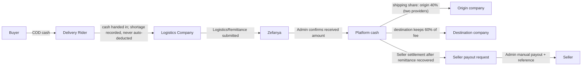
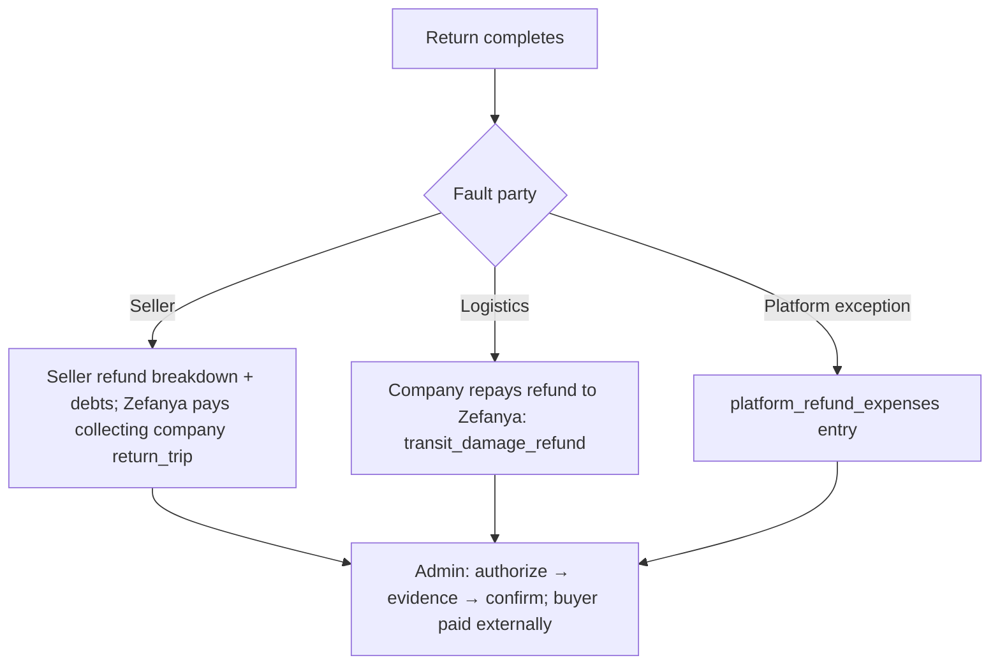

# Zefanya — Final Master Audit and Development Handoff

**Date:** 2026-11-14 · **Repo:** `C:\ProjectEcommerce\WebZefanya` (Laravel, branch `webzefanya-live`) · **Status:** audit only. This document is self-contained: a developer who has not read the conversation can act on it.

**What this document is.** A consolidation of five earlier artifacts — Audit 1.17 (+continuations), the Buyer/Seller/Logistics browser audit, the *Complete Logistics, Returns & Financial Architecture Audit* ("Audit A"), and the *Four-Flow Improvement Decision Audit* ("Audit B") — plus the refund custody verification done earlier in this engagement. Findings are re-stated, corrected and ordered into one roadmap. Nothing was implemented in this final pass.

**Evidence labels.** **VERIFIED-CODE** (source read, `file:line`) · **VERIFIED-DB** (read-only `SELECT`) · **VERIFIED-OS** (read-only Windows service/task query) · **HISTORICAL-TEST** (a test run earlier in this engagement on 2026-11-14; *not* re-run now) · **DOC** (project documentation, not re-verified) · **NOT VERIFIED / UNKNOWN / BLOCKED** (explicit gap) · **RECOMMENDATION** (judgment, not fact). **No tests were run in this final audit.** Money figures I compute are arithmetic on live settings, not measured costs. No legal deadline or competitor superiority is asserted; no operating cost or price is invented.

**Corrections to earlier statements (binding):**
1. Audit A reported "23 findings"; IDs run F-01…F-23 but **F-08 and F-11 were never assigned → 21 findings**.
2. **F-20 is already addressed** — the Logistics station receipt scan also sorts automatically at the parcel's final hub (`IncomingParcelsController.php:333-339`, `ParcelSortingService::sortAfterStationReceipt` `:89`). Audit A's claim of three manual station actions was wrong.
3. **F-06 is partially addressed** — real timers exist (§10); the return/refund escalation gaps are real.
4. **Refund custody is NOT "staging-only."** The served site is the working tree, so the custody rule and Admin notice are live. The browser audit's wording ("verified only in staging") is inaccurate; there is no staging environment.
5. Test claims in this document are **historical** (see §18.1), not performed in this final audit.

---

## 1. Executive summary

Zefanya's **parcel and custody mechanics are strong**: a data-driven hub graph with ROAD/SEA/AIR connections, QR/OTP-verified cross-provider handoffs, derived station inventory, a physical return chain, concurrency-safe refunds with evidence and a frozen payer, centavo-integer money, and COD cash accountability without automatic Rider deductions.

The three things that most limit a real launch are **not** parcel logic:

1. **Economics.** One flat shipping fee (₱50 for ≤2 kg, +₱20/kg) prices every route; Riders are paid ₱10 (pickup) and ₱30 (delivery) flat. For a light parcel: ₱10 remains for station/linehaul on the same-provider route; on the two-provider route the destination keeps ₱0 *before* station, hub, courier or sea/air costs. Provider rate cards exist in the DB and pricing ignores them. Return pickups earn the Rider nothing.
2. **Operations environment.** `zefanya.shop` is PHP's built-in `artisan serve` on port 8000 behind a Cloudflare tunnel, serving the *developer working tree* with one `.env`, one MySQL database and one storage directory shared by developers and AI agents; queue is `sync`, mail is live SMTP inside requests; time-based consumer protections run from one PC's scheduled task; the only backup is a manual **DB-only** dump while 331 private evidence files are outside it.
3. **Coverage and carriage.** Flows 3 (Silang, Cavite) and 4 (Liloan, Cebu) are **not operable on live data** (one operational provider, 0 provider links, no Cavite provider even in the demo DB) and Flow 4 has no carrier/insurance/declared-value/pricing model. Flows 1 and 2 are supportable on live data (direct Los Baños↔Bay connection exists).

Recommended order (details §17, §22): **triage the 354 uncommitted changes → stand up staging → backup incl. files → timers/overdue queue → manifest-connection validation → custody events → Rider API return actions + return-pickup credit → pricing zone card → ≥3-provider allocation → external carrier record.** Do **not** build a third hub tier, new Rider account types, a full double-entry rewrite or a separate transport-management module.

---

## 2. Verified project architecture

```
Buyer ─checkout─▶ Order ─▶ SellerOrder (parcel) ─▶ ParcelRoute (legs JSON)
                              custody_provider_id / custody_hub_id  (mutable pointer)
Seller ─Request Pickup─▶ pickup window/session ─▶ Logistics assigns Pickup Rider (manual only; approved 2026-11-11)
Rider ─pickup scan─▶ PICKED_UP ─▶ Station receipt (also auto-sorts at final hub) ─▶ assign Delivery Rider ─▶ Buyer (OTP + photo)
Between hubs, same provider:  Manifest (batch) + TransferCourier record (no login) + QR/OTP dispatch/receive scans
Between providers:            ParcelHandoff (request/accept/verify/dispatch/receive), directed Admin-approved partnerships
Per leg:                      TransportConnection {ROAD|SEA|AIR, operating_provider_id = a LogisticsProvider}
Return:  ParcelReturn (+ParcelReturnEvent) buyer collection → station → reverse manifest/handoff → origin → Seller QR receipt
Refund:  authorize → submit evidence → Admin confirm (frozen payer, private proof); manual external bank transfer
Money:   COD Rider→Company→Zefanya; 40% origin / 60% destination shipping split; Seller settlement→manual payout
```

Anchors (VERIFIED-CODE): `RoutePlannerService.php:46,121,171` (plan, cross-province, BFS) · `TransportConnection.php:24-57` · `ManifestService.php:51,981` · `ParcelHandoffService.php:102,187` · `StationInventoryService.php` · `ParcelReturnService.php:91,133,209,248,270,292,555,613,1175,1311` · `ParcelReturn.php:19,96,134,144,155` · `CodRemittance.php:23,90` · `ShippingRateService.php:54-70` · `routes/console.php:20-44` · `routes/api.php:121-160` · `routes/rider.php:24-60`.

**Other facts:** statuses change only through `SellerOrderStatusService::transition()` (project rule, `AGENTS.md`); `RuntimeSchema` guards (38 call sites) let code run before optional migrations; optional migrations live in `database/migrations/pending/` and are applied explicitly; 183 migrations total.

**Live data snapshot (VERIFIED-DB, 2026-11-14):** one operational provider (Ninja Express, Laguna: 1 Province Hub, 30 Station Hubs, 62 active ROAD connections — 60 touch the hub, 2 are the direct `Los Baños↔Bay` pair); 0 provider links; 7 seller orders; 0 handoffs; 2 manifests; 2 returns. A second approved provider (id 27) has no hubs. Separate demo DB `zefanya_ninja_demo`: Cebu (53 stations, Liloan covered), Batangas, Bulacan, Metro Manila, Davao; 24 links (20 ACTIVE); ROAD 414 / SEA 5 / AIR 5; **no Cavite provider**.

---

## 3. Consolidated findings register

21 findings (F-series) + 12 new justified findings (N-series). Severity: Critical / High / Medium / Low. Status vocabulary: Confirmed, Partially addressed, Already addressed, Requires owner decision, Requires investigation. Priorities map to §17.

| ID | Severity | Evidence | Affected roles | Current status | Required change | Priority | Dependencies |
|---|---|---|---|---|---|---|---|
| F-01 | Critical | VERIFIED-OS/DB: served tree = working tree; custody rule/notice and uncommitted `Api/Rider/JobController` `return_pickups` are live | all | Confirmed | worktree separation, per-tree env, flag for new restrictions | P0 | owner approval; triage of uncommitted work |
| F-02 | High | `ShippingRateService.php:54-57` returns flat rate; 3 stored rate rows unused; no inter-island zone (`LogisticsShippingRate.php:16-20`) | Buyer, providers | Confirmed | honour a marketplace zone card; add inter-island zone | P0 (before Flow 3/4) | owner rates, provider cost data |
| F-03 | High | `TransportConnection.operating_provider_id` → provider only; no carrier/booking/declared-value schema | Logistics, Admin, Seller | Confirmed | external-carrier record + port scans (+ optional declared value) | P1 | F-02, F-15 |
| F-04 | High | live: 1 operational provider, 0 links; demo: no Cavite | Flows 3–4 | Confirmed (data) | isolated demo data; live only after approval | P1 | none |
| F-05 | Medium | custody pointer written in 11 files; no custody table | Admin, Logistics | Confirmed | append-only `parcel_custody_events` + reconciler | P1 | staging |
| F-06 | High | timers exist (§10); gaps: unassigned/uncollected return, station/Seller receipt delay, unpaid authorized refund, no refund deadline | Buyer, Logistics, Seller, Admin | **Partially addressed** | overdue notices + Admin queue + due dates | P0 | owner timer values |
| F-07 | High | `WAIT_HOURS=168`; project policy review §4.1 flags consumer-law fit | Buyer, Seller | Requires owner decision | counsel review; consider separate defect path | P0 (decision) | counsel |
| F-09 | Medium | API lists return pickups (uncommitted, live); collect/failed only in web `Rider/ReturnPickupController`; no pickup-failure/money/waybill API | Rider | **Partially addressed** | thin API adapters over existing services | P1 | F-01 triage |
| F-10 | Medium | `refund_recipient/reference` free text; no buyer destination | Buyer, Admin | Confirmed | capture buyer destination at request; Admin match view | P2 | — |
| F-12 | Medium | `ManifestService.php` has 0 `TransportConnection` references (file also has uncommitted edits adding return-movement blocks) | Logistics | Confirmed | validate manifest hub pair (incl. reverse) or Admin-authorized exception | P1 | none |
| F-13 | Low | `findPath` hop-count BFS | Logistics | Confirmed | weighted shortest path (hours/cost) | P2 | cost/hours data |
| F-14 | Medium | ≥15 money tables, no journal/statement | Admin, providers | Confirmed | journal *projection* + provider statements | P2 | staging |
| F-15 | High | `ProviderAllocationService` amountless for ≥3 providers; Audit 1.17 §10.3 blocking | providers | Requires owner decision | A1 role shares → A2 leg rates (§9) | P0 (decision) | owner |
| F-16 | Medium | `authorizeRefund` needs collected COD evidence, not remittance; order #41 case | Admin, Logistics | Confirmed / owner decision | show remittance status; owner picks rule | P1 | owner |
| F-17 | Medium | outbound/linehaul suites not run for these audits | all | Requires investigation | isolated four-route test plan (§18) | P1 | staging |
| F-18 | Medium | 354 uncommitted changes; `DemoMarketplaceTest::test_negative_checkout_blocks_unsupported_destination` fails because seeded product is `pending` (product-approval work) | developers | Confirmed | branch/commit by subsystem; fix fixture in that branch | P0 (prereq) | owner approval |
| F-19 | Low | `phpunit.mysql.xml` omits refund tests; a foreign `phpunit` run observed on the shared MySQL runner | developers | Partially confirmed / investigate | list tests; single runner owner | P2 | — |
| F-20 | — | `IncomingParcelsController.php:333-339` | Logistics | **Already addressed** | none | — | — |
| F-21 | Medium | `parcel_returns` has no item/quantity columns | Buyer, Seller | Confirmed | line-level returns (+partial refund offer) | P2 | owner policy |
| F-22 | Medium | Logistics suspension has Rider wind-down ≤72 h (`AccountStatusService.php:15,63-91`); Seller/Buyer none | Seller, Buyer | **Partially addressed** | wind-down rule per role | P2 | owner |
| F-23 | Low | Admin nav "Soon" placeholders | Buyer, Seller, Admin | Confirmed | minimal dispute/appeal queue | P2 | — |
| N-01 | High | `RiderEarning` has only `pickup`/`delivery`; `creditFor` called only on status transition (`SellerOrderStatusService.php:303`) | Rider, Logistics | Confirmed | return-pickup credit (once per return) | P1 | owner pay decision |
| N-02 | High | live rider rates ₱10/₱10/₱30 vs flat fee (§8.1) | providers | Confirmed (arithmetic) | pricing decision | P0 | F-02 |
| N-03 | Low | `zonesFor` presents "own rate if set" while pricing ignores it | providers | Requires investigation (UI not viewed) | make UI state the rule | P2 | F-02 |
| N-04 | Critical | VERIFIED-OS: `artisan serve` task; `QUEUE_CONNECTION=sync`, `MAIL_MAILER=smtp`, DB cache/session; one `.env` | all | Confirmed | production-grade runtime, queue, scheduler | P0 | staging |
| N-05 | High | Scheduled Task `schedule:run` every minute on one PC | all | Confirmed | restartable/monitored scheduler | P0 | N-04 |
| N-06 | Medium | one 168 h timer drives auto-completion/payout and return window | Seller, Buyer | Confirmed | separate timers | P1 | owner |
| N-07 | Medium | no lead-time target for return legs | Buyer, Logistics | Confirmed | per-mode return-leg SLA | P1 | owner |
| N-08 | Medium | COD overdue (3 days) shown on dashboard only (`LogisticsRemittanceService.php:41,82-105`) | Logistics, Admin | Confirmed | reminder + escalation | P2 | timers framework |
| N-09 | Critical | backups manual, DB-only; `storage/app/private` (331 files) and `public` (4,312 files) uncovered | Admin, Buyer, Seller, Rider | Confirmed | scheduled DB+files backup, restore rehearsal | P0 | none |
| N-10 | High | `.codex/`, Codex processes, foreign phpunit in same live tree | developers | Confirmed | one worktree per agent | P0 | F-01 |
| N-11 | High | Audit 1.17 §10 open: commission recognition before `Completed`; shipping voucher > COD; no reversal of confirmed Logistics→Zefanya cash; station staff identity | Admin, providers | Requires owner decision | decide each | P1 | owner |
| N-12 | Medium | Flutter docs: rider earnings computed on device incl. `kReturnFeeShare`; server is authoritative (`MOBILE_API_INTEGRATION_AUDIT.md` §4, DOC) | Rider | DOC only — mobile NOT VERIFIED | follow-up: mobile reads `/rider/earnings` | P2 | N-01 |

---

## 4. Four complete outbound flows

Common prerequisites: approved Seller with pickup address in provider coverage; Seller enabled a provider; approved provider with Station Hub(s) covering both barangays; Riders registered, approved, assigned to a station; checkout only offers routes the planner can build (`RoutePlannerService::planRoute`). Actors: Buyer, Seller, Pickup Rider, Logistics staff (provider account), Delivery Rider, Admin (Super Admin). Money events are in §7–8.

### 4.1 Flow 1 — Los Baños → Los Baños (same municipality)

| # | Actor | Action | Source→Destination | Custody | Status | Evidence | Failure handling |
|---|---|---|---|---|---|---|---|
| 1 | Seller | Request Pickup | — | Seller | READY_FOR_PICKUP | pickup window/session booked | missed window rolls to next window (scheduled) |
| 2 | Logistics | Assign Pickup Rider, confirm dispatch (two actions, manual by approved policy) | — | Seller | same | notification to Rider | stays visible until assigned |
| 3 | Pickup Rider | pickup scan | Seller→Rider | Rider | PICKED_UP | scan/QR; tracking minted | pickup failure report (web) |
| 4 | Logistics | station receipt scan (**also sorts** at final hub) | Rider→Station | Provider/Station | AT_SORTING_CENTER→SORTED | scan | wrong station rejected |
| 5 | Logistics | assign Delivery Rider | Station→Rider | Rider | ASSIGNED_TO_RIDER | — | reassignment with reason |
| 6 | Delivery Rider | start, deliver (OTP + photo + exact COD) | →Buyer | Buyer | OUT_FOR_DELIVERY→DELIVERED | OTP, proof, `collected_*` | fail ⇒ reschedule once, else return to Seller |
| 7 | Buyer/auto | confirm or 168 h auto | — | — | COMPLETED | — | — |

Route has **no legs** (`RoutePlannerService.php:78-90`). **Alternatives:** station-mediated (current) vs direct door-to-door by the pickup Rider vs hybrid for prepaid same-station parcels. **Recommendation:** keep station-mediated (one independent custody scan, COD hand-in, failed-delivery return point); revisit hybrid only if real dwell time is a measured bottleneck. **Status:** PARTIALLY IMPLEMENTED — supportable on live data; not transaction-tested by me. **Missing:** one-step assign+notify UX; return-pickup credit; timers; pricing margin (N-02).

### 4.2 Flow 2 — Los Baños → Bay (municipality to municipality)

Steps 1–3 as Flow 1. Then:

| # | Actor | Action | Source→Destination | Custody | Evidence | Failure handling |
|---|---|---|---|---|---|---|
| 4 | Logistics | origin station scan-in | Rider→Los Baños Station | provider | scan | — |
| 5 | Logistics | create Manifest (own-provider hubs), add parcel, assign TransferCourier, dispatch | Los Baños→Bay | courier/provider | QR/OTP dispatch scan | cancel/recover manifest; stuck-transfer alerts |
| 6 | Logistics (Bay) | receive scan; auto-sort at final hub | →Bay Station | Bay Station | QR/OTP receive | partial receipt, exception, incident |
| 7 | Logistics → Delivery Rider → Buyer | as Flow 1 steps 5–7 | | | | |

Live topology has the **direct** link (connections #7/#8), so the route is one leg; the province hub is **not** required (`Phase4MultiLegRoutingTest.php:579`, HISTORICAL test file; not re-run). **Gaps:** `ManifestService::create` validates no `TransportConnection` (F-12); BFS minimizes hops, not cost (F-13); manual batching. **Status:** PARTIALLY IMPLEMENTED.

### 4.3 Flow 3 — Los Baños → Silang, Cavite (province to province)

Requires: a **Cavite provider** (approved, province-verified) with a Province Hub and a Station covering Silang; an **active directed partnership** Laguna→Cavite (and the reverse for returns); an origin→destination hub path.

| # | Actor | Action | Custody | Evidence | Notes |
|---|---|---|---|---|---|
| 1–4 | as Flow 2 up to the origin Province Hub | | provider A | scans | hub-and-spoke via *Laguna Sorting Center* |
| 5 | Provider A | request `ParcelHandoff` to provider B | A until B's receive scan | request | planner tries partner providers first |
| 6 | Provider B | accept/reject | — | — | no acceptance SLA today |
| 7 | A / B | verifyScan → dispatch → receive (QR+OTP, bound to hub) | A→B | tokens | `parcel_handoffs` |
| 8 | Provider B | hub→Station (manifest), sort, Delivery Rider, deliver | B | OTP/proof | — |
| 9 | Rider B → B → Zefanya | COD: Rider→B (confirm), B→Zefanya (`LogisticsRemittance`) | — | — | — |
| 10 | Admin | pays origin share (40% of fee) to A; B keeps 60% | — | reference | frozen per parcel |

**Status:** **BLOCKED** (live: 0 links, no Cavite provider; demo: no Cavite). Code path exists (HISTORICAL tests `CrossProviderHandoff*`). **Missing:** data; acceptance/rejection timers; reroute on rejection is manual/Admin; ≥3-provider rule (F-15); distance-aware fee (F-02).

### 4.4 Flow 4 — Los Baños → Liloan, Cebu (inter-island)

As Flow 3 plus a SEA or AIR `TransportConnection` between provider hubs/ports. In the demo DB: Cebu provider (id 26), Liloan 14 areas, SEA 5/AIR 5 connections, overdue limits SEA 72 h / AIR 48 h (`config/transfers.php`). **Missing (VERIFIED-CODE/DB):** carrier entity, booking/vessel/flight reference, port cargo-acceptance and release scans, declared value/insurance, sailing cancel/reschedule, inter-island fee, ≥3-provider allocation. **Status:** BLOCKED (live) / MISSING (carrier model). **Recommendation:** extend the existing connection + manifest/handoff with an **external carrier record** (§6.4); do not build a separate transport module.

Direct-delivery alternatives for 3 and 4 do not apply (different provinces/islands need linehaul). Not every route needs a provincial hub: Flow 2 is hub-free where a direct link exists.

---

## 5. Four complete return flows

Single implemented chain (VERIFIED-CODE `ParcelReturnService`): Buyer request (`:91`, within 168 h of delivery) → Seller approve/reject within 3 days else auto-approve (`:133,532`) → Logistics assigns a collection Rider from the covering station (`:555`) → Rider confirms collection with tracking match (`confirmBuyerCollection`) → station hand-in (`receiveFromBuyerCollection` `:613`) → reverse transport (reverse manifest or reverse handoff `:1175`) → origin receipt (`at_origin`, `origin_arrived_at`) → handover code (10 min) → Seller QR receipt (`:1311`) → Admin refund: authorize (`:209`) → evidence (`:248`) → confirm (`:270`/`recordRefund` `:292`). Refund custody gate (new, live): normal path needs the recorded collection → station receipt chain (same station/provider, correct order), or `at_origin` + `origin_arrived_at` for returns never buyer-collected, plus the owning Seller's receipt; otherwise only a documented early exception with private proof (`ParcelReturn::refundCustodyProblem` `:96`).

| Return | Path | Specific needs / issues | Status |
|---|---|---|---|
| R1 Los Baños | Buyer → Return Rider → station → (origin station) → Seller | Rider earns nothing (N-01); no pickup/station/Seller receipt timers (F-06); no optional direct-to-Seller route (Lazada publishes a "Direct Return to Merchant" policy — page unreadable, title only) | PARTIALLY; chain VERIFIED in isolated test (HISTORICAL) |
| R2 Bay → Los Baños | Buyer → Bay Station → reverse manifest → Los Baños Station → Seller | returns skip route-feasibility checks by design (`RoutePlannerService::requireAvailableDeparture`); manifest has no connection check (F-12) | PARTIALLY / NOT TESTED live |
| R3 Silang → Los Baños | Buyer → B station → B hub → reverse handoff → A hub → A station → Seller | needs reverse partnership or per-parcel Admin `authorizeReverseRoute` | BLOCKED |
| R4 Liloan → Los Baños | R3 + reverse SEA/AIR | no reverse-connection validation; carrier gaps | BLOCKED / MISSING |

**Reverse routing should differ from outbound** where a shorter valid path exists (e.g., a one-way direct link); default = mirror, preferred = shortest valid path with Admin exception (§15).

### Return case matrix

| Case | Next actor | Custody | Financial responsibility | Evidence | If nobody acts |
|---|---|---|---|---|---|
| Failed return pickup | Rider reports; after the attempt limit Admin may authorize one more | Buyer | none | reason/notes | escalates to Admin ✔ |
| Missing station acknowledgement | Logistics | Rider/Buyer | none | `station_received` event required for refund normal path | **no timer** (F-06); refund only via exception |
| Wrong-provider receipt | blocked: station must match recorded collection provider/hub | — | — | — | refused ✔ |
| Partial / incorrect return | **not modeled** (whole parcel only; partial refund = amount) | — | Admin | note | — (F-21) |
| Delayed Seller receipt | Seller; code expires 10 min | Logistics until Seller scan | Admin decides | dispute photos | **no deadline** (F-06) |
| Seller refuses receipt | `disputeReceiptBySeller` → Admin | Logistics | Admin | issue/note/photos | Admin queue only |
| Lost/damaged return parcel | Admin `closeAsLoss` | last scanner | custody-based; compensation = merchandise subtotal; no stock/commission change | incident | — |
| Early refund exception | Admin | any | frozen payer (Seller/Logistics/Platform) | documented basis + private proof | — |
| Refund payer liability | Seller default on approval; Admin may set Logistics (transit damage) or Platform (exception) with note | — | `seller_debts`, `logistics_return_charges`, `platform_refund_expenses` | audit log | until refund recorded |
| Return shipping | Seller-fault: Seller charged the frozen original fee; company that collected is paid `return_trip` | — | Zefanya↔company charges settled by Admin | reference | — |
| COD/settlement impact | refund ≤ collected COD; COD remittance remains separately owed; settlements reduce via `returnBreakdown` | — | — | — | F-16 |
| Seller no longer operates | **not modeled** (F-22) | — | — | — | — |

Steps needing a new feature/event/policy: timers (F-06), return-pickup earning (N-01), line-level returns (F-21), optional direct route (policy), shortest-valid-path reverse routing (F-13), reverse-connection validation (F-12), Seller-inactive handling (F-22).

---

## 6. Station, hub and carrier transfer architecture

### 6.1 Current operations

| Capability | State |
|---|---|
| Station→Station (same provider) | Manifest + TransferCourier + dispatch/receive scans; direct if a connection exists |
| Station→Province Hub / Hub→Hub / Hub→Station | same mechanism over `transport_connections` |
| Inter-provider | `ParcelHandoff`, directed approved partnerships, QR+OTP |
| Inter-island | label `SEA`/`AIR` on a connection operated by a provider; longer overdue limits |
| Partial receipt, missing/excess | partial manifest receipt, exception records, incident flow (VERIFIED-CODE/DOC; behaviours NOT TESTED by me) |
| Wrong-station delivery | receipt tokens bound to expected hub/provider (`ManifestService.php:626,746`) — refused |
| Cancellation / reroute | manifest/handoff cancel + recovery; `RouteExecutionService::rerouteFromCurrent` `:271` |
| Inventory | derived, read-only (`StationInventoryService`): one row per parcel, "conflicting transport records" flagged |
| Alerts | overdue transfers warn sender, then Admin (`FlagOverdueTransfersCommand`) |

### 6.2 What to keep manual vs automate (RECOMMENDATION)

Keep manual: dispatch/receive scans (physical proof), loss confirmation, shortage liability, rerouting decisions. Safe to automate: batch *proposals* by destination hub, delivery-Rider suggestions, auto-open an incident when a received manifest omits scanned items, nightly custody reconciler, reminders/escalations.

### 6.3 Gaps

F-12 (no manifest↔connection check), F-05 (no custody history), no acceptance/rejection SLA for provider handoffs, no explicit misrouted-parcel workflow (UNKNOWN), provider-to-provider dispute has no evidence thread (UNKNOWN), staff identity not recorded (provider account is the actor).

### 6.4 Retain-and-extend vs new architecture

| | A Retain | B Extend (recommended) | C New transport module |
|---|---|---|---|
| Connection/manifest model | as is | + connection validation, weights, carrier record, custody events | separate TMS with carrier accounts/tendering |
| Effort | none | medium | large |
| Reliability | weak liability trace for sea/air | reuses QR/OTP + overdue logic | highest, over-built |
| Verdict | demo only | **choose** | future, only with real carrier volume |

Carrier record (design intent, not schema): carrier name/contact, booking or waybill reference, vessel/flight, cargo-acceptance and port-release scans, optional declared value, attached to a manifest/handoff leg.

---

## 7. Money-flow diagrams

Parcel movement and money movement are separate; the "Who owes → holds → receives → trigger → evidence" for each stage:





| Stage | Owes | Holds | Receives | Trigger | Evidence |
|---|---|---|---|---|---|
| COD collection | Buyer | Delivery Rider | — | delivery with OTP + photo + exact COD | `collected_at/amount`, proof |
| Rider→Company | Rider | Rider | Company | company confirms cash (`CodRemittanceService::confirmReceipt` `:30`) | receipt; shortage record (Rider, reason) |
| Company→Zefanya | Company | Company | Zefanya | company submits (`LogisticsRemittanceService::submit` `:335`), Admin confirms/rejects (`:404/:470`) | reference, confirmed amount |
| Origin share | Zefanya | Zefanya | Origin company | Admin `payOriginShare` `:171`; reversible `:501` | reference |
| Seller | Zefanya | Zefanya | Seller | settlement prepared once remittance recovered; Seller requests; Admin pays | settlement/payout rows |
| Commission | Seller | Zefanya | Zefanya | rate snapshot at finalization (10%; 5% for orders finalized before 2026-11-08) | `commission_finalized_at` |
| Return trip / failed delivery | Zefanya (and Seller debt) | — | collecting/carrying company | return completes / failed COD returned | `logistics_return_charges` settled by Admin with reference |
| Refund | frozen payer | Zefanya/company (COD cash) | Buyer | Admin confirms evidence | proof + reference + verification note |
| Lost parcel | liable custodian | — | Seller | Admin confirms; compensation = merchandise subtotal | `parcel_loss_cases/adjustments` |

Open (Audit 1.17 §10): commission recognition before `Completed`; shipping voucher larger than collected COD (accepted at checkout, refused at settlement); **no reversal of confirmed Logistics→Zefanya cash**; platform-funded refund budget; net-revenue label is before refund expense.

---

## 8. COD, refund and unit-economics integrity

### 8.1 Unit economics (arithmetic on live settings — not measured costs)

Live settings (VERIFIED-DB `platform_settings`): Rider pickup ₱10 first / ₱10 additional, delivery ₱30; marketplace fee ₱50 for ≤2 kg + ₱20/kg (`config/buyer.php:26-30`). Pickup pay is the origin company's expense (DOC).

| Light parcel (≤2 kg, one per pickup) | Fee | Rider pay | Remaining for station, hub, courier, linehaul, overhead |
|---|---|---|---|
| Same provider, same station | ₱50 | ₱10 + ₱30 | ₱10 |
| Same provider, two stations | ₱50 | ₱40 | ₱10 (before TransferCourier) |
| Two providers (40/60) | ₱20 origin / ₱30 destination | ₱10 / ₱30 | origin ₱10; destination ₱0 |
| Inter-island | ₱50 | ₱40+ | unknown; sea/air cost data does not exist |

Heavier parcels add ₱20/kg to the fee but not to delivery pay. **Real station, fuel, courier, packaging and carrier costs are UNKNOWN** and must be supplied by providers before rates are chosen.

### 8.2 COD integrity (VERIFIED-CODE/DOC)

Delivery is not proof of cash; collection is recorded separately; shortage keeps Rider + reason and is never marked received and never auto-deducted (approved policy); duplicate collection/confirm is idempotent (status flips once); Company→Zefanya confirmation has **no reversal** after confirmation (N-11); overdue remittance is displayed only (N-08); refund requires recorded collected COD but not remittance (F-16).

### 8.3 Refund integrity

Authorization freezes payer and amount; evidence must match authorization (amount, payer); Admin confirmation requires a verification note and re-checks authorization, evidence, custody and Seller receipt under a lock; confirmation says "Admin evidence review, not independent bank verification" (`ParcelReturn::refundPaymentLabel`); void reopens refund and keeps history; one Super Admin may perform every step, with actor/timestamp per step and a non-blocking notice (approved by owner). HISTORICAL tests (§18.1) cover custody, replays, stale/conflicting events, concurrency. **Untested/open:** free-text recipient (F-10), refund before remittance (F-16), no refund deadline (F-06), no platform-refund budget.

### 8.4 Journal

No append-only journal or provider statement exists (F-14). **Recommended:** a journal *projection* written in the same transactions, not a double-entry rewrite (§15).

---

## 9. Shipping pricing and provider allocation alternatives

All rates/percentages are **owner inputs** (₱X, Y%); none are proposed here.

### 9.1 Pricing

| | P1 Flat (today) | P2 Marketplace zone card (**recommended for launch**) | P3 Provider cards with floor/cap | P4 Route-computed |
|---|---|---|---|---|
| Formula | fee = base + (kg − included) × per-kg (single set) | fee = card[zone] with base+per-kg; zones: same municipality, same province, another province, **inter-island** | provider submits card; Admin approves within floor/cap | Σ over route legs of leg rate by mode + handling |
| Required data | none | Admin rates per zone; provider cost data to choose them | per-provider costs | cost per connection/mode |
| Benefits | simplest | predictable; plumbing exists (checkout already requests a zone and snapshots per-zone rates; `LogisticsShippingRate` table exists) | provider control | precise |
| Financial risks | long routes lose money (§8.1) | needs owner rates; stale if costs change | providers may price to win checkout | data upkeep |
| Complexity | none | small–medium | medium | large |
| Owner decisions | — | rates, weight steps, inter-island zone, effective date | floor/cap, approval | cost basis |

Existing orders keep their frozen fee. Resolution change is localized to `ShippingRateService::resolveRate` plus a new zone.

### 9.2 Allocation

Current approved rule: two providers 40% origin / 60% destination (`CodRemittance.php:23,90`) — **preserve until an authorized change**. ≥3 providers: amountless `parcel_provider_allocations`.

| | A1 role shares | A2 leg-rate table (cost-plus) | A3 weighted by legs/mode | A4 destination keeps all minus fixed origin fee |
|---|---|---|---|---|
| Method | origin %, intermediate fixed %, destination % of fee | each role/leg has a marketplace rate; fee must cover Σ; shortfall = visible platform subsidy | split by number/mode of legs | origin gets a flat fee |
| Data | owner percentages | leg costs | leg counts/modes | flat fee |
| Benefits | quick, schema ready | most transparent | follows route | simplest |
| Risks | inherits flat-fee under-pricing | needs cost data + subsidy ledger | harder to explain | discourages origin providers |
| Complexity | small | medium | medium | small |
| Recommendation | **first multi-hop launch** | **target state** | — | — |

### 9.3 Rider compensation

Flat ₱30 delivery, ₱10/₱10 pickup, none for return pickup or transfers. Options: R1 add a flat return-pickup credit (smallest); R2 tier by zone/weight (after P2); R3 per-km. **Prefer R1 now, R2 later.** Never auto-deduct COD shortages from earnings (approved policy).

---

## 10. Return and refund deadline gaps

**Existing timers (VERIFIED-CODE `routes/console.php:20-44`, scheduled per minute via OS task):**

| Timer | Behaviour |
|---|---|
| Return window | 168 h from delivery (`AutomaticBuyerReceiptService::WAIT_HOURS`) |
| Seller decision | 3 days then auto-approve (`ParcelReturn::SELLER_DECISION_DAYS`, `autoApproveOverdue`) |
| Buyer auto-receipt | 168 h → COMPLETED |
| Missed pickup windows | roll to next window |
| Overdue transfers | warn sender once, then Admin (24 h later) |
| Overdue preparation | escalation job |
| Collection failures | Admin after attempt limit; one extra authorized attempt |
| Handover code | 10 minutes |
| COD overdue | 3-day cutoff, **display only** |

**Missing (needs owner values):** unassigned/uncollected approved return; station receipt delay; Seller non-receipt; Admin refund authorization delay; authorized-but-unpaid refund; refund deadline; return dispute handling time; provider handoff acceptance; COD remittance reminders.

| Which to separate / remind / escalate / keep manual | Recommendation |
|---|---|
| 168 h shared timer | **separate** payout/auto-completion from return window (N-06) |
| Return pickup unassigned, station/Seller delay | reminder → Admin queue (pattern of `FlagOverdueTransfersCommand`) |
| Authorized-unpaid refund | reminder to Admin + Buyer-visible due date |
| COD overdue | reminder to company, then Admin |
| Early refund exceptions, loss confirmation, fault decisions | **stay manual** |

Timer design: T1 fixed calendar-day config values with per-mode extensions (**recommended**) vs T2 business days vs T3 risk-tiered. **No statutory deadline is asserted;** counsel decides (RA 11967 text: https://lawphil.net/statutes/repacts/ra2023/ra_11967_2023.html). Reference points only: Shopee help center — seller must respond within 2 days, auto-approval on silence, partial-refund offer with 1 day to answer, returns window 15 days Mall / 7 days non-Mall, buyer-confirmation 7 / 3 days (https://help.shopee.ph/portal/4/article/81230-[Return-Refund]-What-happens-after-a-seller-receives-my-return%2Frefund-request%3F ; https://help.shopee.ph/portal/4/article/80957-[Order-Protection]-What-is-Shopee-Guarantee). Lazada community lead times (25/45 days) are older posts and unconfirmed. **One Super Admin stays;** no second approver.

---

## 11. Production, data and security findings

### 11.1 Observed (read-only)

| Area | Fact | Evidence |
|---|---|---|
| Web server | Scheduled Task *Zefanya Laravel Server*: `php artisan serve --host=127.0.0.1 --port=8000`, boot trigger, user `Rei` (limited), working dir = working tree, restart count 3 | VERIFIED-OS |
| Public exposure | Windows service *Cloudflared*, token-file tunnel; ingress rules are remotely managed — **not viewable** | VERIFIED-OS / NOT VERIFIED |
| Why edits are live | PHP interprets files per request; one directory for dev, tests and prod; probe: live contact page shows uncommitted text | VERIFIED |
| Database | MySQL 80; app uses schema `Zefanya` as `root`; demo/test schemas on the same server; concurrency schema protected by a restricted account | VERIFIED-DB/CODE |
| Storage | `FILESYSTEM_DISK=local`; `storage/app/private` 331 files (IDs, permits, delivery/return/receipt-dispute photos, rider licenses), `public` 4,312, `demo-isolated` 636 | VERIFIED |
| Queue/mail/cache/session | `QUEUE_CONNECTION=sync`, `MAIL_MAILER=smtp`, `CACHE_STORE=database`, `SESSION_DRIVER=database`, `APP_ENV=production`, `APP_DEBUG=false` | VERIFIED (`.env` keys, no secrets read) |
| Scheduler | Scheduled Task `schedule:run` every minute, last result 0 | VERIFIED-OS |
| Backups | no scheduled backup task found by name; manual DB dump at `C:\Users\Rei\Documents\ZefanyaBackups\` with checksum; restore verified on an isolated schema (105 tables, matching counts; pre-migration snapshot) — DB only | VERIFIED |
| Concurrent agents | Codex runtimes, `.codex/` runner dir, a foreign phpunit run on the shared MySQL runner | VERIFIED-OS |
| Tree state | 354 uncommitted changes incl. unrelated product-approval work; refund custody patch live | VERIFIED |
| Live migration | `parcel_returns.refund_policy_version` applied (owner-requested); down() exists; historical refund left NULL | VERIFIED-DB |

### 11.2 Immediate risks (RECOMMENDATION ranking)

1. Any edit/agent error is instantly live (F-01, N-10). 2. Dev server as production runtime (N-04). 3. Backups cannot restore evidence (N-09). 4. Protections depend on one PC (N-05). 5. App DB user is `root`. 6. Sync queue couples SMTP failures to user requests. 7. Private personal data (IDs, photos) is in the same tree used for development.

### 11.3 Minimum safe production architecture

A **clean checkout on a tagged commit** (separate directory) is the only thing served; production `.env` readable only by the service account; least-privilege MySQL user (not root); a production-grade PHP runtime (PHP-FPM + a web server already present on the machine, or equivalent) instead of `artisan serve`; a real queue worker (database queue) with failed-job monitoring; scheduler with restart-on-failure and a missed-run alert; scheduled backup of **DB + `storage/app/private` + `storage/app/public`** to a location outside the repo, with checksum and periodic restore test.

### 11.4 Staging architecture

`WebZefanya-staging` worktree on a feature branch (port 8001), its own `.env` (`APP_ENV=staging`, own `APP_KEY`, DB `zefanya_staging` with its own limited MySQL user, `MAIL_MAILER=log`, queue not sync to SMTP), data restored from the latest dump and **masked**, **no copy of unmasked private storage**; exposure local-only or behind Cloudflare Access (owner action). One worktree per coding agent; one MySQL-runner lock holder recorded.

### 11.5 Release workflow and rollback

feature branch → staging + restored DB → narrow tests + MySQL runner → **migration dry-run on the restored copy** → review → backup (DB + files, checksum, restore-tested) → tag → switch live checkout to tag → run `pending/` migrations explicitly → smoke tests → rollback = previous tag + migration `down()` or restore. Feature flags (existing `config/*.php` precedent: `returns.restore_verified_resellable`, `transfers.require_transport`) suit **behaviour rollouts** only after separation; a flag cannot protect against a half-edited live file.

### 11.6 Verification needed before changing hosting

Cloudflare ingress/hostnames; Windows account/permissions for the service; PHP extensions/opcache under the chosen runtime; restore rehearsal including files; scheduler and queue behaviour under restart; load test of the chosen runtime (NOT VERIFIED).

---

## 12. Rider web/mobile parity

| Capability | Rider web | Sanctum API (WebZefanya) | Flutter (docs only; source NOT audited) |
|---|---|---|---|
| Pickup confirm | yes | `pickups/{id}/confirm` | DOC: wired (2026-11-06 audit) |
| Pickup failure report | yes | **no** | DOC: blocked, logic inline in web controller |
| Pickup sessions/stops | yes | **no** | DOC: missing |
| Scan verify | yes | `scan/verify` | DOC: wired |
| Delivery start/OTP/proof+COD/failed | yes | yes | DOC: wired; OTP server-side |
| Return collection (collect/failed) | yes (`ReturnPickupController`) | list only (`jobs` returns `return_pickups`, uncommitted/live); **no collect/failed** | DOC: "return pickups" missing |
| Waybill | yes | **no** | NOT VERIFIED |
| Money / COD tracking | `rider/money` | earnings only (`/earnings`) | DOC: earnings screen shows local sums — server authoritative (N-12) |
| Incidents | yes | `jobs/{id}/incidents` | DOC: listed missing at 2026-11-06, API now exists; mobile NOT VERIFIED |
| Notifications | yes | yes | NOT VERIFIED |
| Offline/network recovery | n/a | 409 on stale state | DOC: failed syncs re-read jobs; NOT VERIFIED |
| Authorization/cross-provider | role + ownership checks in services | `api.role` middleware | ownership aborts 403/404 (DOC) |

Documentation date 2026-11-06 predates later changes; treat mobile status as **NOT VERIFIED**. **Recommendation:** extend the existing API with thin adapters over existing services (`confirmBuyerCollection`, `reportCollectionFailure`, pickup failure, waybill, money) — no business logic duplication; keep **one Rider account type**; give TransferCourier an optional login only if/when needed.

---

## 13. Buyer / Seller / Logistics / Admin UI/UX findings

Sources: browser audit (2026-11-1x; screens not re-viewed), code reads. Mobile/tablet layouts BLOCKED in that audit; keyboard/accessibility/expired-session behaviour not tested.

**Required functionality:** disable Checkout/Add to Cart when delivery is unavailable (browser audit H1); Buyer-visible due dates and next actor for returns/refunds (F-06); Admin overdue queue; dispute/appeal channel (F-23); provider rate-card page must state whether cards apply (N-03).

**Important usability:** assign-then-confirm is two steps and repeats on reassign; cryptic "Destination region 04"; stale cart "Set of N" label; order detail "QTY × 1"; badges stay "Preparing" after cancel until reload; show per-return deductions in Seller UI; Logistics return badge now shows real stage (fixed F4).

**Optional competitive enhancements:** partial-refund-without-return offer; ETA on tracking; provider statements/export; Seller payout calendar.

---

## 14. Lazada / Shopee comparison (evidence limits)

Only what public pages support. **Shopee (help center, fetched):** seller must respond within 2 days, auto-approval on no response, partial-refund offer with 1 day to answer, Shopee mediates disputes, refund issued after the returned item is checked, process described as rolling out gradually; Returns Window 15 days (Mall) / 7 days (non-Mall); buyer confirmation 7 / 3 days. **Lazada:** return/refund coverage shown under *Service details* per item (search summary); failed-delivery/customer-return lead times (45 / 25 days) appear in older community posts and are unconfirmed; a Direct Return to Merchant policy exists (page returned HTTP 500; title only). **Not verified for either:** tracking UX, seller payout schedules, rider tooling, mobile usability.

| Area | Zefanya | Observation |
|---|---|---|
| Return response | 3 days, auto-approve | Shopee 2 days (stated) |
| Partial refund offer | none | Shopee offers it |
| Auto-completion | 168 h | Shopee 3 days non-Mall / 7 days Mall (stated) |
| Disputes | Admin placeholder | Shopee mediates |
| Genuine strengths (no comparison claimed) | custody-visible tracking, provider-neutral QR/OTP handoffs, cash accountability without Rider auto-deductions | cheaper to extend than to invent |

**No claim is made that Zefanya outperforms either marketplace.**

---

## 15. Recommended architecture decisions (one per subsystem)

| Subsystem | A Retain | B Refactor | C Redesign | Choice | Why |
|---|---|---|---|---|---|
| Routing engine | graph + BFS | weighted path + manifest/connection validation | external TMS | **B** | hop count can pick a worse route; low-cost fix |
| Station/hub model | 2 tiers | — | add a tier | **A** (+ attributes) | ports already modelled as hubs; no demonstrated need |
| Carrier integration | provider-labelled leg | external carrier record | separate module | **B** | reuses handoff/QR/overdue logic |
| Custody history | pointer | + append-only events + reconciler | event-sourced | **B** | 11 writers; no history |
| Financial journal | tables only | projection + statements | double-entry | **B** | integrity already strong; C unjustified at this volume |
| Rate cards | flat | honour zone card | route-computed | **B → later C-lite** | reuses plumbing |
| Provider settlements | 40/60 + amountless | role shares → leg rates | — | **B** | unblocks multi-hop |
| Rider compensation | flat | + return-pickup credit, later tiers | per-km | **B** | smallest fix |
| Return/refund workflow | chain + evidence | + timers, destination capture, budget alert | external payment integration | **A + timers** | manual by approved design |
| Escalation/monitoring | per-feature jobs | common overdue framework + Admin queue | external monitoring platform | **B** | pattern exists (`FlagOverdueTransfersCommand`) |
| Production runtime | dev server | worktrees + flags + hardened runtime | managed hosting | **B now** | immediate risk reduction |
| Admin model | single Super Admin | weekly self-review report | second approver | **A** | owner decision; no evidence otherwise |

Not recommended: third hub tier, new Rider account types, full double-entry rewrite, separate transport-management module.

---

## 16. Business-policy decisions requiring owner approval

Existing approved (do not change without approval): manual pickup assignment (2026-11-11); 40/60 two-provider split; two delivery attempts; COD shortage never auto-deducted; fault defaults to Seller on approval, Admin may reassign; lost-parcel compensation = merchandise subtotal and custody-based liability; single Super Admin; owner-approved refund receipt/exception/payment-evidence policy.

Decisions needed:

| Policy | Options | Tradeoffs | Recommendation |
|---|---|---|---|
| Shipping price model + rates | P1–P4 (§9.1) | fairness vs effort | P2 after rates/cost data |
| ≥3-provider split | A1–A4 (§9.2) | simple vs transparent | A1 then A2 |
| Return window / warranty path | keep 7 days; longer; separate defect path | Buyer protection vs Seller exposure | counsel; consider separate defect path |
| Seller decision time | 3 days / shorter | speed vs burden | owner |
| Return-leg lead times | none / fixed / per-mode | clarity vs ops burden | T1 + per-mode |
| Refund deadline | none / fixed / tiered | trust vs cash-flow | fixed, announced after counsel |
| Payout release vs return window | coupled / decoupled | Seller cash vs Buyer protection | decouple |
| Refund before COD remittance | allow / require remit-or-shortage | speed vs cash risk | show status; owner chooses |
| Platform-funded refunds | uncapped / monthly budget alert / second approval | control vs single-admin model | budget alert |
| Shipping voucher > COD | accept / cap | cash-safe vs promo reach | cap |
| Rider return-pickup pay | none / flat credit | cost vs coverage | flat credit |
| Suspension with active shipments | none / wind-down per role | safety vs speed | wind-down |
| Reversal of confirmed Logistics→Zefanya cash | none / signed reversal | correction vs finality | signed reversal record |
| Commission recognition before `Completed` | now / after completion | accounting accuracy | after completion |
| Custody rule exposure in production | stay live / flag default-off | protection vs unreviewed restriction | owner chooses; flag after separation |

---

## 17. Prioritized implementation roadmap (dependency-ordered)

**Prerequisites that block downstream work (do first):** (a) owner-approved **triage of the 354 uncommitted changes into branches** (F-18); (b) **staging environment** (F-01/N-04/N-10); (c) **DB+files backup and restore rehearsal** (N-09); (d) **owner decisions** on timers/pricing/allocation.

### P0 — Safety and production-critical

| # | Problem | Users | Implementation (RECOMMENDATION) | Source components | Dependencies | DB/API | Complexity | Financial/security risk | Tests | Acceptance |
|---|---|---|---|---|---|---|---|---|---|---|
| P0-1 | Uncommitted work entangled (F-18) | devs | owner-approved split by subsystem into branches | git only | owner | none | S | accidental loss | — | each subsystem on a branch; tree clean |
| P0-2 | Served tree = working tree; dev server; one env (F-01, N-04, N-10) | all | clean live checkout on tag; staging worktree; per-tree env; limited DB user; hardened runtime | infra, `.env`, scheduled tasks | P0-1, owner | none | M | secrets handling | smoke tests | live commit == tag; staging mail=log |
| P0-3 | DB-only backups (N-09) | all | scheduled DB + `storage/app/private` + `public` backup, checksum, restore rehearsal | infra | none | none | S | privacy of backups | restore test | restored schema + files reproduce counts/hashes |
| P0-4 | Scheduler/queue single point (N-05) | all | restartable scheduler, queue worker, missed-run alert | infra, `routes/console.php` | P0-2 | none | S–M | — | restart test | missed run alerts within N min |
| P0-5 | Return/refund inaction (F-06) | Buyer, Logistics, Seller, Admin | per-step due-at, overdue notices once then Admin queue, Buyer due dates | new commands (pattern `FlagOverdueTransfersCommand`), `ParcelReturn`, notifications, admin views | owner values | new due-at columns | M | wrong/duplicate notices | time-travel tests | one notice, one escalation, queue lists overdue |
| P0-6 | Pricing vs Rider pay (F-02, N-02) | Buyer, providers | decide model; honour zone card; add inter-island zone | `ShippingRateService`, `CheckoutCarrierService`, `LogisticsShippingRate` | owner rates + cost data | maybe zone enum/rows | M | misquote; old orders must not change | quote tests per zone | zone quotes differ; frozen orders unchanged |
| P0-7 | Consumer-law fit of window (F-07) and ≥3 split decision (F-15) | Buyer, providers | decisions only | policy pages | counsel/owner | — | — | legal | — | written decisions |

### P1 — Required for complete four-flow operation

| # | Problem | Implementation | Components | Deps | DB/API | Cx | Risk | Tests | Acceptance |
|---|---|---|---|---|---|---|---|---|---|
| P1-1 | Manifest/connection validation (F-12) | reject manifests without an active connection (or Admin-authorized exception), incl. reverse | `ManifestService`, `RoutePlannerService` | staging | none | S–M | blocks legitimate ad-hoc moves | feature + MySQL | invalid pair rejected; exception path audited |
| P1-2 | Custody history (F-05) | `parcel_custody_events` in same transactions + nightly reconciler; no backfill | 11 pointer writers | staging | new table | M | dual-write bugs | reconciler drift test | four-route staging drift = 0; legacy parcels tolerated |
| P1-3 | Rider return actions + earning (F-09, N-01) | API collect/failed adapters; flat return-pickup credit once per return | `Api/Rider/*`, `ReturnPickupController`, `RiderEarningService` | P0-1, owner pay | API (+ earning type) | M | double credit | API + earning idempotency | credit once; API parity |
| P1-4 | ≥3-provider allocation (F-15) | A1 shares | `ProviderAllocationService` | owner | maybe amounts | M | misallocation | allocation + payout tests | amounts recorded, payable once |
| P1-5 | External carrier record (F-03) | carrier, booking ref, port scans, optional declared value on manifest/handoff leg | `TransportConnection`, `Manifest`, `ParcelHandoff` | P0-6, P1-4 | new table/columns | M | liability gaps | handoff/loss tests | sea/air leg records carrier + scans |
| P1-6 | Cavite/Cebu isolated demo data (F-04) | seed in isolated DB only | demo seeders | none | none | S | **never seed live** | isolated four-route run | Silang plans/delivers in isolation |
| P1-7 | Refund vs remittance rule (F-16); separate 168 h timers (N-06); return-leg SLA (N-07) | per owner | `ParcelReturnService`, `AutomaticBuyerReceiptService` | owner | maybe columns | S–M | Seller cash timing | policy tests | rule enforced + shown |
| P1-8 | Full four-route test plan (F-17) | §18.3 | tests | staging | none | M | — | — | all cases green in isolation |

### P2 — Operational reliability and UI/UX

Weighted routing (F-13); journal projection + provider statements + export (F-14); partial/line-level returns and partial-refund offer (F-21); dispute/appeal queue (F-23); refund destination capture + budget alert (F-10); COD overdue reminders (N-08); suspension rules (F-22); MySQL test config/runner discipline (F-19); rate-card UI clarity (N-03); Rider mobile follow-ups (N-12); UI items in §13. Each: complexity M (journal/line returns L); each requires its own regression tests and owner approval where policy is involved.

### P3 — Competitive enhancements

Customer-visible custody timeline with ETA; partial refund without return; provider statement export; Seller payout calendar; optional direct-to-Seller return for same-cluster returns (owner policy). Measure per §14 (median request→refund days, WISMO contacts, unmatched COD remittances).

---

## 18. Complete test and acceptance plan

### 18.1 Historical tests (run earlier in this engagement, 2026-11-14; **not re-run in this final audit**)

| Test | Result | Notes |
|---|---|---|
| `RefundPaymentPolicyTest` (SQLite) | 42/42 passed | after custody hardening |
| `RefundPolicyPhysicalReturnTest` (parent suite with policy active, incl. new end-to-end chain test, same- and cross-provider) | 49/49 passed | |
| MySQL `PhysicalReturnConcurrencyTest` | 7/7 | isolated `zefanya_concurrency_test` |
| MySQL `Rule05ReturnCompletionConcurrencyTest` | 2/2 | |
| MySQL `LogisticsConcurrencyTest` | 2/2 | |
| MySQL `RefundPaymentPolicyConcurrencyTest` | 4/4 | re-run after hardening |
| MySQL `PlatformRefundConcurrencyTest` | 8/8 | run before final hardening |
| MySQL `ReturnDecisionConcurrencyTest` | 9/9 | run before final hardening |
| Broad feature run (Admin, Logistics, Seller, Buyer, Shared) | 1 failure: `DemoMarketplaceTest::test_negative_checkout_blocks_unsupported_destination`; totals not recorded | failure diagnosed: seeded product `pending` (not PSGC); pre-dates later edits |
| Backup restore | 105 tables restored, matching counts; schema dropped | DB only |

Existing suites **not run** here: routing, handoff, manifest, COD, loss, pickup sessions (names under `tests/Feature/Logistics`).

### 18.2 Acceptance gates before any production activation

Staging parity; migration dry-run on a restored copy; backup + restore (DB and files) verified; four-route isolated run green; MySQL concurrency suites run one at a time with a single runner owner; no new restriction active without an owner-approved flag state.

### 18.3 Required new tests (isolated environment only)

Minimum accounts: reuse demo roles; one Super Admin; add only an isolated Cavite provider (1 Province Hub, 2 Stations, directed links to Ninja Express, forward and reverse). Cases: happy path ×4 outbound and ×4 return; unauthorized provider/station receipt; duplicate assignment/dispatch/receipt; wrong-station delivery; partial manifest receipt; missing/excess parcels; parcel lost/damaged; route cancellation and reroute; failed pickup/delivery ×2; handoff rejection; refund before remittance; cross-provider return settlement and `return_trip` charge; early refund exception with custody missing; stale/conflicting custody events at confirmation; timer tests with time travel (one notice, one escalation); API parity for return collect/failed and idempotent return-pickup credit; pricing quotes per zone with frozen old orders; allocation amounts for 2 and ≥3 providers; concurrent confirm; SEA delay overdue + Admin escalation; network interruption and 409 stale-state handling; historical records (null `refund_policy_version`, pre-event parcels); mobile vs web parity.

---

## 19. Historical compatibility and migration risks

- **Refund policy:** live `parcel_returns.refund_policy_version` is applied; the one historical refund keeps NULL and displays as "Historical refund recorded… requires manual review" (not relabelled as verified). Order #41's historical evidence review remains a manual owner task (browser audit §11).
- **Custody rule (live):** applies only to new authorizations/confirmations; older returns lacking `collected_from_buyer`/`station_received` (or `at_origin` for direct returns) are directed to the early-exception path. Live impact check (2026-11-14): 1 open return (#3, not approved), 0 pending authorizations → 0 newly blocked. When was `at_origin` first logged is UNKNOWN; verify before relying on it for historical direct returns.
- **Custody events table (proposed):** cannot be backfilled without fabricating history; reconciler must tolerate legacy parcels.
- **Pricing:** orders freeze `shipping_fee_minor` and the origin/kept split at order/remittance time (`snapshotAllocation`); a rate change must not alter them. Provider rate cards currently stored (3 rows) would suddenly matter if a future resolver honours them — review before enabling.
- **Commission:** snapshot per order (10%; 5% before 2026-11-08).
- **Optional-migration pattern:** `database/migrations/pending/` + `RuntimeSchema` guards (38 call sites) allow code to run before activation; new work should follow the same pattern and ship a `down()`.
- **Rollback:** restoring a DB-only backup would leave file references dangling (N-09); do not rely on rollback until files are covered.
- **Mobile contract:** Flutter docs date from 2026-11-06; API changes must be additive.

---

## 20. Production readiness assessment

| Area | Assessment |
|---|---|
| Flows 1–2 | **Conditionally supportable** on live data; blocked from "ready" by N-04/N-05/N-09/F-06/F-07 |
| Flow 3 | **BLOCKED** (data, pricing, acceptance timers, ≥3 policy) |
| Flow 4 | **BLOCKED / MISSING** (carrier model, insurance/declared value, inter-island pricing, allocation) |
| Refund path | hardened and tested in isolation (HISTORICAL); live; deadlines/timers missing |
| Financial integrity | strong per-table; no journal/statements; open policy items (§16) |
| Security/data | evidence files unbacked-up; dev server runtime; root DB user; sync SMTP in requests |
| Capstone demo | Flows 1–2 live; Flow 4 only from the isolated demo DB; Flow 3 needs an isolated Cavite provider |

**Verdict: NOT ready for commercial production.** Ready for a supervised capstone demonstration of Flows 1–2.

---

## 21. Instructions for the next coding agent

1. **Read first:** this file; `AGENTS.md`; `docs/1-Context.md`, `docs/4-Flow.md`; `docs/audits/ZEFANYA_AUDIT_1_17_FINAL_END_TO_END_SYSTEM_INTEGRITY.md`; `ZEFANYA_BUYER_SELLER_LOGISTICS_BROWSER_AUDIT.md`; Audit A and Audit B (same folder).
2. **The served tree is production.** Do not edit files in `C:\ProjectEcommerce\WebZefanya` until the owner approves a worktree/branch plan (P0-1/P0-2). Until then, propose; do not implement.
3. Rules from `AGENTS.md` still apply: status changes only through `SellerOrderStatusService::transition()`; stock through `StockService`; no mass-assignment of `status`/`courier_id`; no duplicate notification/payment/status systems; run the narrowest tests first; Pint after PHP edits; never alter tests to hide a defect; no `migrate:fresh`/`db:wipe`; no branches/commits/pushes without explicit approval (and, per owner preference, **no AI attribution lines in commits or PRs**).
4. **Scope:** WebZefanya (Laravel) only. Do not edit `Zefanya-integration/mobile` (Flutter) or the older `Zefanya` copy. Limit each task to files named by the task; report other gaps instead of fixing them.
5. **Data safety:** never write to schema `Zefanya`; do not seed it. *Ninja Express* (provider 18) is a real account; demo seeders must target isolated databases only. Force `MAIL_MAILER=log` for any seeding/testing. Use the isolated MySQL runner (`tests/MySql/run.php`, `phpunit.mysql.xml`, `.codex/t05.env`, lock `.codex/t05-runner.lock`) one suite at a time. The ZiPay wallet was fully removed at the owner's request — do not resume it. Demo flows use the main admin account only; keep a single Super Admin.
6. **Exact recommended next task:** *P0-1 then P0-2.* Prepare, for owner approval, a written triage of the 354 uncommitted changes grouped by subsystem (refund custody + notice; product approval; mobile API; policy pages; others) and a concrete staging plan (paths, ports, `.env` keys, DB user, masking steps). Do not implement before approval. Then P0-3 (backup incl. files).
7. **Never change without explicit owner approval:** the 40/60 two-provider split; the rule that COD shortages are never auto-deducted from Rider earnings; manual pickup assignment; the single-Super-Admin model; the refund authorization → evidence → confirmation chain and its evidence requirements; commission snapshots (10% / 5% before 2026-11-08); frozen per-order fees and allocation snapshots; protections in refund, custody, loss and concurrency code; live data; the `pending/` migration activation convention.

### Critical environment risks (restated)
Served working tree; dev PHP server; shared DB/storage; DB-only backups; single-PC scheduler; sync queue + live SMTP; app DB user `root`; concurrent agents.

### Important modified files/subsystems (uncommitted; some by earlier sessions, some by this engagement)
This engagement: `app/Models/Logistics/ParcelReturn.php`, `app/Services/Logistics/ParcelReturnService.php`, `resources/views/admin/returns/_refund-policy.blade.php`, `tests/Feature/Seller/RefundPaymentPolicyTest.php`, `tests/Feature/Logistics/PhysicalReturnTest.php`, `tests/MySql/RefundPaymentPolicyConcurrencyTest.php`; live DB migration `parcel_returns.refund_policy_version`; backups under `C:\Users\Rei\Documents\ZefanyaBackups\`; four audit documents under `docs/audits/`. Other uncommitted work seen: `app/Services/Logistics/ManifestService.php`, `app/Http/Controllers/Api/Rider/JobController.php`, `app/Http/Controllers/Api/Buyer/CheckoutController.php`, `app/Models/Catalog/Product.php` + product-approval files, `routes/admin.php|logistics.php|web.php`, many views and JS, `phpunit.mysql.xml`-adjacent test files.

### Untested areas
Four-route outbound/linehaul behaviour; Flow 3/4 anything (no data); manifest behaviour without a connection; provider-to-provider disputes; misrouted parcels; mobile app; load/runtime behaviour; timers firing under real scheduler conditions; legal compliance.

---

# MASTER DECISION TABLE

| Area | Current State | Recommended Change | Priority | Owner Approval Needed |
|---|---|---|---|---|
| Release process | production = working tree, dev server, shared env | clean tagged live checkout + staging worktree/DB/env | P0 | Yes |
| Backups | manual DB-only | scheduled DB + files, restore-tested | P0 | Yes (storage of PII backups) |
| Scheduler/queue/mail | one-PC task, sync queue, live SMTP | restartable scheduler, queue worker, alerting; log mail in staging | P0 | Yes |
| Return/refund timers | partial; major gaps | due-at, overdue notices, Admin queue, Buyer due dates | P0 | Yes (values) |
| Shipping price | flat ₱50 + ₱20/kg; cards ignored | zone card (P2) incl. inter-island | P0 | Yes (rates) |
| ≥3-provider allocation | amountless | A1 then A2 | P0 decision | Yes |
| Return window / warranty | 7 days / 168 h | counsel review; separate defect path | P0 decision | Yes |
| Uncommitted changes | 354 mixed | branch by subsystem | P0 | Yes |
| Manifest validation | no connection check | validate incl. reverse | P1 | No (policy-neutral) |
| Custody history | pointer only | append-only events + reconciler | P1 | No |
| Rider return pickup | web only; no earning | API collect/failed + flat credit | P1 | Yes (pay) |
| Inter-island carriage | provider-labelled leg | external carrier record, declared value | P1 | Yes (liability) |
| Coverage data | no Cavite/Cebu live | isolated demo data first | P1 | Yes (live) |
| Refund vs COD remittance | not linked | show status; owner rule | P1 | Yes |
| Payout vs return timers | one 168 h timer | separate | P1 | Yes |
| Journal/statements | none | projection + statements | P2 | No |
| Routing | hop-count BFS | weighted path | P2 | No |
| Partial returns / disputes | none | line-level returns, dispute queue | P2 | Yes |
| Hub tiers, Rider roles, double-entry, TMS | not needed | do not build | — | — |

# FOUR-FLOW COMPLETION TABLE

| Flow | Outbound | Returns | Station Transfers | COD | Earnings | Missing Work |
|---|---|---|---|---|---|---|
| 1 Los Baños→Los Baños | PARTIALLY IMPLEMENTED (supportable; not transaction-tested) | chain VERIFIED in isolated test (HISTORICAL); timers missing | n/a (same station) | PARTIAL (overdue display only; remittance-vs-refund rule open) | Pickup/delivery paid; **return pickup unpaid**; margin ₱10 (arithmetic) | timers, return-pickup credit, pricing |
| 2 Los Baños→Bay | PARTIALLY IMPLEMENTED (direct link live) | PARTIAL / NOT TESTED live | PARTIAL (no connection check; manual batching) | PARTIAL | same; TransferCourier unpaid in-system | F-12, weighted routing |
| 3 Los Baños→Silang | BLOCKED (no provider/links) | BLOCKED | code exists, untested | NOT TESTED | 40/60 VERIFIED in code; destination ₱0 margin (arithmetic); ≥3 REQUIRES POLICY | provider+links data, acceptance timers, pricing, allocation |
| 4 Los Baños→Liloan | BLOCKED live; structural in demo | BLOCKED / MISSING | MISSING (carrier, port scans) | NOT TESTED | REQUIRES POLICY; no cost data | carrier record, declared value/insurance, inter-island pricing, allocation |

# FIRST 10 DEVELOPMENT TASKS

Ordered by dependency and practical impact.

1. **Triage and branch the 354 uncommitted changes** by subsystem (owner-approved) — unblocks everything (F-18).
2. **Release separation + staging**: clean tagged live checkout, staging worktree/DB/env, limited DB user, mail=log (F-01, N-04, N-10).
3. **Scheduled DB + files backup with restore rehearsal** (N-09).
4. **Runtime reliability**: restartable scheduler, queue worker, missed-run alert (N-05) — configured and proven in staging first.
5. **Owner decision packet**: timer values, pricing inputs, allocation, window (unblocks 6, 9, 10).
6. **Return/refund timers + Admin overdue queue** (+ separate payout/return timers if approved) (F-06, N-06).
7. **Manifest–connection validation** incl. reverse, with Admin exception path (F-12).
8. **Custody events + reconciler** (F-05).
9. **Rider API return collect/failed + return-pickup credit** (F-09, N-01).
10. **Pricing zone card (incl. inter-island zone) and ≥3-provider allocation A1** (F-02, F-15) — then external carrier record and isolated Cavite/Cebu test data (next batch).

# HANDOFF FOR NEXT CODING SESSION

- **Authoritative paths:** code `C:\ProjectEcommerce\WebZefanya` (branch `webzefanya-live`); mobile `C:\ProjectEcommerce\Zefanya-integration\mobile` (do not edit); backups `C:\Users\Rei\Documents\ZefanyaBackups\` (SQL + checksum, DB only); MySQL runner files under `WebZefanya\.codex\`.
- **Existing audits:** `docs/audits/` — Audit 1.17, browser audit, `POLICY_REVIEW_2026-11-11.md`, Audit A (`ZEFANYA_COMPLETE_LOGISTICS_RETURNS_FINANCIAL_ARCHITECTURE_AUDIT.md`), Audit B (`ZEFANYA_FOUR_FLOW_IMPROVEMENT_DECISION_AUDIT.md`), this file (authoritative where they differ).
- **Confirmed policies / unresolved decisions:** §16.
- **Critical environment risks:** §11, §21.
- **Existing tests and results (historical):** §18.1; **untested areas:** §21 "Untested areas".
- **Safe development constraints:** §21 items 2–5.
- **Exact next task:** §21 item 6 (triage plan + staging plan for owner approval; no implementation).
- **Never change without owner approval:** §21 item 7.
- **Sources:** Shopee PH Help Center articles (links in §10); Lazada PH community pages (links in Audit B); RA 11967 on LawPhil; internal docs listed above. Unknowns: Cloudflare ingress, provider operating costs, off-system Rider payments, Flutter source, mobile layouts, legal interpretation.
