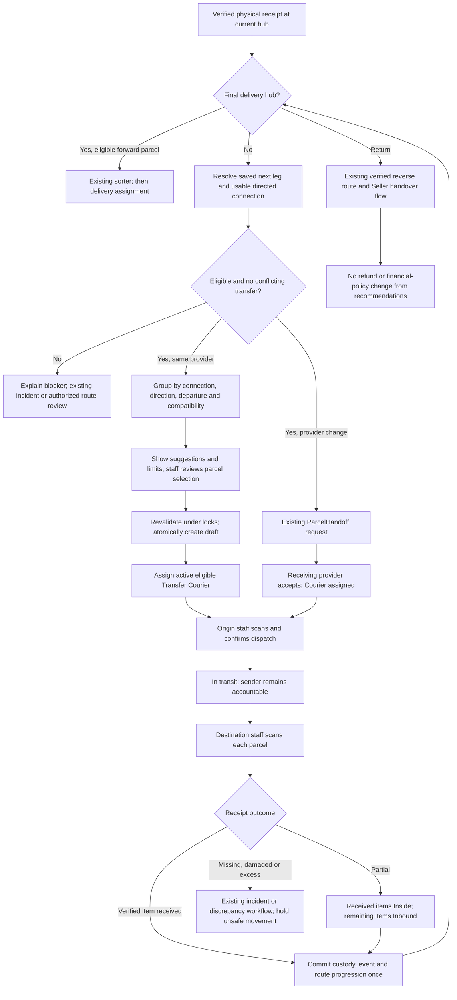

# Zefanya — Station & Transfer Intelligence Implementation Plan

Date: 2026-11-14. Repository: `C:\ProjectEcommerce\WebZefanya`. **Planning only; no application changes, migrations, database queries/writes, fixture changes, tests, builds, live transactions or deployments were performed for this plan.** Only this new document was created. All new component names, routes, fields and algorithms below are proposals, not installed features.

## 1. Executive summary

Extend the existing Laravel Logistics services rather than introduce a transport-management system. Zefanya already plans directed multi-hop ROAD/SEA/AIR routes, separates internal manifests from provider handoffs, assigns Transfer Couriers, verifies dispatch/receipt, advances routes after actual receipt, derives station inventory, handles transfer exceptions and notifies overdue transfers. The missing intelligence is safe connection-bound batching, explainable recommendations, capacity/schedule data, and station dwell monitoring.

The highest-impact first change is to bind a manifest to its actual directed TransportConnection and validate that connection at creation and dispatch, including reverse movement. An existing saved-route feasibility check is useful but does not establish that the **manifest's own endpoints/mode** match the parcel's next leg. Legacy parcels and returns can also bypass forward-route feasibility checks by design. Preserve their custody protections; add explicit transfer validation rather than remove those compatibility paths.

Recommended sequence: **environment isolation gate → transfer safety → route recommendations → manifest recommendations → station intelligence → operational verification**. Build tests within every phase; Phase 5 is integrated acceptance, not the first concurrency review. Physical dispatch, destination receipt and cross-provider acceptance remain authorized human actions. Recommendations never move custody, create financial records or imply a scan occurred.

The user identifies this working tree as production. No coding should start here. Before implementation, establish an owner-authorized isolated checkout/copy, test database, storage, cache/session, mail and queue configuration, and a tested backup/rollback process. This plan does not create or certify that environment. Master-handoff production topology and data counts are historical audit observations, not freshly queried facts.

## 2. Existing architecture and evidence

### 2.1 Investigation method and limitations

Read `AGENTS.md`, project `CLAUDE.md`, relevant architecture/flow/file-map/context documentation, the final master handoff and relevant Audit 1.17 custody, isolation, concurrency, dependency and compatibility sections. Traced the current PHP, routes, migrations, Blade/inline JavaScript and test source. Documentation is context; current source controls the findings below.

**Tool availability:** Graphify **0.9.108** is installed at `C:\Users\Rei\.local\bin\graphify.exe`. Its actual help documents graph queries, paths, explanations, updates and integrations including Codex/Claude. No separate ClaudeGraphFlow executable was found. `C:\ProjectEcommerce\CLAUDE_GRAPH_WORKFLOW.md` and the repository counterpart were absent. Existing `graphify-out/graph.json` has 13,463 nodes; it was queried without rebuilding, installation or hook changes:

```text
graphify --version
graphify --help
graphify query "ManifestService RoutePlannerService StationInventoryService" --depth 1 --budget 1300
```

The query returned 91 nodes with a truncated 41-node display. Graph completeness/freshness is **not certified**. Dependencies were verified with `rg -n`, `rg --files`, `Get-Content`, `git status --short`, `git diff --stat` and path-local `git diff`. No generated graph is behavioral proof. The commercial-ui-ux skill informed the source-based UI plan; no browser/device inspection occurred.

The tree is already extensively dirty. Inspected diffs include existing return-station-receipt gates in `ManifestService`/`ParcelHandoffService`, pickup guidance and controller changes. They belong to existing work and must remain intact. Do not copy an old committed service over the working version. Preserve checkout's existing MySQL transaction snapshot fix too.

**Evidence status:** source-confirmed below; no fresh functional/concurrency pass claimed. Test methods were inspected, not executed. No current live connection counts, scheduler operation, capacities, journey duration, external transport cost, Flutter runtime or staff identity were verified. Master-handoff statements about deployed refund work differ from earlier staging-only wording in Audit 1.17; this plan does not resolve deployment history or treat a staging patch as current application code.

### 2.2 Source findings and gaps

Paths below are relative to the repository. Line anchors are investigation-time navigation aids and may shift with concurrent work.

| Area | Current source evidence | Existing behavior | Gap / implication |
|---|---|---|---|
| Route planning | `app/Services/Logistics/RoutePlannerService.php:46,121,171,260` | Resolves seller/buyer barangay coverage; same-station route has zero legs; deterministic directed BFS through usable connections, path-local visited hubs and depth bound; stores connection/operator per leg | Hop count, not elapsed time or cost; cross-province candidates tried in partnership priority then provider order, not globally ranked routes. No ETA/cost/reliability inputs in connection model |
| Connection validation | `app/Services/Logistics/TransportConnectionService.php::validate`, `::eligibleHub`, `::isUsable`; `app/Models/Logistics/TransportConnection.php:24` | Operational hubs in verified provider province; origin owns operator; ROAD/SEA/AIR; active directed partnership at provider change; rejects duplicate active tuple in service | Validation exists and should be reused. Application duplicate detection alone needs race review; mode expansion migration removed the original endpoint-only uniqueness |
| Route execution | `app/Services/Logistics/RouteExecutionService.php:63,95,251,271`; `app/Services/Logistics/ParcelLegService.php:37,68` | Next destination, final-hub sorting guard, verified receipt progression, authorized incident-based reroute preserving completed legs; no reroute while in transit | Do not rebuild these. Add recommendation projection and route revision tracking for stale clients; test all callers after planner changes |
| Manifest creation | `app/Services/Logistics/ManifestService.php:51,981`; `app/Http/Controllers/Logistics/ManifestController.php:111` | Different operational hubs belonging to the same provider, forward/return direction, optional-schema transport requirement | No manifest connection ID/mode binding; no TransportConnection reference in this service. Hub existence is not a transport edge |
| Manifest membership | `ManifestService.php:87,155,221` | Pickup established, matching origin custody, incident/recovery checks, terminal/return gates, no delivery assignment, no active handoff or manifest | `addParcel()` does not establish that manifest destination equals the parcel's next saved leg. Candidate list filters are narrower/different from write checks: share an authoritative eligibility result |
| Dispatch / receipt | `ManifestService.php:359,610,738` | Locks; per-item action/hub-bound verification; courier readiness; checks saved forward route availability; partial receipt; per-item custody update and route advancement; missing/damaged reports | `requireAvailableDeparture()` skips active returns and absent routes. Even for forward routes it checks saved legs, not the manifest's selected connection. Retain receipt after connection shutdown |
| Handoffs | `app/Services/Logistics/ParcelHandoffService.php:187,409,469,755,795`; `ProviderHandoffSchemaService.php` | Directed partner eligibility, request/accept/dispatch/receive, receiving provider authorization, QR/OTP, reverse verified-path logic and existing Admin-authorized reverse exception | Must remain the boundary for provider changes. New connection binding must not accidentally remove parcel-specific reverse authorization or grant a new partnership |
| Reverse internal moves | `app/Services/Logistics/ParcelReturnService.php::reverseManifest` (near 1157) | Locks return/parcel, checks owner and return readiness, calls manifest create/add; buyer collection alone does not establish station custody | Destination is passed to the own-provider manifest mechanism; add directed edge and return-path validation, not an assumed reverse of every forward edge |
| Transfer Courier | `app/Services/Logistics/TransferCourierService.php:97,112,139,198`; `app/Models/Logistics/TransferCourier.php` | Provider-owned active personnel record, no login; assignment history, vehicle/plate snapshot, busy-on-road protection; assignment and dispatch lock courier | No capacity or departure schedule model found. No new Rider account/earning type is required for intelligence |
| Inventory | `app/Services/Logistics/StationInventoryService.php:19,143`; `HubsController.php:21`; `DeliveryMonitoringController.php:43` | One row per parcel; Inside vs Inbound; sort/exception subcounts; terminal returns/recovery and buyer-return station-receipt rules; provider/station scope | Service currently restricts requested hubs to **STATION** type. Province hubs need equivalent operations projection, not blanket removal of scope. No capacity or reliable continuous dwell projection |
| Sorting | `IncomingParcelsController.php:267–339`; `ParcelSortingService.php::sortAfterStationReceipt`; `ParcelTransitStatusService.php::arrivedAtHub` | Pickup-to-station scan auto-sorts at final hub; intermediate hub blocked; previously sorted parcel may resume Sorted after final transfer | Manifest/handoff receipt invokes transit/leg services, not the general first-time auto-sort hook. First-time transfer arrival can remain ArrivedAtHub. Extend existing sorter at these receipt boundaries |
| Monitoring | `app/Services/Logistics/StuckTransferService.php:45`; `FlagOverdueTransfersCommand.php`; `config/transfers.php`; `routes/console.php` | Overdue batches/handoffs, sender notice then Admin, row-claimed notification markers; scheduled every 15 minutes without overlap | `modeFor()` looks up first currently active edge for endpoints, defaults ROAD. Deactivating/replacing an edge can change classification of an existing transfer; snapshot actual mode at dispatch. No station dwell monitor |
| Exceptions | `app/Services/Logistics/ParcelIncidentService.php`; `RouteExecutionService::buildReroutePlan`; manifest/handoff recovery methods | Missing, damaged, wrong-hub/inactive-connection/failed-transfer incident paths, verified recovery and audited reroute already exist | Master handoff's "misrouting workflow unknown" is incomplete relative to inspected source. Extend existing workflows; excess/unlisted arrivals need a deliberate intake design, not silent membership |
| History / finance | `SellerOrder.php::trackingEvents`, `::manifestMovementEvents`, `ParcelReturnEvent`; `ProviderAllocationService.php:23`; `CodRemittance.php::snapshotAllocation` | Durable movement/return/status/audit rows; mutable custody pointer; distinct-provider handling chain; 40/60 and frozen accounting | No unified append-only custody event stream. More hub stops do not mean more providers. Same-provider 100% direction is **not asserted deployed**; ≥3 allocations remain policy-gated |

The ManifestService class comment and some old test names say canonical status never changes. Current dispatch/receipt calls `ParcelTransitStatusService`, which records InTransit/ArrivedAtHub through the status service. Use actual behavior when designing regression assertions.

### 2.3 Dependency map and impact boundaries

| Entry / caller | Service chain | Records and downstream consumers |
|---|---|---|
| `routes/logistics.php:36` (`auth:logistics`, `logistics.approved`) → ManifestController store/add/scan/dispatch/receive | ManifestService → verification, TransferCourierService, incident/leg/transit/return services | manifests/items, SellerOrder custody, parcel_routes, status/return/audit histories; station inventory; tracking; delivery eligibility; overdue monitoring |
| Logistics HandoffController / Returns controller | ParcelHandoffService / ParcelReturnService → ProviderHandoffSchemaService, scan verification, leg/transit services | parcel_handoffs, links, return events, custody, provider allocation preparation; same inventory/tracking consumers |
| IncomingParcelsController / ParcelSortingController | LogisticsHubService, status, ParcelLegService, ParcelSortingService, CourierAssignmentService | authoritative origin/destination coverage, station receipt, status, courier availability and delivery assignment; do not automate pickup assignment |
| Logistics Hubs / DeliveryMonitoring | StationInventoryService → custody, active manifests/handoffs, returns/events, incidents | read-only lists and counts. DeliveryMonitoring already uses `?station=` inventory mode; preserve old URLs |
| Buyer checkout web/API | CheckoutCarrierService → RoutePlannerService; CheckoutService → saved ParcelRoute | availability, reviewed quote/token/fingerprint, frozen order/fee snapshots. Shared planner changes affect checkout, not just Logistics UI |
| Logistics/Admin exception resolution | ParcelIncidentService → RouteExecutionService::previewReroute/rerouteFromCurrent | incident, existing route row and parcel_route_rereoutes audit; don't move a parcel by editing its plan |
| Scheduler / dashboards | FlagOverdueTransfersCommand → StuckTransferService; Admin TransportOverviewController | notification markers, notices, transport overview; no loss or custody transition from a timer |
| Tracking / mobile consumers | SellerOrder tracking and RouteExecutionService::trackingSummary; Buyer API shipments; Rider API jobs | preserve additive response compatibility and identity privacy; Flutter source/runtime not independently traced in this task, inspect integration clients before changing payloads |

Financial impact review: route completion enables sorting/delivery, which ultimately creates COD/remittance and Rider earnings; provider changes affect allocation chains; reverse movement feeds refund custody and return charges. Intelligence services must remain projections. They must not call settlement/refund/payout/commission writers. Changes at receipt must preserve incident holds, existing refund custody checks and status-service invariants. Regression tests must compare all money snapshots before/after operational recommendations and movements.

## 3. Current versus proposed workflow

| Step | Current | Proposed extension |
|---|---|---|
| Determine next destination | Saved route/next-leg service exists; manual selection can diverge | Explainable next-leg recommendation from verified current location and usable directed edge |
| Batch selection | Staff creates draft, manually adds parcels; recent-destination history is suggested | Computed groups by connection/direction/departure/compatibility; staff reviews before atomic draft creation |
| Prepare transfer | Courier records, verification and manual dispatch already exist | Bind edge, lock/revalidate current eligibility/capacity/schedule, reject stale batch without partial mutation |
| Travel | Sender accountable until receipt | Same rule; separate physically in transit from sender's liability; preserve dispatched snapshots |
| Receive | Per-item scan, partial receipts, exceptions, route advancement | Reuse; consistent first-time final-hub auto-sort; next recommendation only after receipt |
| Monitor | Station inventory, transfer overdue, incident queues | Reconciled province/station projection, dwell episodes, unassigned/ready/incoming filters and explainable alerts |

## 4. Route-planning architecture

### 4.1 Resolve locations without geographic assumptions

1. Resolve origin from seller pickup barangay via `LogisticsHubService`, using operational validated coverage. Freeze checkout's origin/destination as today. Municipality names are labels, not routing keys.
2. Resolve final delivery station from buyer barangay and eligible provider. A provider may own many stations/hubs; compare provider IDs at each leg. Current eligibility is constrained by verified province/live parent-hub rules; this plan does not expand one provider into multiple provinces.
3. For an existing parcel, use verified current custody plus actual receipt/recovery evidence. A planned hub or retained sender custody during transit is insufficient. Display "in transit" or "location unverified" instead of presenting a departure recommendation.
4. Same station: zero transfer legs, independent receipt then existing sort/delivery. Same municipality with different legitimate stations: route through explicit connections; municipality equality alone does not authorize a transfer.
5. Municipality-to-municipality: use a valid direct edge if appropriate; do not force province-hub detours. Cross-province/inter-island: use active configured multi-hop edges/partnerships. Example `Los Baños Station → Laguna Main Hub → Cavite Main Hub → Silang Station` is illustrative, not a claim that this topology is configured live.
6. ROAD/SEA/AIR is selected from the actual edge, never inferred from province/island names. A provider change uses ParcelHandoff, a same-provider edge uses Manifest. Existing external-carrier/liability gaps remain separate launch gates for real SEA/AIR operation.

### 4.2 Practical routing strategy

Keep deterministic bounded BFS initially, behind one common eligibility predicate (`TransportConnectionService`). Load an adjacency snapshot for one planning request, avoiding repeated validation queries per branch where safe; always revalidate at mutation. Maintain visited hubs, a depth bound, and best-known hub cost/hops so branching cycles cannot explode. Keep the current candidate-priority policy until an explicit business change; disclose that it may not choose the globally shortest route.

Add a narrow `ParcelTransferEligibility` projection (proposed) producing verified origin, next hub, connection ID, mode, provider IDs, route revision and structured reasons. It wraps existing route/return/incident services; it does not maintain a second route state machine.

Evaluate future metrics as follows:

| Metric | Available now | Recommendation |
|---|---|---|
| Transfer count / eligible edges | Yes | Deterministic minimum-hop baseline; connection ID stable tie break |
| Estimated travel time | No authoritative per-edge values | Optional positive duration minutes maintained by operator; include schedule waiting time. Show unknown if absent |
| Transportation cost | Not in connection model | Optional operational estimate in integer minor units/currency, separate from buyer shipping rate and financial allocation; never substitute for a charge |
| Provider eligibility | Yes | Mandatory constraint, not a soft score; active directed links at every provider change |
| Reliability | No calibrated evidence/score | Show observed completed-journey samples later, with sample size and period; no invented default reliability penalty |
| Operational constraints | Hub/edge/provider/courier states partly exist | Hard filter closures/holds/approved schedules and known limits; preserve diagnostic reason |

Once duration coverage is reliable, a small Dijkstra implementation is sufficient (nonnegative weights). Prefer an explainable lexicographic ranking: eligibility first, estimated arrival where data is comparable, then transfer count and deterministic IDs. Keep minimum-hop fallback for incomplete data and label estimates unknown; missing estimates are never zero cost/time. Cheapest/fastest tradeoffs and reliability penalties require owner-selected objectives, not an arbitrary blended score. No external routing engine, live map service or AI route selection is needed.

### 4.3 Changes, cancellation and reverse movement

Re-evaluate future availability at dispatch. Disabled future edge: hold, show reason and route-review action; do not silently edit checkout snapshots. Use existing incident-authorized reroute from verified location, preserving completed legs, old/new paths and original destination. Never rewrite an in-flight leg. Revalidate on confirmation; stale preview cannot change route revision or custody.

An ordinary reverse route must have its own usable directed edges; a forward connection is not reverse permission. Resolve internal reverse path toward frozen return origin without cycles; cross-provider return follows existing reverseTarget/verified forward path and directed reverse partnership or existing parcel-specific Admin authorization. A new emergency edge waiver must be scoped independently (§5). It cannot replace Seller return receipt, refund evidence, a partner's acceptance, or provider authorization.

## 5. Manifest connection-validation design

### 5.1 Why the current gap exists

`ManifestController::store()` accepts hub IDs/direction; `ManifestService::create()` calls `operationalHub()` twice and saves. Database composite FKs guarantee both hubs belong to the manifest provider, not that a transport edge exists. Neither manifests nor their items store the selected connection. Dispatch's per-parcel `requireAvailableDeparture()` checks a saved forward route's remaining availability; it does not compare that route to this manifest. Absent-route and active-return exclusions intentionally leave legacy/reverse paths outside that guard. This is source-confirmed missing validation, **not a reproduced live invalid dispatch**.

### 5.2 One authoritative contract at every write boundary

Introduce `ManifestConnectionValidator` as a focused service, reusing connection validation and `ParcelTransferEligibility`. Validate at draft creation, add/remove-relevant edits and dispatch (dispatch is decisive):

| Validation | Required result |
|---|---|
| Actor/provider | Approved authenticated provider owns both internal hubs and the originating operator; actual actor ID comes from guard, not request |
| Hubs | Different, operational, verified province/parent constraints satisfied; never infer eligibility from a dropdown |
| Directed edge | Exact `origin → destination`, selected connection ID, mode and operating provider; active and usable at creation/departure |
| Direction | Forward uses saved next leg. Return uses verified station receipt and authorized reverse path; no mixing directions |
| Parcel | Established physical availability at origin, permitted status, no hold/recovery/loss/terminal conflict, return readiness, compatible route/mode/provider and no delivery-Rider conflict |
| Membership | No unreleased membership on another manifest and no active handoff; one parcel once in submitted IDs; stale draft assignment cannot win |
| Schedule/capacity | Selected departure still open, parcel limits and shared capacity valid when those features are enabled; unknown required data blocks auto-grouping |
| Exception | Either ordinary valid edge or an independently authorized, exact-scope, unexpired emergency exception; never a client boolean |

Return structured reason codes and human text, e.g. `connection_inactive`, `next_leg_mismatch`, `not_physically_received`, `active_transfer`, `incident_hold`, `unknown_weight`. Share decisions between UI suggestions and mutation services, but mutation always recomputes under locks.

### 5.3 Persistence and legacy compatibility

Propose nullable `transport_connection_id` on manifest (and handoff for mode-consistent monitoring), plus immutable dispatch snapshots of endpoints, mode, operator and relevant schedule/limits. FK restrict deletion; historical edge meaning cannot be changed by editing endpoints. Disable/replace a used edge, retain it for history. Include binding in audit and revision/hash; freeze after dispatch.

New drafts require explicit connection choice; auto-select only a single unambiguous valid option and show it. Existing drafts with null binding require staff review before dispatch; no arbitrary "first active edge" selection. Existing dispatched transfers without binding remain receivable under existing scan/ownership rules; render mode as legacy/unknown (retain current legacy monitoring fallback until a reviewed compatibility change). Never infer historical movement by adding fake receipt events. A legacy parcel without ParcelRoute may use a manually selected validated edge under current custody rules; automatic next-hop recommendation remains unavailable unless a route is explicitly reviewed.

### 5.4 Connection deactivation and emergency moves

- Deactivation before creation: exclude and reject. After draft creation: show blocked draft, require replacement connection/review or cancellation; no scan tokens can override failure at dispatch.
- Deactivation concurrent with dispatch: both writers lock the same connection/control rows in a documented order; one operation precedes the other. A check without shared locking is insufficient.
- Deactivation after dispatch: retain sender liability and original mode; destination can acknowledge actual receipt. Block the next unavailable leg; do not cancel, erase, teleport or silently mark an in-transit parcel lost.
- Emergency transfer proposal: Admin-authorized record scoped to provider, exact origin/destination, mode, direction, parcel IDs/batch, reason/evidence, validity and permitted uses. Audit authorization, use and revocation. Creation may reference an authorized planned move, dispatch rechecks it. Never waive scans, approved provider ownership, physical custody, holds, capacity safety or cross-provider acceptance. The owner must approve who may authorize a missing/inactive-edge waiver and its limits before enabling this new exception path. Until then, reject and request network review. Reuse existing reverse authorization semantics without making it a universal edge waiver.

## 6. Manifest recommendation algorithm

Implement an on-demand read projection `ManifestSuggestionService`, not automatic batch creation or a new job that transports parcels.

1. Accept an authorized provider/hub and optional departure window; build a consistent inventory/route snapshot. Include Province Hubs through the scoped projection extension, not by treating them as stations.
2. Evaluate each physically present parcel once through the common eligibility result. Inbound parcels, current pickup/delivery Rider holdings, unresolved incidents/recovery and unverified legacy custody are not available stock.
3. Resolve exact next directed connection and direction. Group by `(provider, origin_hub, destination_hub, connection_id, transport_mode, direction, departure_id, compatibility_class)`. Handoffs are displayed separately as cross-provider actions; do not create a same-provider manifest containing partner parcels or a new cross-provider batch abstraction.
4. Apply known handling constraints only. No hazard/temperature/insurance compatibility is certified by absence of data; unsupported requirements are excluded for review. Establish their data contract before promising such carriage.
5. Capacity packing: stable FIFO by verified arrival time then parcel ID; oldest eligible parcels first. Sum `SellerOrder.parcel_weight_grams` snapshots, count parcels and reserve against the departure's remaining approved limits. Missing historical weight is unknown: avoid catalog-derived fallback for capacity certification. Use volume/dimensions only if reliable measurements exist. No assumed vehicle capacities. A larger parcel that doesn't fit is explained and left for a later batch; it is not silently dropped.
6. If no schedule/limit is configured, show an **unscheduled suggestion / capacity unverified**. Staff can review an ordinary draft, but the system must not claim a capacity-checked departure. Owner decides whether verified limits become mandatory for dispatch; recommendations requiring unknown constraints stay blocked.
7. Return included and excluded parcel IDs with all relevant reason codes, aggregate weight/count, departure/timezone, connection/operator details, evaluated-at time, route/transfer/connection revisions and a server-generated fingerprint. Exclusions are only for the authorized station's candidate set; do not leak other providers' parcel/customer data.
8. Staff removes any suggested item, or searches/adds other currently eligible items in the same group. Recompute totals and explain additions. Show no automatic reassignment from another draft; explicitly remove there first.
9. Confirm selection with a request idempotency key. Inside one transaction, re-read and lock transfer/parcel/connection/departure state, revalidate all selected items, then create one draft and memberships. On stale/invalid selection, create **nothing**, return per-item reasons and require refreshed review. Retrying the same key/payload returns the same draft; changed payload with same key is rejected.
10. Refresh on page re-entry, explicit Refresh, completed station receipt/add/remove/dispatch/incident/route action and a modest visibility-aware poll. Cancel superseded AJAX responses. A refresh is informational; no GET writes. Cache only if keyed by provider/hub and revision; never trust it at confirmation.

Capacity reserved by one departure is shared across its drafts and manifests, not independently reusable per batch. Cancelled drafts release future reservation; dispatched missing parcels do not free capacity retrospectively. Departures are materialized UTC instants with an Asia/Manila display, not naive recurring local strings. A skipped/cancelled departure invalidates recommendations and undeparted drafts; actual in-flight movement remains tracked until receipt/recovery.

## 7. Station inventory and dwell-time intelligence

### 7.1 Operational projection, not a stock ledger rewrite

Extend StationInventoryService behind a hub-scoped operations projection that supports Municipality Stations **and Province Hubs**, retaining provider ownership and old station-only callers/URLs. Do not reuse Product stock tables. Preserve `Total = Inside + Inbound`; `to_sort` and `exceptions` overlap Inside and must not be added to it. Show physical presence separately from financial/custody accountability. Contradictory active movements generate one parcel row plus a conflict flag, not multiple inbound inventory units.

Suggested mutually exclusive primary state: Inbound / Present / With Rider / In transfer / Recovery-location-unknown / Terminal; operational flags (awaiting sorting, ready, assigned draft, overdue, disputed) are secondary and may overlap. Enforce the same time-consistent database view for rows and header counts; paginate in SQL where practical instead of loading all station parcels into memory. Keep legacy projection fallback explicitly labelled.

| Monitor filter | Derivation / next action |
|---|---|
| Awaiting sorting | Present, forward final hub, eligible unsorted status; invoke existing sorter, never sort intermediate/return/held parcels |
| Ready for dispatch | Present, eligible next edge, no blocker; separate draft-assigned from unassigned |
| Awaiting manifest | Ready same-provider parcel with no active membership; link recommendation group |
| Incoming / awaiting receipt | Dispatched pending items to this hub; show received/expected counts and sender; excluded from Inside |
| Awaiting Delivery Rider | Verified final-hub arrival and Sorted with no delivery assignment; reuse assignment page/service |
| Overdue at hub | Current verified dwell episode exceeds configured threshold, with unknown ages separate |
| Misrouted | Verified location conflicts with next-leg origin/final coverage; existing wrong_hub incident/recovery/reroute |
| Disputed / damaged / missing | Existing incident/return-dispute state; do not count missing as available dispatch stock |
| Capacity | Configured parcel/weight limits less physical occupancy; show inbound separately as forecast; no configured limit means Unknown |

### 7.2 Dwell episodes and reliable timestamps

Start a new episode at actual verified station receipt: origin intake, manifest item receipt, partner receipt, buyer-return station acknowledgment, failed-delivery Rider handback or verified recovery at a hub. End physical dwell on actual dispatch, delivery/pickup handover away from the hub, Seller return handover or terminal disposition that removes physical stock. Assignment/draft creation, reroute, sorting and repeated scans do not restart the clock. A cancelled draft does not end dwell; cancelled dispatched transfer does not begin a station episode until physical recovery is scanned.

Keep total elapsed physical dwell during a dispute/hold visible; label hold duration separately. Whether holds pause an SLA is an owner decision, not an implied timer reset. Returning to the same hub after a real trip starts a new episode; expose cumulative journey time separately. Never use Order.created_at or planned arrival as the station arrival timestamp.

Unify append-only `parcel_custody_events` alongside existing movement records in the **same transaction**, covering all pointer writers before enabling authoritative dwell alerts. Event fields: parcel ID, event kind, occurred_at/recorded_at UTC, from/to provider and hub, actor type/ID, movement/source identity, correlation/idempotency identity, reason/evidence reference and schema version. Dispatch denotes physical exit while preserving sender liability; receipt denotes arrival. Corrections append linked superseding events; they do not edit original evidence. The stream records facts and reconciles projections, not a replacement for current refund/status workflows.

Build `StationDwellService` from episodes/events and an idempotent projection; optionally use existing trustworthy receipts as labelled observed timestamps. Historical records without a verified arrival show **Age unknown**. Do not backfill fictional receipt history or send retrospective overdue alerts merely because an order is old. Nightly reconciliation reports drift/conflicts for human review and never silently rewrites custody or financial records.

### 7.3 Thresholds, reminders and escalation

Reuse scheduler/notification patterns, with `StationDwellMonitor` and a small command only after reliable episodes exist. Configure warning/escalation by operational state, hub class and applicable transport mode; owner chooses durations, business/calendar-hour treatment, hold behavior, recipients and repeat cadence. **No new deadline is selected in this plan.** Keep existing transfer defaults (ROAD 24 h, SEA 72 h, AIR 48 h, Admin +24 h from `config/transfers.php`) as current configuration facts, not new approved station deadlines.

Notify responsible provider account first (current login model), show station context and oldest parcel links; escalate to existing Admin overview/queue. Claim one notification per `(episode, threshold_version, stage)` transactionally, deliver after commit with retryable delivery state so a failed notification is not permanently marked sent. Use existing notification channels and scheduler observability; no automatic loss/penalty, courier deduction or transfer execution. Named station-staff delivery requires an approved staff identity/permissions model first.

## 8. Physical transfer, custody and exceptions

| Situation | Required behavior / reuse |
|---|---|
| Standard lifecycle | Eligible physical stock → next-leg recommendation → suggested group → staff-confirmed draft → assigned Transfer Courier → origin verified per-item dispatch → transit → destination verified per-item receipt → inventory/route advancement → final auto-sort or next recommendation |
| Partial receipt | Update each verified item once. Batch remains open while unreceived active items remain; received items may continue their own journey. Partial completion must not fabricate remaining receipts |
| Missing | Existing `reportIssue('missing')` records issue and releases membership without receiving; retain sender accountability and block further movement via incident. A resolved/closed batch does not prove all parcels arrived |
| Excess/unlisted parcel | Reject ordinary batch receipt. Record an authorized discrepancy/intake incident with tracking, physical hub and evidence, without rewriting original dispatched contents. Unknown barcode remains quarantined/unidentified; do not create a SellerOrder. Link to verified wrong-hub recovery only after identity/authorization review |
| Damaged | Reuse verified damage receipt plus incident/hold. Physical Inside may rise while dispatch eligibility remains false; no auto-sort/delivery/refund from the damage flag |
| Wrong-station arrival | Ordinary expected-hub scan fails. Use existing authorized wrong-hub recovery/incident path to record actual location, then reviewed reroute. Never relabel arrival as intended destination |
| Duplicate scan / receipt | No duplicate membership, custody event, route advancement, notification or status/earning. Existing endpoints may reject duplicate receipt rather than return 200; preserve safe semantics. New idempotent command retries must replay identical result or return explicit conflict |
| Unauthorized receipt | Guard, provider membership, expected receiving hub and action-bound scan token all validated server-side. Transfer Courier has no login and cannot acknowledge destination receipt |
| Cancelled transport | Draft: release only unsent membership/reservation. After dispatch: preserve movement, use existing cancellation/recovery hold; partial-received manifests cannot be blanket-cancelled through current cancel method |
| Handoff rejected/failed | Preserve explicit partner accept/reject and return authorization. Suggest another eligible route only from verified custody through current incident workflow; do not infer receipt or force another provider |
| Disputed custody | Freeze operational eligibility, show evidence conflict to responsible provider/Admin, recover/resolve using existing services; reconcile facts without automatic liability or financial revision |
| Concurrent requests | Membership/dispatch/receipt/incident/reroute serialize on shared parcel/control rows; rollback includes custody, route, event and reservation writes. Expired/forged scan token never becomes valid through a suggestion |

Extend `ParcelSortingService` after **successful verified final manifest/handoff receipt**, once route progress and custody agree. Run within a reviewed transactional boundary and test rollback/notification interactions. Existing service checks destination, incident holds and status transition rules; intermediate or reverse receipt must not auto-sort for buyer delivery. Preserve pickup courier release order in IncomingParcelsController so auto-assignment cannot release a newly busy Rider.

## 9. UI/UX plan within existing pages

Audience: Logistics provider operations, with Admin monitoring; Transfer Courier personnel have no account. Primary tasks: find next action at a hub, review one eligible batch, and acknowledge actual movement. Visual source: existing `Layouts.logistics`, Tailwind v4 tokens in `resources/css/app.css`, existing cards/tabs, scan feedback and focus patterns. No new framework, theme or standalone dashboard module.

| Surface / actual files | Proposed change |
|---|---|
| `resources/views/Logistics/Dashboard/index.blade.php` | Small station selector and action counts (incoming, unsorted, ready, overdue); link to filtered existing queues, no duplicate parcel list |
| `Logistics/Hubs/index.blade.php`, `DeliveryMonitoring/index.blade.php` and Hubs/DeliveryMonitoring controllers | Reuse current inventory drilldown; extend to a hub Operations view including Province Hubs. Tabs for Available, Incoming, Outgoing, Holds; age, verified location, next destination and capacity context. Preserve `?station=` links |
| `Logistics/Manifests/index.blade.php`, `create.blade.php`, `show.blade.php` | Add Suggested batches tab / entry. Connection/mode/operator/departure shown before selection; eligible and excluded counts with reasons; review totals, manual additions/removals, one Create draft action |
| `Logistics/Manifests/receive.blade.php` | Keep per-item scans; expected/received/missing/damaged counts, partial receipt state and custody history. Excess-arrival action opens existing exception context, never an unverified Receive all |
| `Logistics/Handoffs/index.blade.php`, `show.blade.php` | Show cross-provider next actions and selected edge, partner acceptance, courier and overdue status; preserve existing lifecycle buttons and receiving-provider boundary |
| `Logistics/Exceptions/*`, `Admin/Transport/index.blade.php` | Integrate dwell, failed handoff, misrouting and reconciliation filters with existing incidents/overdue views; Admin monitors/authorizes applicable exceptions, Logistics assigns couriers/Riders |
| `Logistics/TransportConnections/index.blade.php`, `TransferCouriers/*` | Show directed endpoints, mode and eligibility/blockers; later approved estimates/limits/departures. Keep connection setup separate from daily movement confirmation |
| `resources/views/Components/logistics/sidebar.blade.php` | Existing nine-item design already groups manifests/couriers under **Transfers**, Incoming & sorting together, inventory via Setup, deliveries/monitoring together. Add tabs/context links within these groups; keep Setup for network configuration. No new top-level Station and Transfer menu duplication |

Current destination suggestions in `ManifestController::suggestDestinations()` and create-page inline JavaScript are **recently used hubs**, not route-valid batch recommendations. Label/replace that behavior with eligible connected options while preserving form input on errors. For richer behavior, extract only changed inline logic to `resources/js/logistics/manifest-suggestions.js` (proposed), wired through existing Vite/layout conventions. Reuse `Logistics/_parcel-queue-assets.blade.php` and shared scan/progress components rather than new design primitives.

States required: loading; no physical inventory; no usable connection with setup/review link; all candidates excluded with reasons; unknown age/capacity; stale selection; partial receipt; permission denied; held/disputed parcel; offline scan/submit; recoverable server error. Preserve selection on a failed refresh, disable confirmation until current review succeeds, prevent double submit and announce result with accessible status text. Show evaluation time and UTC-backed Manila display; avoid provider/customer identity leakage in shared tracking.

Acceptance requires desktop/tablet/mobile (375/768/1280 px), light/dark, keyboard/focus, screen-reader status labels and long tracking/hub names. On mobile show a readable per-parcel card and persistent reviewed count/action without hiding exclusion reasons; desktop uses dense tables. Color supplements explicit text. Offline is an error/retry state, never permission to queue unverified physical mutations silently. No visual usability claim is made from source inspection alone.

## 10. Security and concurrency requirements

1. Keep Logistics guard + approval middleware, CSRF on web writes, provider-scoped queries and existing policies/service authorization. Hub ownership is not named staff assignment: current shared provider identity cannot prove which employee scanned. Do not silently introduce a staff access model or a second Super Admin.
2. Existing manifest membership unique generated column (`manifest_items_active_parcel_unique`) protects one unreleased membership; handoffs have their own active-parcel unique constraint. These constraints do **not** exclude one manifest plus one handoff across two tables. Both writers must share the SellerOrder lock and check both memberships under it. Preserve composite hub/provider FKs.
3. Audit lock ordering before additions. Current manifests commonly lock manifest → item → parcel; handoffs lock parcel → handoff; reverseManifest already enters through a locked return/parcel. Adding a naive global "parcel first" rule to only one method risks deadlocks. Document a single acquisition graph covering create/add/remove/dispatch/receive/recover/cancel/returns/incident/reroute and worker paths; change only necessary conflicting paths with race tests. For multi-parcel operations acquire parcel IDs in stable order. Discover affected IDs, lock, then reread membership to catch changes; retry whole transaction on bounded deadlock, never replay partial external effects.
4. Serialize connection updates and departure validation on the same lock protocol. Current `TransportConnectionService::setActive()` locks origin hub then refreshes/updates edge, so dispatch cannot merely lock edge after an incompatible hub order. Review link suspension/provider status/hub deactivation too; specify whether commit precedes or follows the departure and enforce that ordering.
5. Courier locking already prevents simultaneous on-road use; preserve it and test across Manifest and ParcelHandoff. Schedule/capacity reservations need departure row lock and unique reservation per batch/parcel; multiple drafts cannot oversubscribe one departure. Check busy state again at dispatch.
6. Enforce active edge uniqueness at DB level after legacy-duplicate audit: generated nullable active origin key plus destination/mode/operator, or equivalent supported MySQL/SQLite strategy. Do not reinstate the obsolete endpoints-only unique index (different modes legitimately coexist). Migration design must tolerate existing duplicates by reporting them, never deleting history automatically.
7. Add mutation revision/version check for drafts, routes and departures. A signed recommendation or client `updated_at` does not authorize a mutation. Use canonical payload hash, server-stored idempotency result scoped to provider/action/key, row locks and current eligibility. Reject mismatched payload reuse. Repeated empty drafts must not accumulate from retries.
8. Scan tokens remain short-lived, one-use, actor/action/parcel-item/hub-bound via `ParcelHandoffVerification`; consume only after successful commit as existing services do. Persisted transfer state and unique event identity protect replay even if token cleanup fails.
9. Events, custody pointer, route progression, membership release, capacity changes and audit row commit together. Notifications/cache refresh occur after commit, with retry/dedup state. No GET endpoint or nightly reconciler modifies custody.
10. Consistent inventory snapshots and one-row-per-parcel rules are required under partial receipt. Add covering indexes only after representative EXPLAIN/query review; avoid materialized counters as a second authority. Logs carry reasons/correlation IDs, not OTPs/private proof or recipient information.

## 11. Database and API impact (proposed only)

Use the repository's optional `database/migrations/pending/` + RuntimeSchema compatibility approach for future schema work. No migration file is created in this task. Safe deployment requires an isolated restore rehearsal and explicit activation; unavailable optional schema must disable new suggestions/binding features rather than bypass existing safety. Do not turn feature flags into scan/custody exceptions.

| Component | Proposed schema/API change | Compatibility / boundary |
|---|---|---|
| Manifest / handoff binding | Nullable connection FK; dispatch snapshot of endpoints/mode/operator; transfer revision; optional emergency authorization FK | Existing dispatched nulls remain receivable. New draft binding required after activation; old drafts reviewed. No historical mode invented |
| Connections | Optional duration/cost metadata, active-tuple DB uniqueness; immutable used-edge identity | Cost is estimate only, not shipping charge; owner supplies operational inputs; no currency mixing |
| Route | Revision integer or equivalent reliably incremented value; retain legs JSON and reroute audit | Existing legs already include connection/operator IDs. No route-table rewrite; absent-route parcels explicitly supported |
| Departures | `transport_departures` with connection ID, UTC depart/cutoff, state, approved count/weight limits, version; small reservation table | Add after safety phase. Optional schedule templates materialize departures; do not build a scheduling engine. Frozen snapshots retain departed schedule |
| Hub capacity | Nullable count/weight capacity, or small hub-operations settings record | No values invented; physical occupancy vs inbound forecast shown separately; Province/Station scopes explicit |
| Custody facts | `parcel_custody_events` unique source/event identity; indexes on parcel/time and hub/time | Append-only new facts, no fictitious legacy backfill. Preserve original records/refund custody checks |
| Dwell / alerts | Rebuildable episode projection; unique episode + threshold-version + notification-stage delivery record | Unknown historical arrival stays unknown; retries do not duplicate alerts; reconciler reports, not repairs |
| Emergency / idempotency | Scoped authorization/audit rows; provider/action/key + payload hash/result uniqueness | Existing reverse authorization not generalized; no financial bypass, no extra admin account |

**Web/API design:** keep existing Logistics controller routes; add authenticated read endpoints before `{manifest}` wildcard, e.g. proposed `GET /logistics/manifests/suggestions?hub_id=&departure_id=` and `POST /logistics/manifests/from-suggestion`. Extend create/add/transport/dispatch forms with connection/revision data. Read endpoint returns grouped IDs/totals/exclusions/version, no scan tokens or full buyer profile. Write accepts selected IDs and idempotency key, recomputes and returns existing draft URL. JSON conflict returns 409 plus current reasons; validation 422; scoped 403/404 consistent with existing ownership behavior; Blade form errors keep reviewed inputs.

Do not add a public Logistics/mobile mutation API for this task. Buyer/Rider APIs retain keys/status definitions; additive route/age labels only if needed and tested. Inspect `routes/api.php`, `Api/Buyer/OrderController`, `Api/Rider/JobController` and actual Flutter parsing in the integration repository before changing shared serialization; Flutter runtime remains unverified. No change to COD, rates, Seller/Rider compensation, commission, refund or payout endpoints.

## 12. Dependency-ordered implementation roadmap

Complexity: S = localized service/UI change; M = several coordinated service/schema/test changes; L = multiple custody writers or operational integration. These are relative sizes, not time commitments. Each task includes the concrete acceptance gate; coding is not authorized by this planning document.

### Prerequisite G0 — isolate implementation and establish baseline

- **Problem/change:** served dirty tree and shared resources make test/coding unsafe. Prepare owner-approved isolated environment and preserve task-start snapshots/diffs; verify DB and private/public evidence backup restore. No branching/activation inferred from this plan.
- **Affected/new:** environment/test harness configuration in the approved isolated location; existing `tests/MySql/Preflight.php`, `run.php`, `phpunit.mysql.xml`; no new application component.
- **Dependencies / DB/API:** owner authorizes isolation/storage details; restricted disposable DB only, non-live cache/session/storage/mail/queue. No public API change.
- **Complexity/risk:** M; accidental live mail/database/files, concurrent runners.
- **Tests/acceptance:** prove Reflection/autoload/base_path and process paths use isolated source, config is uncached/safe, restricted runner cannot access `Zefanya`, one runner owns DB, restore includes evidence files. Capture narrow existing suite baseline before coding. Do not call this complete based on historical audit text.

### Phase 1 — Transfer safety

**P1.1 — Connection binding and manifest validation (first coding slice)**

- **Problem/change:** own hubs can form an unconnected draft; dispatch does not bind batch to actual edge. Add validator, selected connection binding and exact hub/mode/operator checks at create and dispatch; reject stale/inactive edge. Keep receivable historical transfers and all existing scan/return/incident gates.
- **Affected/new:** ManifestService create/add/dispatch, Manifest/ManifestItem, ManifestController store/create, TransportConnectionService and TransportConnection, manifest create/show views, StuckTransferService; new ManifestConnectionValidator; pending nullable binding/snapshot migration.
- **Dependencies / DB/API:** G0; extend web form input, nullable fields and scoped connection choices; no financial change. Do not enable emergency waiver until P1.3 decision.
- **Complexity/risk:** M; old drafts, mode ambiguity, deactivation race, fixtures historically missing edges.
- **Tests/acceptance:** no-edge/wrong-direction/mode/operator/hub and concurrent deactivate vs dispatch; valid dispatch succeeds; already-dispatched receipt still works after edge disabled; snapshot mode stable. Fix test fixtures only where new safety contract requires a real connection; never weaken custody or tokens.

**P1.2 — Shared eligibility and assignment race boundary**

- **Problem/change:** candidate and write checks differ; endpoints may diverge from saved next leg; separate membership constraints need shared locking. Centralize read-only reason result, enforce it under locks for add/dispatch and handoff conflicts; retain proven physical/reverse gates.
- **Affected/new:** ManifestService eligibleParcels/addParcel/dispatch; ParcelHandoffService request/dispatch; RouteExecutionService, ParcelLegService, ParcelReturnService; new ParcelTransferEligibility; existing unique membership migrations retained.
- **Dependencies / DB/API:** P1.1; no new financial schema, return reason codes additive; revisions as needed. Review full lock acquisition graph before edits.
- **Complexity/risk:** M; deadlock/legacy-route blockage, holding current invalid drafts.
- **Tests/acceptance:** wrong-next-leg rejected before departure; absent-route manual validated transfer retains compatibility; buyer collection without station receipt rejected; manifest-vs-handoff and two-manifest races leave one winner; no uncommitted inventory appears.

**P1.3 — Reverse validation and exceptional movement scope**

- **Problem/change:** reverse internal destination lacks exact connection binding; forward edges/links cannot grant reverse permission. Validate directed reverse segments toward frozen origin, reuse reverseTarget and existing authorization. Design/implement emergency waiver only if owner scope approved; otherwise return actionable blocked reason.
- **Affected/new:** ParcelReturnService reverseManifest/reverseHandoff, ParcelHandoffService reverseTarget, ProviderHandoffSchemaService, validator, Admin/Logistics exception views; scoped authorization record only if approved.
- **Dependencies / DB/API:** P1.1–P1.2; owner decision for new edge waiver. Nullable exception FK/audit if enabled; existing return authorizations retained.
- **Complexity/risk:** M; accidental broad bypass, circular reverse route, refund-custody damage.
- **Tests/acceptance:** missing reverse edge blocked; reverse-only/forward-only links distinguished; valid stepback succeeds; wrong origin/provider/replayed/expired waiver rejected; human acceptance/dispatch/receipt always required; financial/refund snapshots unchanged.

### Phase 2 — Route intelligence

**P2.1 — Explainable next-hop projection and reviewed reroute integration**

- **Problem/change:** staff manually selects hubs despite saved route. Expose next-hop/action with exact edge and blockers; integrate existing preview/incident-authorized reroute; add route/draft revision checks.
- **Affected/new:** RoutePlannerService, RouteExecutionService, ParcelLegService, ParcelTrackingVerificationService, Manifest/Handoff controllers/views; common eligibility projection from P1.2, small response presenter if needed.
- **Dependencies / DB/API:** P1 complete; optional revision column; additive Logistics read response. Checkout consumers must use unchanged shared eligibility.
- **Complexity/risk:** M; presenting planned location as actual, stale decisions, changing provider chain/accounting.
- **Tests/acceptance:** four route shapes, intermediate/final distinction, no route while in flight, stale reroute conflict, completed legs/history preserved, no new provider chain enabled through blocked financial policy.

**P2.2 — Bounded planner efficiency and optional duration ranking**

- **Problem/change:** path-local BFS may repeatedly explore branches; hop-only path/candidate priority ignores duration. Add bounded adjacency/best-state traversal with deterministic behavior first; add positive duration ranking only after reliable data/objective decision. Cost/reliability remain explainable metadata until approved inputs exist.
- **Affected/new:** RoutePlannerService findPath/destinationCandidates, TransportConnection fields/service/setup view, CheckoutCarrierService/CheckoutService callers and tests; no external engine.
- **Dependencies / DB/API:** P2.1; duration/ranking owner inputs before behavior change; optional metadata columns, route legs remain compatible.
- **Complexity/risk:** M; changed checkout availability, provider-priority semantics, missing metadata, route search growth.
- **Tests/acceptance:** deterministic ties, cycles/branching depth bound, direct route avoids forced hub, ROAD/SEA/AIR, missing-data fallback explicit, same-station zero route, checked-out financial snapshots unchanged; query/time budgets measured on representative isolated graph.

### Phase 3 — Manifest intelligence

**P3.1 — Departure and capacity contract**

- **Problem/change:** no shared schedule/limit model; cannot certify batch capacity. Add minimal departures/reservations and explicit unknown values; use frozen parcel weight, not current catalog weight; snapshot limits on departure.
- **Affected/new:** TransferCourierService, Manifest models/controllers, TransportConnection setup; proposed TransportDeparture/CapacityReservation models and validation service; pending schema, limited setup forms.
- **Dependencies / DB/API:** P1/P2.1; owner provides capacity/schedule inputs and enforcement policy. Proposed tables/limits from §11; no charge calculation/API policy change.
- **Complexity/risk:** M; oversubscription, units/timezone/cutoff mistakes, invalid default limits.
- **Tests/acceptance:** exact-limit success, count/weight overflow rejection, unknown snapshot excluded from certified batch, shared-departure contention, cancellation release, busy courier retained, SEA/AIR support not inferred from a road vehicle label.

**P3.2 — Suggestions and atomic staff-confirmed drafts**

- **Problem/change:** manual batching/recent-destination hints. Implement §6 grouping/explanations, review edits, idempotent atomic draft creation and stale revalidation.
- **Affected/new:** new ManifestSuggestionService, ManifestController and create/index/show views, routes/logistics.php literal read/create endpoints; optional JS module and request idempotency storage.
- **Dependencies / DB/API:** P1, P2.1, P3.1 for scheduled/certified groups; allow labelled unscheduled suggestions separately. New read endpoint and existing-safe mutation adapter, no background physical action.
- **Complexity/risk:** M; stale group, duplicate drafts, provider data leakage, hidden exclusions.
- **Tests/acceptance:** 18 eligible same-edge parcels → one reviewed draft with 18 unique items; incompatible/assigned/held/inbound excluded with reasons; staff subset/additions valid; stale single item rolls back entire creation; identical retry same result; concurrent requests no duplicates/reservation overspend.

### Phase 4 — Station intelligence

**P4.1 — Complete receipt-to-final-sort integration**

- **Problem/change:** origin intake auto-sort exists; first-time final transfer receipt lacks consistent sorter hook. Extend existing sorter at manifest/handoff receipt after verified route/custody progression; keep reverse/damage/incident holds excluded.
- **Affected/new:** ManifestService receive, ParcelHandoffService receive, ParcelSortingService, ParcelTransitStatusService, CourierAssignmentService notification boundary; no parallel sorter.
- **Dependencies / DB/API:** P1/P2.1 (can ship before P3 if isolated and validated); no new schema/API required.
- **Complexity/risk:** S–M; duplicate status/earnings, invalid auto-assignment, releasing busy pickup Rider, non-atomic failure.
- **Tests/acceptance:** one receipt → final route completion and Sorted once; intermediate remains unsorted; repeated receipt no extra transition; returns/held/damaged not delivery-sorted; failed transition/notification boundary leaves retry-safe state.

**P4.2 — Custody events, hub operations and dwell projection**

- **Problem/change:** station-only projection, no reliable episode timestamps or unified events. Add transactional facts at all custody boundaries, extend province operations without breaking station scope, build dwell/occupancy projection and reconciliation report.
- **Affected/new:** StationInventoryService; Hubs/DeliveryMonitoring controllers/views; origin/failed-delivery receipt, manifest/handoff/recovery/return/loss/status writers; SellerOrder tracking; proposed custody event/episode models and StationDwellService.
- **Dependencies / DB/API:** P1, P2.1; P4.1 for complete operation labels. Pending event/projection/capacity schema; additive hub filter. Audit current pointer writer set with `rg custody_hub_id/custody_provider_id` before implementation, not a fixed historical file count.
- **Complexity/risk:** L; dual-write drift, legacy fabricated history, event-order/visibility errors, query scaling.
- **Tests/acceptance:** Inside/Inbound totals match rows; Province+Station scope enforced; partial transfer/return/failed-delivery/recovery episodes correct; assignments/reroutes do not reset clock; unknown historical age; transaction rollback no orphan event; reconciler reports injected drift without repair.

**P4.3 — Dwell alerts and integrated monitoring UI**

- **Problem/change:** existing transfer alerts do not cover station dwell; one mode lookup can misclassify historical transfers. Read dispatch snapshots, configure approved dwell rules, add idempotent delivery/retry and link into existing Dashboard/Exceptions/Admin Transport pages.
- **Affected/new:** StuckTransferService, FlagOverdueTransfersCommand, config/transfers.php, routes/console.php, existing notifications/dashboard/exception/Admin transport views; new dwell command/notification state only as necessary.
- **Dependencies / DB/API:** P1 dispatch snapshots, P4.2, owner threshold/recipient/hold rules; episode notification identity storage and settings. No penalty/payment/status transition.
- **Complexity/risk:** M; duplicate/lost notice, wrong recipient, historical false alerts.
- **Tests/acceptance:** exact time boundaries and timezone; one warning/escalation per episode/version; competing schedulers one notice; failed channel retry; legacy no fake overdue; deactivated edge doesn't change new transfer's mode; Admin has monitor links, no assignment control.

### Phase 5 — Operational verification

**P5.1 — Four-flow, financial and API acceptance**

- **Problem/change:** structural tests are not proof of operable live network. Execute outbound/return journeys × four shapes in isolation with real configured edges, links, actors and proofs; preserve historical compatibility and money snapshots.
- **Affected/new:** existing feature/MySQL suites in §13; minimal isolated fixtures for missing Cavite/Cebu topology; Buyer/Rider API contract tests; no live data/seeding, no additional Super Admin.
- **Dependencies / DB/API:** relevant P1–P4 slices complete; financial/carrier policy gates respected. Test DB only; public API unchanged except approved additive fields.
- **Complexity/risk:** M; network-dependent seed data, misleading legacy fixture pass, financial gating mistaken for route success.
- **Tests/acceptance:** named journeys and negative cases pass, per-case inventory/custody/route reconciles; 40/60 and historical 10%/5% snapshots unchanged; pending ≥3 financial flow remains blocked; record actual counts/assertions/skips, not historical totals.

**P5.2 — Real races, frontend acceptance and rollout review**

- **Problem/change:** SQLite cannot prove lock behavior; source-only UI isn't field-verified. Execute sequential restricted MySQL worker races, frontend failure/retry and responsive checks; rehearse optional-schema activation/rollback on restored copy; controlled owner-reviewed release only after isolation.
- **Affected/new:** tests/MySql harness/worker and explicit isolated suite registration, relevant JS/UI tests, browser acceptance; no new operational system.
- **Dependencies / DB/API:** G0 plus shipped slices and applicable decisions; no live writes. Migration rehearsal only in isolated restored database during later coding work.
- **Complexity/risk:** M; shared DB runner conflicts, duplicate side effects, rollback losing evidence.
- **Tests/acceptance:** every race asserts actual worker overlap and one committed winner; connection disable/dispatch and capacity contention tested; responsive/offline/stale/permission flows pass; old dispatched transfer remains receivable; backup/restore includes proof files; release report names unverified carrier/mobile/policy limits. Do not activate all phases as one unreviewed release.

## 13. Test plan and acceptance matrix

**Executed in this planning task: 0 PHPUnit tests, 0 MySQL tests, 0 frontend/browser tests.** There are no passed/failed/assertion counts to report. Earlier master/Audit 1.17 results are historical and intentionally not added into a current total. Static inspection identified the following reusable tests; inherited MySQL wrappers are not automatically independent races.

### 13.1 PHPUnit (isolated SQLite, then relevant MySQL parity)

Existing files under `tests/Feature/Logistics/`: `Phase4MultiLegRoutingTest`, `AutomaticRouteProgressionTest`, `RoutedTransitionsTest`, `TransportConnectionManagementTest`, `InternalManifestFlowTest`, `InternalManifestDatabaseTest`, `ProviderHandoffDatabaseTest`, `CrossProviderHandoffTest`, `CrossProviderHandoffQrTest`, `F2HandoffAuthorizationTest`, `HandoffStaleActionTest`, `HandoffCancellationTest`, `StationInventoryTest`, `IncomingParcelsTest`, `ParcelSortingTest`, `Phase5ExceptionHandlingTest`, `EndToEndLogisticsStabilizationTest`, `PhysicalReturnTest`, `RefundPolicyPhysicalReturnTest`, `ReturnRecoveryTest`, `ParcelLossTest`, `ProviderAllocationTest`.

| Required scenario | Acceptance assertions / target |
|---|---|
| Same municipality | Same station zero legs/no manifest; distinct covered stations require actual edges; origin receipt still mandatory |
| Municipality / multi-hub | Direct edge avoids unnecessary hub; multi-hop advances one leg per verified receipt; connection ID/mode/operator match |
| Province / cross-provider | Each change has directed active partnership; same-provider multi-station move creates no handoff; wrong provider cannot receive |
| Inter-island | Explicit SEA/AIR edge and intermediate steps; inactive mode/port hub blocks planning; chosen snapshot stays stable; external-carriage readiness not asserted |
| Invalid/inactive connection | Create, add and dispatch boundaries; reverse direction; wrong operator/mode; old dispatched receipt permitted; stale future departure held |
| Suggestions | Group keys, 18-item example, exclusions, manual edits, stale fingerprint, idempotent retry, no GET mutation |
| Capacity / schedule | Count/weight exact fit, one overflow, unknown/zero-unreliable weight, no schedule, cutoff/timezone, cancelled departure, shared reservations |
| Duplicate assignment | Same request duplicate IDs; another draft; existing handoff; released membership reused only after eligible custody |
| Partial/missing/excess/damaged | Received subset Inside, remainder Inbound; missing not received; excess quarantined/reviewed; damaged physically received but held; status aggregate with exceptions |
| Wrong station / token | Forged, expired, wrong action/hub/parcel/item/provider; no route/custody mutation; authorized recovery distinct from expected receipt |
| Route changes | In-flight refusal, verified recovery before reroute, preserve completed paths, stale revision and disabled subsequent edge |
| Dwell / alerts | Exact threshold, holds, one episode on duplicate scan, genuine revisit new episode, no timer reset on assignment/sort, unknown legacy age, one warning/escalation/retry |
| Historical parcels | No saved route/event stream/binding/courier-required marker; safe manual transfer and actual receipt compatibility; no fabricated history or retroactive money |
| Auto-sort | First final manifest/handoff receipt sorts once; intermediate/reverse/held paths excluded; status/notification rollback safe |

Add focused new `ManifestConnectionValidationTest`, `ManifestSuggestionTest`, `StationDwellTest` and `HubOperationsTest` only for behavior not covered by existing suites. First establish baseline, then red case, minimal service change, targeted pass. Run affected checkout/security/API tests after shared planner changes; run COD/remittance/refund/payout/commission/shipping/Rider earnings regressions after receipt/custody changes. Assert unchanged persisted money, not merely successful HTTP status. No full-suite run unless failures/impact warrant it.

### 13.2 MySQL concurrency (real workers, sequential runner)

Reuse `tests/MySql/Preflight.php`, `run.php`, `worker.php` and `UsesLogisticsDatabase`. Existing `LogisticsConcurrencyTest` contains concurrent verified receipt and reroute cases. `LogisticsRoutingTest`, `LogisticsProgressionTest`, `LogisticsConnectionsTest`, `LogisticsExceptionsTest`, `LogisticsStabilizationTest` and `RoutedTransitionsTest` provide MySQL parity wrappers; inspect inherited methods and test discovery rather than equate wrapper execution with concurrent contention.

`phpunit.mysql.xml` currently explicitly lists a limited set of files and **does not list these Logistics classes**. `tests/MySql/run.php` accepts only filters/testdox/no-progress/debug, so a filter cannot discover omitted files. In the future isolated change set, explicitly register the intended suites (or provide a reviewed isolated config/runner extension) and prove discovery before claiming coverage. Never bypass Preflight/runner lock just to execute a missing class; no configuration is changed by this plan.

Required races: same parcel to two manifests; manifest vs handoff; duplicate suggestion confirmation; add/remove vs dispatch; two dispatches; same courier on two batches/handoff; connection/hub/link shutdown vs dispatch; capacity on shared departure; duplicate same-item receipt; two different-item receipts closing a partial batch; receive vs cancellation/recovery/loss; custody correction vs stale scan; route revision vs old recommendation; competing dwell schedulers and failed-notification retry. Verify rollback of event/route/custody/audit/reservation side effects and one successful state transition. Use barriers/proof of blocking, not a timing sleep as proof of overlap.

Future authorized isolated commands: `php tests/MySql/run.php --preflight-only`, then `php tests/MySql/run.php --filter=<registered-case>`. Preflight must confirm exact test server/schema/restricted account and deny production access. Never overlap suites sharing the disposable schema; do not run these commands in the served tree for this planning task.

### 13.3 Frontend/browser acceptance

Unit-test extracted suggestion grouping display/reason rendering, stale response cancellation, capacity totals as display only, retained selections, double-submit handling and offline/timeout/conflict recovery using the repository's established JS test setup. Server tests remain authoritative for eligibility/totals. During future implementation run targeted Pint for changed PHP paths, appropriate JS tests, Vite build in isolation and `git diff --check`; avoid formatting all dirty files or regenerating unrelated assets.

Browser in isolated environment: provider-scoped hub switch, zero eligible group, invalid connection, 18-parcel subset review/create, courier assignment, per-item dispatch, partial receipt with missing/damaged/excess report, wrong-station refusal, final auto-sort, subsequent-leg suggestion and overdue drilldown. Inspect 375/768/1280 px, dark/light, keyboard, focus return, screen-reader announcements, slow network, retry and expired session. No real parcel/financial record is mutated on `zefanya.shop`.

## 14. Risks and unresolved decisions

- **Production environment:** dirty served source, shared DB/storage and historical contradictory staging/deployment documentation. Independent isolation and backup proof remain prerequisites, not claims from this plan.
- **Missing operational data:** travel time, costs, capacity, schedules, handling restrictions and reliability cannot be invented; Unknown is a meaningful state. Do not turn example geography into live coverage.
- **Policy/finance boundary:** two-provider 40/60 remains; same-provider 100% is an owner-approved **design direction requiring separate implementation and financial verification**, not an already deployed feature. ≥3-provider allocation remains separate policy. More hubs do not imply more payees. No COD/rates/earnings/refund/snapshot changes in this roadmap's operational slices.
- **Cross-provider/SEA/AIR:** structural graph support does not resolve carrier contracts, actual availability, booking, loss liability/insurance, inter-island pricing or financial allocation. Block unsupported operational promises; no new carrier module within the first coding task.
- **Concurrency:** existing lock order and schema availability need reconciliation before adding rows/locks. Generated uniqueness protects individual tables, not the full workflow. Notifications stamped before successful delivery can be lost; proposed delivery retry covers new alerts without claiming current delivery is guaranteed.
- **Historical evidence:** no new custody stream can prove past events. Unknown age/location/mode requires review; preserve original evidence and receivability. Refund #41 and all financial history remain untouched.
- **Staff accountability:** current provider identity is real authorization but not individual staff attribution. Named station-staff restrictions need an owner-approved membership model; don't claim existing station-level employee authorization.
- **Scope creep:** weighted routing, third-party carriage, same-provider allocation, pricing and staff accounts are separately gated. A safe connection validator does not require completing them first. Every coding slice needs fresh path-local diff review because another contributor may change the tree after this investigation.

### A. Existing versus Missing Functions

| Function | Existing State | Required Improvement | Priority |
|---|---|---|---|
| Hub coverage and directed connection eligibility | Implemented in hub/connection services | Reuse; lock/DB-uniqueness audit | P1 |
| Same-station and directed multi-hop routes | Implemented, BFS, ROAD/SEA/AIR | Explain next hop; bounded search; optional evidence-based duration ranking | P2 |
| Manifest connection binding | Missing; hub ownership only | Exact connection and snapshot; create/dispatch validation including reverse | P1 |
| Parcel route-to-manifest match | Partial physical/route feasibility guards | Exact next-leg endpoint/mode/operator match at write | P1 |
| Membership uniqueness | Per-table unique constraints and locks exist | Cross-table shared parcel locking; race verification | P1 |
| Transfer Courier assignment | Implemented, active/owned/busy/history | Reuse; capacity/schedule extension where approved | P3 |
| Provider handoff / reverse authorization | Implemented | Preserve directed boundaries and parcel-specific authority | P1 |
| Per-item dispatch/partial receipt | Implemented | Keep; bind selected edge, retry/exception verification | P1/P5 |
| Route progression / incident reroute | Implemented | Reuse; explicit stale revisions and recommendations | P2 |
| Final receipt auto-sort | Origin intake implemented; transfer-first arrival partial | Reuse sorter consistently after final verified receipt | P4 |
| Automatic manifest grouping | Missing; recent-destination hints only | Explainable read recommendations + human-confirmed atomic draft | P3 |
| Capacity / departures | Missing in inspected transfer model | Minimal limits, actual departures and shared reservations | P3 |
| Station inventory | Implemented, station-only, derived | Province-hub projection, action states and query scaling | P4 |
| Dwell / unified custody facts | No unified event/episode projection | Append-only facts, unknown legacy age, dwell/reconciler | P4 |
| Transfer overdue | Implemented mode defaults and notifications | Snapshot mode; delivery retries; extend to dwell with approved thresholds | P1/P4 |
| Misrouting / recovery | Incident/recovery/reroute paths exist | Integrate evidence/monitoring, explicit excess-arrival intake | P4 |
| Same-provider 100% allocation | Approved direction, not claimed deployed | Separate financial implementation/verification; outside first slice | Separate |
| ≥3-provider amounts | Policy-gated/amountless handling records | Owner policy first; do not infer amounts from stops | Separate |

### B. Proposed Workflow



```mermaid
sequenceDiagram
    participant Staff as Authorized Logistics staff
    participant App as Existing transfer services
    participant DB as Locked parcel and transfer records
    participant Receiver as Destination provider staff
    Staff->>App: Review suggestion and request draft
    App->>DB: Lock and revalidate edge, parcel, capacity and revision
    DB-->>App: Commit draft only; no custody movement
    Staff->>App: Assign Courier and submit verified dispatch scans
    App->>DB: Recheck availability and record departure facts
    Note over DB: Sender liability retained; parcel physically in transit
    Receiver->>App: Confirm actual per-item receipt with bound verification
    App->>DB: Commit receipt, membership release, custody and route/event update
    Note over DB: Connection shutdown after dispatch does not erase arrival
    App-->>Receiver: Partial or complete receipt; next action / final auto-sort
```

### C. Implementation Sequence

| Phase | Task | Dependencies | Complexity | Acceptance Criteria |
|---|---|---|---|---|
| Gate | G0 isolation, preservation, backup and baseline | Owner-authorized safe environment | M | Source/DB/files/mail isolated; restricted single runner; restore verified |
| 1 | P1.1 connection binding | G0 | M | No invalid departure; stable dispatched mode; historical receipt allowed |
| 1 | P1.2 eligibility + locks | P1.1 | M | Correct next leg; one active transfer winner; no weaker custody |
| 1 | P1.3 reverse + exceptional movement | P1.1–2; emergency scope decision | M | Directed reverse validated; exception never waives scans/ownership |
| 2 | P2.1 next-hop projection / reroute | Phase 1 | M | Verified origin; explained next action; completed/in-flight legs preserved |
| 2 | P2.2 planner efficiency / optional ranking | P2.1; data/objective for ranking | M | Deterministic bounded search; honest unknowns; checkout parity |
| 3 | P3.1 departures and capacity | P1, P2.1; operational inputs | M | Shared limits cannot oversubscribe; no invented capacities |
| 3 | P3.2 reviewed suggestions | P3.1, authoritative eligibility | M | Explainable groups; atomic/idempotent reviewed draft; no auto-dispatch |
| 4 | P4.1 final transfer receipt auto-sort | P1, P2.1 | S–M | Eligible final receipt sorts once; other flows stay guarded |
| 4 | P4.2 custody/dwell/hub projection | P1, P2.1, P4.1 | L | Correct Inside/Inbound, events and episodes; unknown history explicit |
| 4 | P4.3 alerts / integrated UI | P4.2, snapshots, owner thresholds | M | One warning/escalation, retry-safe delivery, existing navigation |
| 5 | P5.1 four-flow / financial/API | Relevant implemented phases | M | Named isolated journeys green; financial snapshots unchanged |
| 5 | P5.2 races / frontend / rollout review | G0 and applicable slices | M | Real overlapping-worker assertions, responsive/failed-state checks, safe activation rehearsal |

### D. Owner Decisions

Only decisions that require business/environment authority:

1. Approve the concrete isolated coding/release environment and protected backup/restore arrangement before implementation. This planning request does not authorize editing served application files or deploying.
2. Define who can authorize emergency missing/inactive-edge transfers, their evidence, exact scope, validity/reuse and revocation rules. Existing reverse authorization alone does not answer a general emergency-carriage policy.
3. Supply/approve operational station/vehicle/departure capacities, schedules and cutoff rules, supported handling constraints, and whether unknown limits prohibit dispatch or only certified recommendations.
4. Approve dwell warning/escalation durations, recipient/responsibility rules, business/calendar-hour handling, held-parcel treatment and repeat cadence. Keep existing transfer thresholds until deliberately changed.
5. Before time/cost optimization changes routing behavior, select the objective and whether existing provider-priority ordering may change; supply reliable duration/cost inputs. No arbitrary weights or reliability score will be invented.
6. If individual station-staff accountability/access is required, approve staff identity and station-membership roles. Current provider accounts remain the operating authority meanwhile.
7. For a separately scoped financial implementation, confirm activation details for the approved same-provider 100% direction and resolve ≥3-provider allocation. Preserve 40/60 eligible two-provider routes and frozen historical records; these decisions do not block a policy-neutral manifest validator.
8. Before real inter-island carriage, approve actual carrier/provider arrangements, coverage, liability/evidence requirements and applicable financial policies. Route graph capability alone is insufficient.

### E. Recommended First Coding Task

**P1.1: bind new manifests to an explicit usable directed connection and revalidate it at dispatch, with immutable dispatch mode/operator snapshots and legacy receipt compatibility.**

This closes the confirmed gap at the physical departure boundary, fixes the foundation needed by recommendations and accurate overdue classification, and fits existing services without changing money policies. Include focused invalid-edge and deactivation/dispatch regression cases immediately. Do it only after G0 in an approved isolated environment. Follow with exact parcel-next-leg validation and reverse-route coverage (P1.2/P1.3); do not advertise "smart routing" or complete transfer safety until those gates pass.
