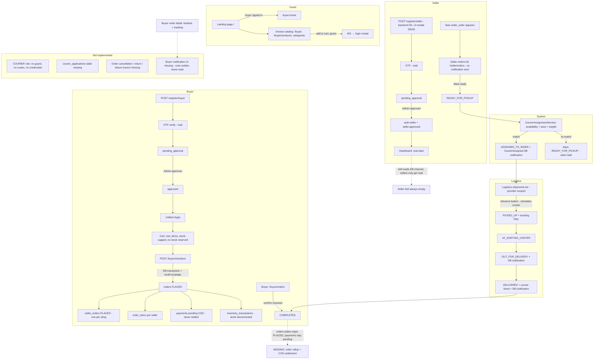

# Zefanya — System Flow Audit

> **Purpose:** Document what flows are actually implemented, partially implemented, missing, or incorrectly connected in the current codebase. **Inspection and documentation only — no application code was modified.**
>
> **Audit date:** 2026-09-25 · **Audited commit base:** `5319a3a` (master) · **Verification:** `php artisan test --compact` → **157 passed (639 assertions)** at audit time; `php artisan route:list` → **92 routes**.
>
> **⚠️ Re-verified 2026-10-02** against the same commit **plus uncommitted working-tree changes** (product variants, buyer account pages, policies, Google sign-in, seller-modal repair, checkout double-submit tokens, `status_histories` actor columns, `OrderActor` enum). `php artisan test --compact` → **242 passed, 1 failed (1097 assertions)**; `php artisan route:list` → **99 routes**. Sections below are updated where the re-verification changed a finding; resolved items are marked **[RESOLVED 2026-10-02]**. The single failing test is `BuyerOrderLifecycleTest::test_index_renders_reference_design_shell_with_real_buyer_info` — a **test-side assertion bug**: `assertSee('Orders &amp; Tracking')` double-escapes to `Orders &amp;amp; Tracking` while `Buyer/Orders/index.blade.php:95` renders `Orders &amp; Tracking` (the page itself is fine; sibling tests on the same route pass).

## Status Legend

| Marker | Meaning |
| ------ | ------- |
| ✅ Implemented | Exists and is wired end-to-end (route → controller → DB → UI) |
| ⚠️ Partial | Exists but incomplete, dead-ended, or only half-wired |
| ❌ Missing | Does not exist at all |
| 🔴 Incorrect | Exists but is wired to the wrong target, wrong value, or produces an error |
| ❓ Unverified | Could not be confirmed from code alone |

---

## 1. System Inventory (what actually exists)

| Area | Finding |
| ---- | ------- |
| Route files | `routes/web.php`, `routes/buyer.php`, `routes/seller.php`, `routes/logistics.php`, `routes/admin.php`, `routes/console.php`. **No `routes/api.php` — no API endpoints exist.** |
| Controllers | 28 files. Fully implemented: `Buyer\{Cart,Checkout,Order,Home,Product,Category,RegisterBuyer,VerifyBuyerOtp,Login}`, `Seller\{Auth,Dashboard,Order,Product,RegisterSeller,VerifySellerOtp}`, `Logistics\{Dashboard,Shipment,RegisterLogistics,VerifyLogisticsOtp}`, `Admin\{Auth,Dashboard,Registration}`, `Auth\{LoginChoice,UnifiedLogin}`. **[RESOLVED 2026-10-02]** `Buyer\AccountController` is fully implemented (`index/update/passwordEdit/passwordUpdate/addressEdit/addressUpdate`) with working forms + `BuyerAccountPagesTest`; `Buyer\ChatController` now has redirect stop-gap methods (chat feature itself still unbuilt). |
| Models | `Order`, `SellerOrder`, `OrderItem`, `Payment`, `InventoryTransaction`, `CartItem`, `Voucher`, `Product`, `ProductImage`, `Courier`, `StatusHistory`, `Buyer\Buyer`, `Seller\Seller`, `Logistics\LogisticsProvider`, `Admin\Admin`, `Shared\{User,Category}`. Ghost files `app/Models/Seller/Product.php` + `Seller/ProductImage.php` declare `namespace App\Models` and can never autoload (dead). |
| Enums | `OrderStatus` (13 cases), `PaymentMethod`, `PaymentStatus`, `VoucherType`, `LogisticsProviderStatus`. Status columns are VARCHAR + enum casts ✅ (one stale doc comment — see §7). |
| Middleware | `Seller\EnsureSellerApproved` (`seller.approved`, applied), `Logistics\EnsureLogisticsApproved` (`logistics.approved`, applied), `Admin\EnsureAdminRole` (`admin.role`, **aliased in `bootstrap/app.php` but applied to zero routes**). |
| Policies / Gates | **[UPDATED 2026-10-02]** Three policies exist and are registered in `AppServiceProvider::boot`: `BuyerOrderPolicy` (`Gate::policy(Order::class, …)` — `view`/`confirmReceived`), `SellerOrderPolicy` (`Gate::policy(SellerOrder::class, …)` — `view`/`markReady`), `SellerOrderFleetPolicy` (named gate `advance-shipment`). Used via `authorizeForUser()` in `Buyer\OrderController`, `Seller\OrderController`, `Logistics\ShipmentController`. **Still missing vs. project rule #8:** `DeliveryPolicy`, `CourierApplicationPolicy` (entities don't exist yet); no `admin.role` middleware on any route. |
| Form Requests | `Buyer\StoreBuyerRegistrationRequest`, `Seller\StoreSellerRegistrationRequest`, `Seller\StoreProductRequest`, `Logistics\StoreLogisticsRegistrationRequest`. Checkout/cart/order actions validate inline in controllers. |
| Services | `App\Services\CartSummary` (cart math), `App\Services\SellerOrderStatusService` (state machine + history + notifications), `App\Services\CourierAssignmentService` (auto courier matching). |
| Notifications | 9 classes under `app/Notifications/`. **Mail:** `Buyer\BuyerVerifyOtp`, `Buyer\BuyerRegistrationDecision`, `Seller\SellerRegistrationOtp`, `Seller\SellerRegistrationDecision`, `Logistics\LogisticsRegistrationOtp`, `Logistics\LogisticsRegistrationDecision`. **Database:** `Buyer\CourierAssigned`, `Buyer\OrderOutForDelivery`, `Buyer\OrderDelivered`. |
| Events / Listeners / Jobs | **None exist.** |
| Auth guards | `web`, `admin`, `buyer`, `seller`, `logistics` (`config/auth.php`). **No `courier` guard.** |
| Tests | **[UPDATED 2026-10-02]** 40 test files (+ `tests/TestCase.php`); checkout (incl. double-submit token), cart, fulfillment lifecycle, courier assignment, logistics shipment sim + CAS, buyer order lifecycle, account pages, product variants, registration/login + Google sign-in, address lookup all covered — **242/243 green** (the 1 failure is the assertion-escape bug noted in the header). |

## 2. Flow Mapping by Actor

### A. Landing / Guest Flow

| Step | Status | Evidence |
| ---- | ------ | -------- |
| Landing page | ✅ | `routes/web.php` `GET /` (`home`) → `LandingPage.index`; a signed-in buyer is redirected to `buyer.home` before render |
| Guest catalog browsing | ✅ | `routes/buyer.php`: `GET /buyer`, `/buyer/categories{/{slug}}`, `/buyer/products{/{id}}` are outside `auth:buyer`; `Buyer\HomeController@index`, `ProductController`, `CategoryController` serve real DB data (active, in-stock, approved sellers only) |
| `/shop` | ⚠️ | `GET /shop` (`shop.browse`) re-renders `LandingPage.index` — duplicate of `/`, not a real browse page (`routes/web.php:118`) |
| Navbar guest vs authenticated | ✅ | `Components/navbar.blade.php`: `variant => 'buyer'` renders Login/Register for guests, avatar dropdown for signed-in buyers; asserted by `tests/Feature/Components/NavbarTest.php` |
| Login page | ✅ | `GET /login` → `Auth\LoginChoiceController@show`; `POST /login` → `Auth\UnifiedLoginController@login` tries **seller → logistics → buyer** guards, redirects by role, blocks non-approved accounts with role-specific messages |
| Registration entry | ⚠️ | `GET /register` → `Auth/Register-Type` includes all three modals. **Buyer modal works** (`resources/js/buyer/buyer-register-modal.js` posts `form.action`, full OTP panel). **Seller modal works [RESOLVED 2026-10-02]** — extracted to `Components/seller-register-modal.blade.php` with `seller*`-prefixed ids; `seller-register-modal.js` now submits (`submitSellerRegistration` → `form.action`) and drives the OTP verify/resend panel. Logistics modal works (`logistics-register-modal.js:435` posts `form.action`). |
| Guest cart behavior | ✅ | Cart badge shows 0 for guests (`AppServiceProvider` view composer short-circuits). `POST /buyer/cart/add` behind `auth:buyer` → 401 JSON for guests → `buyer.js` opens the login modal; controller double-checks `auth('buyer')->check()` |
| Guest attempting protected actions | ✅ | `bootstrap/app.php` `redirectGuestsTo`: `buyer/*` → `buyer.login`, `seller/*` → `seller.login`, `admin/*` → `admin.login`, `logistics/*` → `login` |
| Wishlist icon | ❌ | Navbar heart is `<a href="#">` (`Components/navbar.blade.php:177`); `.wish-toggle` hearts only toggle a CSS class (`resources/js/buyer/home.js:15`). No wishlist table, route, or controller exists |

### B. Buyer Flow

| Step | Status | Evidence |
| ---- | ------ | -------- |
| Buyer registration | ✅ | `POST /register/buyer` (throttle 5/min) → `Buyer\RegisterBuyerController@store` → `buyers` row `status = pending_verification`, ID upload on private `local` disk, `BuyerVerifyOtp` **mail** |
| OTP verification | ✅ (modal path) | `POST /register/buyer/verify-otp/{buyer}` → `VerifyBuyerOtpController@verify` (`hash_equals` + expiry) → `markEmailVerified()` → `pending_approval`; `…/resend` throttled 3/5min; modal panel 4 drives both |
| OTP deep-link page | 🔴 | `GET /register/buyer/verify-otp/{buyer}` → `VerifyBuyerOtpController@show` renders `view('Buyer.verify-otp')` — **that Blade file does not exist** (only `Buyer/register-buyer-check-email` + `register-buyer-pending` exist). `store()` returns `verify_url` pointing at this route; anyone following it gets a 500 |
| Admin approval | ✅ | `Admin\RegistrationController@approveBuyer/rejectBuyer` → `status = approved/rejected` + `BuyerRegistrationDecision` **mail**. ⚠️ `approved_by`/`approved_at`/`rejection_reason` are **silently dropped** — not in `Buyer::$fillable` (known gap, `memory-bank/project-overview.md`) |
| Buyer login | ✅ | `Buyer\LoginController@login` and `UnifiedLoginController@login` both refuse non-`approved` accounts with specific messages; `POST /buyer/logout` + `POST /logout` invalidate the session |
| Buyer dashboard / account | ✅ **[RESOLVED 2026-10-02]** | `GET/PATCH /buyer/account` → `Buyer\AccountController@index/update` exist and render working forms (`Buyer/Account/profile.blade.php`); covered by `BuyerAccountPagesTest` |
| Profile / address / password pages | ✅ **[RESOLVED 2026-10-02]** | `AccountController::{passwordEdit,passwordUpdate,addressEdit,addressUpdate}` all exist with validating forms; `Buyer/Account/*` views render and are PATCH-tested |
| Product browsing / details | ✅ | `Buyer\ProductController@index/show` + `Buyer/Products/*` partials (gallery, buy-box, reviews, tabs, seller strip, related); PDP buy-box and quick-view modal carry add-to-cart |
| Add to cart | ✅ | `CartController@add`: validates active + `stock_quantity > 0`, merges lines inside `DB::transaction` with `lockForUpdate()`, caps quantity at stock, JSON `{cart_count}`. Cart never mutates stock (by design) |
| Update / remove cart | ✅ | `CartController@update` (caps at current stock, rejects unavailable/trashed products), `destroy`, `bulkDestroy` (403 if any id not owned) |
| Cart page + voucher | ✅ | `CartController@index/summary/applyVoucher/removeVoucher` + `Buyer/Cart/*` views + `resources/js/buyer/cart.js`; server re-validates voucher on every summary |
| Checkout page | ✅ | `CheckoutController@index` resolves `?items[]=` scoped to the buyer's own available lines, parks selection in session, redirects to cart with an error if nothing resolves |
| Order creation | ✅ | `CheckoutController@store` → one `DB::transaction`: locks product rows (`lockForUpdate()`, ordered by id), re-checks stock, creates `orders` + one `seller_orders` per shop + `order_items` + one **pending COD** `payments` per shop, decrements stock, writes `inventory_transactions` (`reason = checkout`), then deletes only the purchased cart lines and clears session keys. Money comes only from `CartSummary` — nothing trusted from the request |
| Confirmation page | ✅ | `GET /buyer/checkout/success/{order}` → `Buyer/Checkout/success.blade.php` (ownership 404). ⚠️ Shows `orders.status`, which never changes from `PLACED` |
| Payment flow | ⚠️ | **COD only.** `payments` rows are created `status = pending`; `Payment::markPaid()` exists (`app/Models/Payment.php:53`) but is **never called anywhere** — every payment stays `pending` forever, `paid_at` never set, no payment UI |
| Order history / tracking | ✅ | `Buyer\OrderController@index/show` (ownership 404) + `Buyer/Orders/{index,show}` — per-seller badges derived from `seller_orders`, full `status_histories` timeline, tracking number, courier panel |
| Confirm received | ⚠️ | `POST /buyer/orders/{order}/confirm-received` transitions every `Delivered` seller_order → `Completed` ✅. But the button (`$canConfirm`, `Buyer\OrderController@show`) appears only when **ALL** seller_orders are exactly `Delivered` — in a multi-seller order where one slice is already `Completed` and another later becomes `Delivered`, `Completed !== Delivered` keeps `$canConfirm` false → **the remaining slice can never be confirmed from the UI** |
| Order cancellation | ❌ | No cancelled status in `OrderStatus`, no cancel route/controller/UI, no restock path |
| Wishlist | ❌ | See §2A |
| Buyer notifications UI | ❌ | `CourierAssigned` / `OrderOutForDelivery` / `OrderDelivered` are written to the `notifications` table, but **no buyer view reads them** (no bell, no page — verified: only seller dashboard views reference `$notifications`) |
| Logout | ✅ | `UnifiedLoginController@logout` logs out seller + logistics + buyer guards, invalidates session, regenerates token, redirects home |

### C. Seller Flow

| Step | Status | Evidence |
| ---- | ------ | -------- |
| Seller registration (backend) | ✅ | `POST /register/seller` → `Seller\RegisterSellerController@store` → `sellers` row `pending_verification` + `SellerRegistrationOtp` mail; OTP verify/resend routes + `Seller/register-seller-verify-otp.blade.php` form work |
| Seller registration (UI) | ✅ **[RESOLVED 2026-10-02]** | The modal was extracted to `Components/seller-register-modal.blade.php` (all ids `seller*`-prefixed, no buyer-modal collisions) and `seller-register-modal.js` now wires `submitSellerRegistration` → `POST /register/seller` and the full OTP flow (`sellerOtpForm` verify + resend) |
| Admin approval | ✅ | `Admin\RegistrationController@approveSeller/rejectSeller` + `SellerRegistrationDecision` mail. ⚠️ Same `$fillable` gap: `approved_by`/`approved_at`/`rejection_reason` silently dropped on `Seller` |
| Seller login | ✅ | `GET /seller/login` forwards to unified login; `UnifiedLoginController` tries the seller guard first, approved-only; legacy `Seller\AuthController@login` also approved-only. `seller.approved` middleware re-checks every request |
| Seller dashboard | ✅ | `Seller\DashboardController@index` — real product/stock/order/sales queries from `seller_orders`, 7-day sales trend, recent orders, low-stock list |
| Product creation / editing | ✅ | `Seller\ProductController@store/update` with `StoreProductRequest`; slug generation; images upload to `public` disk; ownership enforced by `authorizeOwnership()` (403) |
| Product images delete | ✅ | `deleteImage()` — ownership + product-image match check, reassigns primary |
| Product variants | ✅ **[RESOLVED 2026-10-02]** | `product_variants`/`product_options` tables + models + `VariantSyncService` + option UI on PDP/cart landed (no `TODO:` left in `_item.blade.php`/`_buybox.blade.php`) |
| Stock management | ⚠️ | Sellers edit `stock_quantity` directly via product update (`ProductController@update`) — **outside any transaction/lock and with no `inventory_transactions` ledger entry**, unlike checkout which follows rule 7. Direct-edit restocks are invisible to the append-only stock ledger |
| Product activation / deactivation | ✅ | `PATCH /seller/products/{product}/status` (`toggleStatus`, `active`/`inactive` only) + soft-delete `destroy` |
| Receiving orders | ⚠️ | `GET /seller/orders` shows `seller_orders` scoped `seller_id` with buckets (`to_ship/ready/shipped/delivered`), and the dashboard shows recent orders. **But no "new order" notification is ever sent to the seller** — `Seller` notifications are only registration-decision mails (channel `mail`), while the dashboard bell reads the `notifications` table (channel `database`), so **the seller bell can never contain anything** |
| Seller accepting / processing | ❌ | The `CONFIRMED` and `PREPARING` states exist in `OrderStatus` and in the `SellerOrderStatusService::ALLOWED` graph, but **no route/controller/UI ever transitions to them** (verified: zero `OrderStatus::Confirmed`/`::Preparing` references outside the enum) |
| Mark ready for pickup | ✅ | `POST /seller/orders/{sellerOrder}/mark-ready` → `Seller\OrderController@markReady` (ownership 404) → `SellerOrderStatusService::transition(ReadyForPickup)` → immediately `CourierAssignmentService::assign()`; warns honestly when no courier matches |
| Handoff to Logistics | ⚠️ | Handoff is **implicit and automatic**: as soon as a courier matches, the order jumps `READY_FOR_PICKUP → ASSIGNED_TO_RIDER`. There is no logistics-side request/accept step and no way to re-assign later. If no courier matches, the order sits at `READY_FOR_PICKUP` with only a seller-side flash warning — nobody else is alerted |
| Courier / delivery control | ✅ (boundary respected) | Seller has **no** route that touches courier assignment or post-ready statuses; `SellerOrder::$fillable` excludes `status`, and only `markReady` calls the state machine |
| Sidebar: Shipments | 🔴 | `GET /seller/shipments` returns a static stub (`Seller/Shipments/index.blade.php` = "Manage your shipments." — no data, no controller) |
| Sidebar: Vouchers / Reports / Feedback / Chat / Account | ❌ | Hardcoded static views returned by closures in `routes/seller.php` (lines 43–61). `Seller/Vouchers/{create,edit}.blade.php` exist but **no POST/PUT routes and no forms** point at them — orphaned views |
| Logout | ✅ | `POST /logout` (unified) clears all guards; legacy `POST /seller/logout` also works |

### D. Logistics Flow

| Step | Status | Evidence |
| ---- | ------ | -------- |
| Logistics registration | ✅ | `POST /register/logistics` → `Logistics\RegisterLogisticsController@store`; modal submits (`logistics-register-modal.js:435`); OTP page `Logistics/register-logistics-verify-otp.blade.php` exists with working forms |
| Admin approval | ✅ | `Admin\RegistrationController@approveLogistics/rejectLogistics` — `LogisticsProvider::$fillable` **does** include `approved_by`/`approved_at`/`rejection_reason` (works correctly) |
| Logistics login | ✅ (no dedicated page) | `routes/logistics.php` has no public login group by design; `UnifiedLoginController` tries the `logistics` guard (redirect → `logistics.dashboard`); `LogisticsLoginFlowTest` covers it |
| Logistics dashboard | ⚠️ | `Logistics\DashboardController@index` renders **honest placeholders** — all four stats are `—`, `operationsReady => false`, empty-state panels (`Logistics/Dashboard/index.blade.php`). Controller passes `$notifications`/`$unreadCount` but the view **never renders them** (data unused) |
| Receiving fulfillment requests | ❌ | **No request/queue concept exists.** `ShipmentController@index` only lists orders whose assigned courier already belongs to this provider (`whereHas('courier.provider')`). Nothing to receive, review, accept, or reject |
| Assigning a courier | ❌ (logistics-side) | Assignment happens **automatically inside the seller's markReady** via `CourierAssignmentService` (availability + service-area + weight match, `changedBy = 'system'`). The Logistics panel has **no assign/reassign action** — sidebar item "Delivery Assignment" has `route => null` |
| Courier management | ❌ | No CRUD, no activation/deactivation, no courier list. `couriers` rows are created only by `database/seeders/CourierSeeder.php` / factories. Sidebar items "Rider Management" and "Courier Applications" have `route => null` |
| Delivery monitoring | ✅ | `GET /logistics/shipments` → `ShipmentController@index` — provider-scoped, eager-loaded (`courier.provider`, `order.buyer`, `seller`, `orderItems.product`) |
| Delivery status updates | ✅ (simulated) | `POST /logistics/shipments/{seller_order}/advance` → `ShipmentController@advance` (404 unless the order's courier belongs to this provider) → `NEXT_STEP` map drives `ASSIGNED_TO_RIDER → PICKED_UP → AT_SORTING_CENTER → OUT_FOR_DELIVERY → DELIVERED` through the state machine; tracking number auto-generated on `PICKED_UP`; courier `is_available` released on `DELIVERED` |
| Handoff from seller | ⚠️ | Trivially "received" because assignment already happened; no explicit handoff record or notification to logistics |
| Handoff to courier | ⚠️ | **The logistics panel plays the courier's role** — `changedBy` is the provider's business name. There is no real courier step (see §2E) |
| Completion of delivery | ⚠️ | Pipeline stops at `DELIVERED`; `COMPLETED` requires the **buyer** to press Confirm Received (`Buyer\OrderController@confirmReceived`). Nothing auto-completes if the buyer never acts |
| Sidebar dead links | ⚠️ | `Components/logistics/sidebar.blade.php`: 6 of 8 items have `route => null` (render as `#`) — Rider Management, Courier Applications, Incoming Parcels, Parcel Sorting, Delivery Assignment, Account |
| Logout | ✅ | `Components/logistics/sidebar-logout.blade.php` posts unified logout |

### E. Courier Flow

> **Headline finding: the Courier as an application actor does not exist.** The `couriers` table is a data record only (name, phone, vehicle, service area, availability — **no email/password columns**), there is no `courier` guard in `config/auth.php`, no courier routes file, no courier controller, and no courier views. Every "courier action" in the system is performed by the Logistics panel's simulation button.

| Step | Status | Evidence |
| ---- | ------ | -------- |
| Courier registration / application | ❌ | **No `courier_applications` table** (migrations list has no such file; grep across the repo only finds checklist notes saying "not started"). No application routes, controller, or UI. The settled architecture `courier_applications → couriers` (project rules §4) is unimplemented |
| Courier approval (Logistics) | ❌ | No approval flow. Couriers enter the DB only via `CourierSeeder` / `CourierFactory` |
| Courier account creation | ❌ | `create_couriers_table.php` has no credential columns; no password hashing, no guard, no provider in `config/auth.php` |
| Courier login | ❌ | No route, no guard. `grep auth:courier` → zero results |
| Assigned deliveries (courier-side) | ❌ | No courier-facing view. Assignment is recorded (`seller_orders.courier_id`) and visible only to seller, buyer, and logistics panels |
| Accepting assignments | ❌ | Assignment is forced by `CourierAssignmentService` at markReady; no accept/reject step |
| Pickup / in-transit / delivery attempt / success / failure | ⚠️ (logistics-simulated) | `ShipmentController@advance` performs `PICKED_UP → AT_SORTING_CENTER → OUT_FOR_DELIVERY → DELIVERED` on the courier's behalf. **The failure path (`DELIVERY_FAILED → RETURNED`) is unreachable** — `NEXT_STEP` has no failure branch and no route ever sets `DELIVERY_FAILED` |
| Delivery completion | ⚠️ | `DELIVERED` is set by logistics; `COMPLETED` only by buyer confirmation. No courier-side completion |
| Status synchronization with seller_order / order | ✅ (by construction) | There is no separate `deliveries` table — the delivery state **is** `seller_orders.status`, so it cannot desynchronize from the seller order. However, the parent `orders.status` never moves (see §4), and no `deliveries`/`delivery_events` tables exist despite being named in the settled architecture and in `OrderStatus`'s doc comment |
| Courier access control | ❌ | Cannot be evaluated — the role has no surface (`❓ Unverified` would be generous; there is simply nothing to access) |

### F. Admin Flow

| Step | Status | Evidence |
| ---- | ------ | -------- |
| Admin authentication | ✅ | `Admin\AuthController` (`GET|POST /admin/login`, logout); separate `admin` session guard |
| Admin access protection | ⚠️ | All routes behind `auth:admin` — other roles' sessions cannot pass (separate guard) ✅. But `EnsureAdminRole` (`admin.role:<role>`) is **applied to zero routes**: the `admins.role` column (`admin`, `super_admin`, `moderator`, `support`) is never enforced, so every admin has identical power |
| Buyer / seller / logistics approval | ✅ | `Admin\RegistrationController` — unified queue (`index` merges pending buyers + sellers + logistics providers), approve/reject with required `rejection_reason` (max 500) + decision mails |
| Legacy duplicate queue | ⚠️ | `Admin\SellerRegistrationController` (index/approve/reject) and the `Admin/Registrations/sellers.blade.php` view are **not referenced by any route** (`route:list` shows none) — dead code |
| Admin dashboard | 🔴 | `Admin/dashboard.blade.php` shows **hardcoded fake stats**: "128 Active Users", "5 Open Disputes", "₱12,450 Commission". The one real query is broken: `Buyer::where('status', 'pending')` — **`pending` is not a valid buyer status** (actual values: `pending_verification`, `pending_approval`, `approved`, `rejected`), so "Pending Registrations" always renders **0** |
| Sidebar badge | 🔴 | `Components/admin-sidebar.blade.php:39` repeats the same wrong query (`status = 'pending'`) → the pending-registrations badge never shows |
| Buyer/seller management (beyond approval) | ❌ | No user list, edit, ban, or delete routes |
| Courier management | ❌ (correctly) | Admin has **no** courier routes — the role boundary (logistics owns courier lifecycle) is respected |
| Product / category management | ❌ | No admin product/category routes (only sellers manage products) |
| Order monitoring | ❌ | No admin order routes or views |
| Notifications (admin-facing) | ❌ | Nothing notifies admins (e.g., new registrations); they must refresh the queue page |
| Logout | ✅ | `POST /admin/logout` invalidates session, redirects to `admin.login` |

## 3. Order Lifecycle Trace (expected vs actual)

### Expected concept

`Buyer Checkout → Order Created → Seller Order Created → Seller Receives → Seller Processes → Ready for Pickup → Logistics Receives → Logistics Accepts → Courier Assigned → Courier Picks Up → In Transit → Delivered → Order Completed`

### Actual implementation

```text
Buyer Checkout (CheckoutController@store)
  → orders(PLACED) + seller_orders(PLACED) + order_items + payments(pending)   ✅
Seller sees order in /seller/orders                                            ⚠️ (no notification)
Seller clicks "Mark as ready" (Seller\OrderController@markReady)
  → seller_orders: PLACED → READY_FOR_PICKUP                                   ✅
  → CourierAssignmentService auto-picks a courier
      matched:  → ASSIGNED_TO_RIDER + courier.is_available=false               ✅ (system, not logistics)
      no match: stays READY_FOR_PICKUP + seller-side warning only              ⚠️ (silent stall)
Logistics opens /logistics/shipments and presses Advance (ShipmentController@advance)
  → PICKED_UP (tracking_number generated) → AT_SORTING_CENTER
    → OUT_FOR_DELIVERY → DELIVERED (courier released)                          ⚠️ (logistics simulates courier)
Buyer presses "Confirm received" (Buyer\OrderController@confirmReceived)
  → DELIVERED → COMPLETED                                                      ⚠️ (UI can block in multi-seller)
```

There is **no separate "Logistics receives / accepts a request" step** — assignment happens inside the seller's action, and the logistics panel only advances already-assigned shipments.

### Status ownership table (`seller_orders.status`, VARCHAR(20), `App\Enums\OrderStatus`)

| Status | Who changes it | Where | Notes |
| ------ | -------------- | ----- | ----- |
| `PLACED` | Buyer (creation) | `CheckoutController@store` (`forceFill`) | Also the initial value of `orders.status` |
| `CONFIRMED` | — | — | 🔴 Defined in enum + `ALLOWED` graph but **no actor ever sets it** |
| `PREPARING` | — | — | 🔴 Same — dead state |
| `READY_FOR_PICKUP` | Seller | `Seller\OrderController@markReady` via `SellerOrderStatusService::transition` | Allowed directly from `PLACED` (confirm/prepare steps skipped) |
| `ASSIGNED_TO_RIDER` | System | `CourierAssignmentService::assign` (called from markReady) | `changedBy = 'system'`; notification `Buyer\CourierAssigned` (database) |
| `PICKED_UP` | Logistics | `ShipmentController@advance` | `tracking_number` generated here (`SellerOrder::generateUniqueTrackingNumber`) |
| `AT_SORTING_CENTER` | Logistics | `ShipmentController@advance` | |
| `SORTED` | — | — | 🔴 Graph branch exists (`AT_SORTING_CENTER → SORTED`) but no UI action |
| `OUT_FOR_DELIVERY` | Logistics | `ShipmentController@advance` | Notification `Buyer\OrderOutForDelivery` |
| `DELIVERED` | Logistics | `ShipmentController@advance` | Notification `Buyer\OrderDelivered`; frees courier |
| `COMPLETED` | Buyer | `Buyer\OrderController@confirmReceived` | Terminal; no auto-complete timeout |
| `DELIVERY_FAILED` | — | — | 🔴 Unreachable — no failure action anywhere |
| `RETURNED` | — | — | 🔴 Unreachable — only reachable from `DELIVERY_FAILED`; no restock side effect exists either |

**Rules enforced:** every transition must pass `SellerOrderStatusService::ALLOWED` (forward-only graph, `InvalidArgumentException` otherwise), runs inside `DB::transaction`, and appends a `status_histories` row (`StatusHistory::record`). `SellerOrder::$fillable` excludes `status`/tracking is set only by the service — mass-assignment of status is not possible from requests ✅.

### Order-level and payment-level synchronization

| Record | Expected | Actual | Status |
| ------ | -------- | ------ | ------ |
| `orders.status` | Rolls up seller_order progress (e.g. shipped/completed/cancelled) | **Written once at checkout (`PLACED`) and never updated by any code path** (verified: no `Order` update/forceFill outside `CheckoutController@store`). Buyer order list compensates by deriving badges from `seller_orders`, but `Buyer/Checkout/success.blade.php` displays the frozen `orders.status` | 🔴 |
| `payments.status` | `pending → paid` on COD hand-off/delivery | `Payment::markPaid()` is never invoked; every payment stays `pending`, `paid_at` stays NULL, and no view displays payment status | 🔴 |
| `status_histories` | One row per hop | ✅ written inside the transaction for every hop (7 rows for a full run, asserted by `FulfillmentLifecycleTest`) | ✅ |
| Notifications | Buyer milestones | ✅ 3 database notifications fire from `SellerOrderStatusService::maybeNotify`; ⚠️ no buyer UI reads them | ⚠️ |
| Notifications | Seller new-order alert | ❌ never sent | ❌ |
| Notifications | Logistics new-shipment alert | ❌ never sent | ❌ |
| Stock restock | On return/cancellation | ❌ no cancellation/return flow exists, so no `inventory_transactions` rows with `reason = return/cancel` can ever appear | ❌ |

### Missing / invalid transitions

- Missing: seller accept (`PLACED → CONFIRMED`), seller prepare (`CONFIRMED → PREPARING`), delivery-failed branch, return restock, cancellation, order-level rollup, payment settlement.
- Invalid-but-possible: none found — the state machine rejects illegal hops, and `markReady` surfaces the exception as a flash error rather than corrupting state.

## 4. Multi-Seller Orders

Verified path for one checkout spanning two shops (covered by `tests/Feature/Http/Controllers/Buyer/CheckoutControllerTest.php` — happy path ×2 sellers, full-discount single seller, etc.):

| Concern | Status | Evidence |
| ------- | ------ | -------- |
| 1 buyer order → N seller orders | ✅ | `CheckoutController::placeOrder` groups `CartSummary::sellerGroups` by seller and creates one `SellerOrder` per group; `seller_orders` unique `(order_id, seller_id)` enforces one slice per shop (`2026_09_22_110002`) |
| Order items per seller | ✅ | `order_items.seller_order_id → seller_orders` RESTRICT; product name/price are snapshots (`2026_09_22_110003`) |
| Separate payments per seller | ✅ | One COD `Payment` per `seller_order` (`payments.seller_order_id` unique); order-level voucher discount allocated by largest-remainder (`CheckoutController::allocateDiscount`) so per-shop amounts sum exactly to `orders.total_minor` |
| Seller visibility isolation | ✅ | `Seller\OrderController@index` filters `where('seller_id', $seller->id)`; `show`/`markReady` 404 on foreign ids |
| Independent fulfilment per slice | ✅ | Each `seller_order` carries its own `status`, `tracking_number`, `courier_id`, `status_histories` |
| Separate deliveries per seller | ⚠️ | There is no `deliveries` table (see §7). The "delivery" is the `seller_order` row itself → naturally per-seller, but deviates from the settled `seller_orders 1—1 deliveries` architecture in project rules §4 |
| Logistics handles slices independently | ✅ | `ShipmentController` scopes per `seller_order`; a two-seller order can be advanced one slice at a time; each slice matches its own courier |
| Courier assignment per slice | ✅ | `CourierAssignmentService` runs per `seller_order` using that slice's `parcelWeightGrams()` and the shared address snapshot |
| Order status rollup | 🔴 | `orders.status` never aggregates slice progress (stays `PLACED` even when all slices are `COMPLETED`) |
| Buyer confirm-received across slices | ⚠️ | `confirmReceived` correctly loops all `Delivered` slices, but the `$canConfirm` gate (`where('status','!==', Delivered)->isEmpty()`) hides the button once **any** slice is `Completed` — a slice that reaches `Delivered` *after* a sibling completed can never be confirmed via UI (route itself would still work if posted directly) |
| Per-seller shipping/handoff | ⚠️ | All slices share one `orders.shipping_address` snapshot; there is no per-seller address override (acceptable for marketplace model, noted for completeness) |

**Verdict:** the multi-seller data model itself is the strongest part of the system — splitting, pricing, isolation, and per-slice fulfilment all work. The gaps are the order-level rollup and the confirm-received gate.

## 5. Stock and Cart Behavior (actual implementation)

| Question | Answer (traced in code) |
| -------- | ----------------------- |
| Does adding to cart reduce stock? | **No — deliberately.** `CartController@add` comment: "a cart is not a stock reservation"; it only writes `cart_items` inside a transaction with `lockForUpdate()` on the buyer's existing cart row to protect `unique(buyer_id, product_id)` |
| Does checkout reduce stock? | **Yes.** `CheckoutController::placeOrder` runs one `DB::transaction`: product rows fetched `lockForUpdate()` **ordered by id** (consistent lock order → no deadlock), stock re-validated under the lock, then decremented with an `inventory_transactions` row (`reason = checkout`) in the same transaction |
| Can two buyers buy the last item? | **No overselling.** The second transaction blocks on the row lock, re-reads the new stock, throws `CheckoutException` ("went out of stock while placing your order"), and the whole transaction rolls back — zero partial writes (tested: `CheckoutControllerTest` insufficient-stock case asserts zero writes) |
| Is stock checked inside a transaction? | ✅ Checkout: yes. ✅ Cart add: transaction + lock (but only touches cart rows). ⚠️ Seller product update writes `stock_quantity` **without** a transaction/lock and without a ledger row |
| Protection against overselling? | ✅ at checkout (lock + re-check + rollback). The read-validate-write pattern required by project rule 7 is honored for checkout |
| What happens when payment/order creation fails? | Everything (order, seller orders, items, payments, stock, ledger) is in the **same** transaction → full rollback; buyer is redirected to the cart with the error flash |
| Can users checkout an unavailable product? | ❌ No — `store()` re-validates: missing cart line, `!isAvailable()`, or `quantity > stock` → redirect to cart with a combined error, zero writes. Soft-deleted products excluded (tested) |
| Can cart quantities exceed stock? | **Not at write time.** `add()` caps `min(requested, stock_quantity)`; `update()` caps the same way. Stock can drop *after* the line exists (another buyer, or a seller lowering stock) — that is caught at checkout, not in the cart ⚠️ (cart UI may show a quantity that checkout later rejects) |
| Voucher safety | ✅ Always re-resolved server-side (`Voucher::resolveCode`) at cart, checkout index, and checkout store; invalid/expired codes are dropped with a notice rather than trusted. ⚠️ `Voucher::rejectionReason()` enforces `usage_limit` against `times_used`, but **`times_used` is never incremented anywhere**, so `usage_limit` never triggers |

## 6. Authentication and Authorization

### Role access matrix

| Role | Guard | Route protection | Status gate | Can reach other roles' areas? |
| ---- | ----- | ---------------- | ----------- | ---------------- |
| Guest | — | Public: `/`, catalog, `/login`, `/register/*`, `/admin/login`, `/seller/login` | n/a | Protected paths redirect via `redirectGuestsTo` (`bootstrap/app.php`); JSON gets 401/419 |
| Buyer | `buyer` | `auth:buyer` on cart/checkout/orders/account/chat (`routes/buyer.php`) | `Buyer\LoginController` + `UnifiedLoginController` refuse non-`approved` | ❌ No — `auth:seller/logistics/admin` all fail for a buyer session (separate guard session keys) |
| Seller | `seller` | `auth:seller` + `seller.approved` on the whole panel group (`routes/seller.php:15`) | `EnsureSellerApproved` logs out non-approved sellers and invalidates session | ❌ No — buyer/admin/logistics guards unaffected by a seller session |
| Logistics | `logistics` | `auth:logistics` + `logistics.approved` (`routes/logistics.php:15`) | `EnsureLogisticsApproved` mirrors seller behavior (enum-based) | ❌ No |
| Courier | — | **No guard, no routes** | — | n/a — role does not exist |
| Admin | `admin` | `auth:admin` only (`routes/admin.php:20`) | none (admins have no status column) | ❌ No — other guards fail. ⚠️ But **any admin role** (`admin`/`super_admin`/`moderator`/`support`) can do everything because `admin.role` middleware is applied to zero routes |

### Ownership checks (**[UPDATED 2026-10-02]**: three Policies now exist; remaining checks are controller-level)

| Surface | Check | Style |
| ------- | ----- | ----- |
| Buyer orders | `BuyerOrderPolicy@view/confirmReceived` via `authorizeForUser($buyer, …)` in `show`/`confirmReceived` (`Order::policy` registered in `AppServiceProvider`); `index()` scopes the query to the buyer | policy ✅ |
| Buyer cart | every query scoped `where('buyer_id', auth id)`; `bulkDestroy` 403s if any id unowned | scoped ✅ |
| Buyer checkout/success | `abort_unless($order->buyer_id === …, 404)` | inline ✅ |
| Seller orders | `SellerOrderPolicy@view/markReady` via `authorizeForUser(...)` (ownership = `seller_id`) | policy ✅ |
| Seller products | `ProductController::authorizeOwnership` → 403 on `seller_id` mismatch (+ image-product match) | inline ✅ |
| Logistics shipments | named gate `advance-shipment` → `SellerOrderFleetPolicy@advance` (courier must belong to the provider); `index()` scoped via `whereHas('courier.provider')` | gate ✅ |
| Admin | none beyond guard | ⚠️ |

**Project rule #8 partially satisfied:** `SellerOrderPolicy` + `BuyerOrderPolicy` (covers the `OrderPolicy` role) + `SellerOrderFleetPolicy` exist, are registered, and are enforced. **Still missing:** `DeliveryPolicy`, `CourierApplicationPolicy` (their entities don't exist yet). Remaining inline checks (checkout/success, seller products) are acceptable but should migrate to policies when touched.

### Session / logout

- `UnifiedLoginController@logout` clears seller + logistics + buyer guards, `invalidate()` + `regenerateToken()` → home ✅.
- `Buyer\LoginController@logout`, `Seller\AuthController@logout`, `Admin\AuthController@logout` each clear their own guard ✅.
- Login always `session()->regenerate()` ✅; failed approval states are logged out before the next guard is tried ✅.

### Navigation separation

- Guest vs buyer navbar: ✅ (variant logic + `NavbarTest`).
- Seller/logistics/admin shells own their own sidebars; landing/buyer/auth shells are top-navbar-only ✅ (per `memory-bank/mistakes.md` rule).
- ~~⚠️ Buyer navbar "My Account" → dead route (500, §2B)~~ **[RESOLVED 2026-10-02]**; wishlist icon → `#`; no notifications entry point.

## 7. Database Consistency

### Tables present (migrations)

`users`, `admins`, `buyers`, `sellers`, `logistics_providers`, `categories`, `products` (+ parcel dimensions migration), `product_images`, `cart_items`, `vouchers`, `orders`, `seller_orders`, `order_items`, `payments`, `inventory_transactions`, `couriers`, `status_histories`, `notifications` (+ framework cache/jobs tables).

### Tables named in the architecture that do NOT exist

| Table | Where it's promised | Status |
| ----- | ------------------- | ------ |
| `courier_applications` | Project rules §4 settled architecture (`courier_applications → couriers`), memory-bank overview | ❌ Missing — no migration, model, or flow |
| `deliveries` | Project rules §4 (`seller_orders 1—1 deliveries`), rule #5 permanent records list | ❌ Missing — delivery state folded into `seller_orders.status` + `courier_id` + `tracking_number` |
| `delivery_events` | Rule #5 permanent records; `OrderStatus` doc comment ("shared by … delivery_events") | ❌ Missing — replaced in practice by `status_histories` |
| `shipments` | Task/rules reference | ❌ Missing — logistics UI reads `seller_orders` directly (route named `logistics.shipments.*` is a naming fiction) |
| `product_variants` (+ `product_options`, `product_option_values`) | `TODO:` in `Buyer/Cart/_item.blade.php` | ✅ **[RESOLVED 2026-10-02]** — migrations `2026_09_27_000003..000009` (incl. backfill), `ProductVariant`/`ProductOption(Value)` models, `VariantSyncService`, `variant_id` on cart/order-items/images/inventory, covered by `BuyerVariantFlowTest`/`ProductVariantsTest` |

> ⚠️ The project rules say "Do not restructure the settled database architecture without asking the developer first." The delivery tables were deliberately not built yet ("delivery pipeline is Phase 3" — `memory-bank/project-overview.md`) while `seller_orders` grew tracking/courier columns instead. **Whether this folding is an approved deviation or an outstanding restructure is an open question for the developer** — flagged, not assumed.

### Relationships actually wired

```text
buyers 1─n orders (RESTRICT) ✅
orders 1─n seller_orders (RESTRICT, unique order_id+seller_id) ✅
seller_orders 1─n order_items (RESTRICT) ✅ ; order_items n─1 products (SET NULL, nullable) ✅
seller_orders 1─1 payments (RESTRICT, unique seller_order_id) ✅
seller_orders 1─n inventory_transactions (RESTRICT, nullable) ✅
seller_orders 1─1? couriers (nullable FK, nullOnDelete) ✅  [couriers 1─n seller_orders]
seller_orders 1─n status_histories (RESTRICT) ✅
logistics_providers 1─n couriers (RESTRICT) ✅
sellers 1─n products / cart_items n─1 buyers / cart_items n─1 products (cascade) ✅
```

Model relationship methods match the FKs (`Order::sellerOrders`, `SellerOrder::{order,seller,orderItems,payment,courier,statusHistories}`, `Courier::provider/sellerOrders`, etc.). No missing relationship was found on the order pipeline.

### Status fields / enums

- All business statuses are VARCHAR with PHP enum casts ✅ (`orders.status`, `seller_orders.status` VARCHAR(20); `payments.status` VARCHAR(20) + `PaymentStatus`; `logistics_providers.status` + `LogisticsProviderStatus`).
- 🔴 **Stale/incorrect documentation:** `app/Enums/OrderStatus.php` lines 5–11 claim *"Stored as a native MySQL ENUM column per the Milestone 4 schema spec — a deliberate deviation from the project's usual VARCHAR-only status rule"* — the actual migrations use `->string('status', 20)`. The comment contradicts rule #6 and the code.
- Product status is a plain string (`active`/`draft`/`inactive`) with an `change_products_status_to_string` migration — consistent ✅.
- No native MySQL ENUM found in any status column ✅.

### Records expected but never created / never updated

| Record | Problem |
| ------ | ------- |
| `orders.status` after checkout | Created `PLACED`, **never updated** (§3) |
| `payments.status` / `paid_at` | Created `pending`, **never updated** — `markPaid()` dead code |
| `vouchers.times_used` | **never incremented** → `usage_limit` unenforceable |
| `buyers/sellers.approved_by/at`, `rejection_reason` | Silently dropped on approve/reject (`$fillable` gap on `Buyer`/`Seller`; works on `LogisticsProvider`) — admin audit trail for buyers/sellers is lost |
| `notifications` rows for buyers | Created but never read by any buyer-facing view |
| `status_histories.changed_by` for logistics hops | Set to the provider's business name — fine; courier never appears because no courier actor exists |
| `couriers` rows in a live system | Only seeders/factories create them; no production path |
| Duplicate/unused | Ghost `app/Models/Seller/{Product,ProductImage}.php` (wrong namespace, never autoloaded); `Admin\SellerRegistrationController` + `Admin/Registrations/sellers.blade.php` unrouted; `cart_items` hard-deletes rows (fine — not a permanent record) |

### Indexes / constraints

- `orders`: unique `reference`, index `(buyer_id, created_at)` ✅; `seller_orders`: unique `(order_id, seller_id)`, index on FKs ✅; `payments`: unique `seller_order_id` ✅; `status_histories`: index `(seller_order_id, created_at)` ✅; `couriers`: index `(is_available, vehicle_type)` + provider ✅; `seller_orders.tracking_number` unique nullable ✅.
- ⚠️ `buyers.contact_no` has **no unique constraint** (docs note 3 duplicates already exist).

## 8. Broken or Incomplete Connections (grep-and-trace results)

### 🔴 Dead routes (route exists, controller target doesn't)

1. **[RESOLVED 2026-10-02]** `GET|PATCH /buyer/account` → `Buyer\AccountController::{index,update}` — methods now exist (full profile/address/password implementation).
2. **[RESOLVED 2026-10-02]** `GET /buyer/chat`, `GET /buyer/chat/{id}` → `Buyer\ChatController::{index,show}` — now redirect stop-gaps with a "coming soon" flash (chat feature itself still unbuilt).
3. `GET /register/buyer/verify-otp/{buyer}` → renders `view('Buyer.verify-otp')` — **view file still missing** → 500 (deep-link fallback; `store()` even returns it as `verify_url`). *(Verified still broken 2026-10-02: only `Buyer/register-buyer-check-email` + `register-buyer-pending` exist.)*

### 🟡 Buttons / links that lead nowhere or do nothing

4. ~~Seller registration modal: Submit + OTP Verify buttons dead (no handlers in `seller-register-modal.js`), plus duplicate-id binding to buyer modal nodes.~~ **[RESOLVED 2026-10-02]** — handlers present; modal extracted to `Components/seller-register-modal.blade.php` with namespaced ids.
5. Navbar wishlist heart → `href="#"`; product-card `.wish-toggle` toggles CSS only — no persistence.
6. Logistics sidebar: 6 items `route => null` (`Components/logistics/sidebar.blade.php`) — Rider Management, Courier Applications, Incoming Parcels, Parcel Sorting, Delivery Assignment, Account.
7. Seller sidebar: Shipments/Vouchers/Reports/Feedback/Chat/Account → static placeholder views from closure routes; `Seller/Vouchers/{create,edit}` views are orphaned (no routes, no forms).
8. `GET /shop` → same landing page as `/`.

### 🟠 Data written but never read / fields never updated

9. Buyer database notifications (`CourierAssigned`, `OrderOutForDelivery`, `OrderDelivered`) — written, **no buyer UI** reads `notifications`.
10. Seller dashboard notification bell (`Components/seller/notification-bell.blade.php`) queries `$seller->notifications()` (database channel), but all seller notifications are sent via **mail** → the bell can never display anything; and no new-order notification exists anyway.
11. Logistics dashboard controller collects `$notifications`/`$unreadCount` but `Logistics/Dashboard/index.blade.php` never renders them (only loads `notification-bell.js`).
12. `orders.status` — written once, never updated (see §3).
13. `payments.status`/`paid_at` — `Payment::markPaid()` dead code; COD never settles.
14. `vouchers.times_used` — never incremented; `usage_limit` inert.
15. `OrderStatus::{Confirmed, Preparing, Sorted, DeliveryFailed, Returned}` — enum + graph entries with **no transition trigger** (state machine allows them; nothing calls them).
16. `Admin\SellerRegistrationController` + `Admin/Registrations/sellers.blade.php` — no routes reference them (dead code).
17. Ghost models `app/Models/Seller/{Product,ProductImage}.php` — wrong namespace, can never autoload.

### 🔵 Hardcoded / fake UI data

18. Admin dashboard: "128 Active Users", "5 Open Disputes", "₱12,450 Commission" hardcoded; pending count queries invalid status `'pending'` → always 0 (also in admin sidebar badge).
19. Buyer cart drawer in `Buyer/Layouts/app.blade.php` still shows hardcoded demo content (known outstanding item).
20. Product card sold count / delivery-estimate days are demo values derived from product id (developer-approved 2026-09-22; must be replaced when real sales/lead-time data exist).
21. `Buyer\HomeController@index` still has local `$cartCount = 0` (view composer overrides it — harmless but stale).

### 🟣 Missing handoffs in the core pipeline

22. Seller marks ready with **no matching courier** → order stalls at `READY_FOR_PICKUP` with only a transient seller warning; no persistent alert to logistics/admin, no retry, no queue.
23. Logistics has **no assignment action** — once (auto-)assigned, a delivery can never be reassigned to another courier.
24. No seller → logistics notification at handoff; no logistics → courier anything.
25. No step marks COD collected; no step marks the parent order complete; no auto-complete/failure escalation.

## 9. Flow Status Table

| Flow | Status | Current Behavior | Missing / Problem | Relevant Files |
| ---- | ------ | ---------------- | ----------------- | -------------- |
| Guest browsing + landing | ✅ | Public catalog; landing redirects signed-in buyers; navbar variants correct | `/shop` duplicates landing; wishlist heart dead | `routes/web.php`, `LandingPage/index.blade.php`, `Components/navbar.blade.php` |
| Buyer registration + OTP | ⚠️ | Modal submits, OTP panel verifies/resends, mails sent, pending page shown | Deep-link OTP route 500s (missing view) | `Buyer/RegisterBuyerController.php`, `Buyer/VerifyBuyerOtpController.php`, `resources/js/buyer/buyer-register-modal.js`, `routes/web.php` |
| Seller registration | ✅ | **[RESOLVED 2026-10-02]** Modal submits + OTP panel verifies/resends (component extracted to `Components/seller-register-modal.blade.php`); backend + OTP pages work | none material | `Seller/RegisterSellerController.php`, `resources/js/seller/seller-register-modal.js`, `Components/seller-register-modal.blade.php` |
| Logistics registration | ✅ | Modal posts, OTP page works, admin approves (audit fields persist) | none material | `Logistics/RegisterLogisticsController.php`, `resources/js/logistics/logistics-register-modal.js` |
| Admin approval queue | ⚠️ | Unified pending queue; approve/reject + mails | `approved_by/at/rejection_reason` dropped for buyer/seller; dashboard + sidebar badge query invalid status `'pending'`; fake stats | `Admin/RegistrationController.php`, `Admin/dashboard.blade.php`, `Components/admin-sidebar.blade.php` |
| Authentication (unified) | ✅ | seller → logistics → buyer guards, approved-only, role redirects, full logout | `admin.role` middleware never applied | `Auth/UnifiedLoginController.php`, `config/auth.php`, `bootstrap/app.php` |
| Buyer account / profile / address | ✅ | **[RESOLVED 2026-10-02]** All account routes → real controller methods + forms; covered by `BuyerAccountPagesTest` | none material (chat/wishlist separate) | `Buyer/AccountController.php`, `Buyer/Account/*.blade.php`, `routes/buyer.php` |
| Buyer chat | ⚠️ | **[UPDATED 2026-10-02]** Routes now redirect to storefront with "coming soon" flash (no more 500) | Entire chat feature still unbuilt | `Buyer/ChatController.php`, `Buyer/Chat/*.blade.php` |
| Product catalog (buyer) | ✅ | Real DB data, approved-seller + stock scoping, PDP with buy-box | Sold-count/delivery-days are demo values | `Buyer/HomeController.php`, `Buyer/ProductController.php`, `Components/buyer/product-card.blade.php` |
| Cart | ✅ | add/update/remove/bulk/summary/voucher all real, stock-capped, ownership-scoped | Cart drawer demo content; qty can go stale vs stock until checkout | `Buyer/CartController.php`, `Buyer/Cart/*`, `resources/js/buyer/cart.js`, `Services/CartSummary.php` |
| Checkout → order creation | ✅ | Transactional, locked, per-seller split, COD payments, ledger rows, cart cleanup, success page | `orders.status` frozen at PLACED on success page; voucher `times_used` not incremented | `Buyer/CheckoutController.php`, `2026_09_22_110001..110005 migrations` |
| Payment (COD) | ⚠️ | Pending payment rows created per seller_order | Never settled (`markPaid()` dead); no UI; no paid_at | `Models/Payment.php`, `Enums/PaymentStatus.php` |
| Buyer order history / tracking | ✅ | List + detail with per-seller badges, timeline, tracking, courier panel | Confirm-received button blocked in mixed Completed/Delivered multi-seller orders | `Buyer/OrderController.php`, `Buyer/Orders/*.blade.php` |
| Buyer notifications | ❌ | 3 database notifications written on milestones | No buyer-facing bell/page reads them | `Notifications/Buyer/{CourierAssigned,OrderOutForDelivery,OrderDelivered}.php` |
| Order cancellation / returns | ❌ | — | No statuses wired, no routes, no restock | — |
| Seller dashboard | ✅ | Real product + order/sale stats, recent orders, low-stock | Bell permanently empty (mail-only seller notifications) | `Seller/DashboardController.php`, `Seller/Dashboard/index.blade.php` |
| Seller product management | ✅ | CRUD + images + status toggle + ownership checks | Stock edits bypass transaction/ledger | `Seller/ProductController.php`, `Seller/Products/*` |
| Seller order processing | ⚠️ | List/detail + single "Mark ready" action | No CONFIRMED/PREPARING steps; no new-order alert to seller | `Seller/OrderController.php`, `Seller/Orders/*.blade.php` |
| Seller → Logistics handoff | ⚠️ | Auto: markReady → `CourierAssignmentService` → ASSIGNED_TO_RIDER | No logistics request/accept step; silent stall when no courier; no reassignment | `Services/CourierAssignmentService.php`, `Seller/OrderController.php` |
| Logistics dashboard | ⚠️ | Honest empty states | All stats placeholder; notification data passed but not rendered | `Logistics/DashboardController.php`, `Logistics/Dashboard/index.blade.php` |
| Logistics delivery monitoring | ✅ | Provider-scoped shipment list, eager-loaded | — | `Logistics/ShipmentController.php@index`, `Logistics/Shipments/index.blade.php` |
| Logistics status advance | ✅ | Validated 4-hop simulation with tracking + courier release | Logistics plays the courier; no failure branch | `Logistics/ShipmentController.php@advance` |
| Courier assignment (logistics-driven) | ❌ | Assignment is automatic + system-owned | No assign/reassign UI for logistics | `Components/logistics/sidebar.blade.php` (dead item) |
| Courier lifecycle (application → approval → account) | ❌ | — | No `courier_applications` table, no credentials, no guard, no routes | (absent) |
| Courier as login actor | ❌ | — | `couriers` has no email/password; no `courier` guard | `config/auth.php`, `2026_09_25_000002_create_couriers_table.php` |
| Delivery completion | ⚠️ | Buyer confirm-received → COMPLETED | No auto-complete; UI gate can strand multi-seller slices | `Buyer/OrderController.php@confirmReceived` |
| Admin order/user/product management | ❌ | Only registration approval exists | All admin management modules missing | `routes/admin.php` |
| Policies (rule #8) | ⚠️ | **[UPDATED 2026-10-02]** `BuyerOrderPolicy` + `SellerOrderPolicy` + `SellerOrderFleetPolicy` (`advance-shipment` gate) exist, registered, enforced via `authorizeForUser()` | `DeliveryPolicy` / `CourierApplicationPolicy` still absent (entities don't exist); `admin.role` unapplied | `app/Policies/*`, `AppServiceProvider::boot` |

## 10. Missing Features (prioritized by structural impact, not preference)

### Critical — blocks the core platform flow or breaks a live user path

| # | Item | Why it's Critical |
| - | ---- | ----------------- |
| C1 | ✅ **[RESOLVED 2026-10-02]** **Buyer account routes 500** → `AccountController` fully implemented + tested | *(Historical: a primary navigation item on every buyer page led to a server error; profile/address management is also a prerequisite for checkout address selection)* |
| C2 | ✅ **[RESOLVED 2026-10-02]** **Seller registration UI dead** → submit/OTP handlers wired; ids namespaced in `Components/seller-register-modal.blade.php` | *(Historical: no new seller could register through the product UI → no supply side; backend exists but was unreachable)* |
| C3 | **`orders.status` never updated** | The parent order permanently claims `PLACED`; any future feature trusting `orders.status` (receipts, admin monitoring, disputes, reports) will be wrong |
| C4 | **COD payments never settle** (`markPaid()` never called) | Financial records stay `pending` forever; the platform cannot report revenue truthfully or reconcile COD |
| C5 | **Courier actor entirely absent** (no `courier_applications`, no credentials, no guard, no routes) | Half of the five-role model has no implementation; the delivery pipeline only works because the logistics panel impersonates the courier |
| C6 | **No logistics ownership of assignment** (auto-assign inside seller action; no assign/reassign UI; silent stall when no courier matches) | Violates the "Logistics owns assignment/monitoring" boundary and leaves orders stuck with no visibility |

### High — important missing functionality or broken connections

| # | Item | Why it's High |
| - | ---- | ------------- |
| H1 | Buyer OTP deep-link route 500s (missing `Buyer.verify-otp` view) while `store()` advertises it as `verify_url` | Broken registration fallback reachable from real responses |
| H2 | Buyer database notifications have no UI (bell/page) | Milestone notifications are invisible to their only audience |
| H3 | Seller never notified of new orders; dashboard bell permanently empty (channel mismatch: mail vs database) | Sellers learn about orders only by manually opening the orders page — unacceptable for a marketplace |
| H4 | `$canConfirm` gate strands multi-seller orders (mixed Completed/Delivered hides Confirm Received) | Blocks the final lifecycle transition for a supported scenario |
| H5 | Admin dashboard + sidebar pending count query invalid status `'pending'` (always 0); fake "128/5/₱12,450" stats | Admins cannot see the actual approval queue size at a glance; UI shows fabricated numbers |
| H6 | `approved_by`/`approved_at`/`rejection_reason` silently dropped for buyers/sellers (`$fillable` gap) | Approval audit trail — a compliance/data-integrity requirement — is lost |
| H7 | **[PARTLY RESOLVED 2026-10-02]** `BuyerOrderPolicy`/`SellerOrderPolicy`/`SellerOrderFleetPolicy` now exist + enforced; `DeliveryPolicy`/`CourierApplicationPolicy` still absent (entities don't exist) | Remaining new controllers (rider/sorting) must not skip policy wiring when those phases land |
| H8 | `admin.role` middleware applied to zero routes | Role column exists but all admins are effectively super-admins |
| H9 | Unreachable statuses `CONFIRMED`, `PREPARING`, `SORTED`, `DELIVERY_FAILED`, `RETURNED` (no triggers) | Seller "accept/process" stages and the entire failure/return branch are non-functional |
| H10 | No order cancellation anywhere (and no restock side-effect path) | Buyers cannot cancel; sellers/admins cannot resolve bad orders except outside the system |

### Medium — incomplete functionality that does not block the main flow

| # | Item | Why it's Medium |
| - | ---- | --------------- |
| M1 | No `deliveries`/`delivery_events`/`courier_applications` tables vs. settled architecture (folding open question) | Core flow runs today; needs a developer decision before the courier phase |
| M2 | Seller stock edits bypass `DB::transaction` + `inventory_transactions` ledger | Ledger completeness suffers; overselling risk low (single seller owns stock) but rule #7 applies to all stock modifications |
| M3 | Voucher `times_used` never incremented → `usage_limit` inert | Vouchers work otherwise; only limit-enforcement is broken |
| M4 | No auto-complete / failure escalation (buyer must press Confirm Received; no failure UI) | Orders can idle at `DELIVERED`; workaround exists |
| M5 | Logistics dashboard stats placeholders + unused notification data; 6 dead sidebar items | Panel is usable for monitoring; expectations management only |
| M6 | Seller sidebar placeholder pages (Shipments/Vouchers/Reports/Feedback/Chat/Account) + orphaned voucher views | Static pages mislead but nothing crashes |
| M7 | ~~Buyer chat routes 500 (empty controller)~~ **[RESOLVED 2026-10-02 — now a redirect stub]** | Chat is not part of the core purchase flow; the live broken route is gone (feature itself unbuilt) |
| M8 | Admin has no user/product/order management modules | Approval queue covers onboarding; deeper admin work not yet required by the flow |
| M9 | No admin/seller/logistics "new registration" or "new shipment" alerts | Manual polling works at current scale |

### Low — minor inconsistencies, cleanup, UX

| # | Item | Why it's Low |
| - | ---- | ------------ |
| L1 | `OrderStatus` doc comment falsely claims native MySQL ENUM | Documentation-only; code is correct |
| L2 | Ghost model files `app/Models/Seller/{Product,ProductImage}.php` | Never autoloaded; confusion risk only |
| L3 | Dead `Admin\SellerRegistrationController` + `Admin/Registrations/sellers.blade.php` | Unreachable code |
| L4 | `/shop` duplicates `/`; stale `$cartCount = 0` in `Buyer\HomeController`; hardcoded cart drawer; demo sold-count/delivery-days (approved) | Cosmetic / already tracked in memory-bank |
| L5 | `buyers.contact_no` lacks a unique constraint (duplicates exist) | Data hygiene |
| L6 | Buyer navbar wishlist heart (`href="#"`) with no feature | Cosmetic until wishlist is scheduled |
w
## 11. System Flow Diagram (as actually implemented)



**Reading the diagram:** the solid chain `Checkout → PLACED → READY_FOR_PICKUP → ASSIGNED_TO_RIDER → PICKED_UP → AT_SORTING_CENTER → OUT_FOR_DELIVERY → DELIVERED → COMPLETED` is fully wired and test-covered (157 green tests). Everything attached with dotted lines is written-but-unread data, and the dashed `MissingActors` subgraph is the absent half of the five-role model.

## 12. Final Summary

### Current System State

**What is working (✅):**
- The end-to-end happy path is genuinely wired and test-covered: **buyer checkout → per-seller order split → stock decrement under lock with ledger → seller "mark ready" → auto courier assignment → logistics advance through pickup/sorting/out-for-delivery/delivered → buyer confirm receipt → COMPLETED**, with a `status_histories` audit trail on every hop (was 157 tests green at audit date; **2026-10-02: 242/243 green** — the 1 failure is a test-side assertion-escape bug, see header — plus a documented manual browser walkthrough in `TODO.md`).
- Catalog browsing, cart, voucher math, multi-seller pricing, unified authentication with approval gates, buyer/seller/logistics registration backends with OTP, admin approval queue with decision mails, per-role route protection, ownership scoping on every sensitive order/product route, and the seller/logistics role boundary (seller stops at READY FOR PICKUP; admin has no courier routes) are all solid.
- Concurrency safety at checkout (`lockForUpdate` + full rollback + `inventory_transactions`) complies with project rule 7.

**What is partially working (⚠️):**
- Order lifecycle: 8 of 13 statuses are reachable; seller accept/prepare steps, `SORTED`, and the failure/return branch have no trigger. Logistics drives delivery by simulating the courier. Payments are created but never settled; `orders.status` never rolls up; the multi-seller confirm-received gate can strand slices; notifications are written but never delivered to humans (no buyer UI, empty seller bell, no logistics/admin alerts); seller stock edits bypass the ledger; admin/logistics dashboards show placeholders; the seller→logistics handoff auto-assigns with a silent-stall path and no reassignment.

**What is missing (❌):**
- The entire **Courier actor** (no `courier_applications`, no courier credentials/guard/routes/UI), courier-lifecycle ownership for Logistics (application review, approval, courier management, assignment UI), buyer chat (redirect stub only), buyer wishlist, order cancellation/returns/refunds, a buyer notification center, admin management modules beyond approvals, `DeliveryPolicy`/`CourierApplicationPolicy` (entities don't exist yet), and the `admin.role` middleware application.

**What is incorrectly connected (🔴):**
- ~~`GET|PATCH /buyer/account` and `GET /buyer/chat{/{id}}` → empty controllers → 500~~ **[RESOLVED 2026-10-02]** (account fully implemented; chat redirects with a "coming soon" flash).
- `GET /register/buyer/verify-otp/{buyer}` → missing `Buyer.verify-otp` view → 500 (advertised as `verify_url`).
- Admin dashboard + sidebar pending counts query the non-existent status `'pending'` (always 0) while displaying hardcoded "128 / 5 / ₱12,450" figures.
- ~~Seller registration modal has no submit/OTP handlers (plus duplicate element ids) — supply-side onboarding broken in the UI.~~ **[RESOLVED 2026-10-02]**
- Seller notification bell reads the database channel while sellers only ever receive mail notifications → permanently empty.
- `approved_by`/`approved_at`/`rejection_reason` silently dropped on buyer/seller approval (`$fillable` gap).

**What blocks a complete, honest end-to-end flow:**
1. ~~Buyer account 500s (broken nav on every buyer page).~~ **[RESOLVED 2026-10-02]** — remaining live 500: the OTP deep-link route (item under Recommended Order #1).
2. ~~No working seller registration UI (no new supply can be onboarded).~~ **[RESOLVED 2026-10-02]**
3. `orders.status` and `payments.status` never advance (order + money truth frozen).
4. No real courier role and no logistics assignment ownership (delivery works only as a seeded single-provider simulation; no failure/return path; stalls unattended when no courier matches).
5. Notifications are written but never shown to buyers, and sellers are never alerted to orders.

### Recommended Implementation Order (dependency-ordered, only what the audit proves necessary)

1. ~~**Fix the three dead buyer routes**~~ **[2 of 3 DONE 2026-10-02]** — `AccountController::{index,update}` + address/password implemented ✅; `buyer.chat` routes now redirect (chat itself still unbuilt) ✅. **Remaining:** create the missing `Buyer/verify-otp.blade.php` or drop the `GET /register/buyer/verify-otp/{buyer}` route + the `verify_url` it emits. *(No dependencies; removes the last live 500.)*
2. ~~**Repair seller registration UI**~~ **[DONE 2026-10-02]** — submit/OTP handlers wired and ids namespaced in `Components/seller-register-modal.blade.php`. *(Backend already works; supply side unblocked.)*
3. **Synchronize order + payment truth** — define and implement the `orders.status` rollup whenever a `seller_order` transitions, and call `Payment::markPaid()` at the agreed COD moment (developer decision: on `DELIVERED`, on `COMPLETED`, or on buyer confirmation). Also fix `$canConfirm` so any `Delivered` slice can be confirmed. *(Touches money + permanent records → requires a contract.)*
4. **Complete the seller fulfilment steps (graph-ready)** — wire `CONFIRMED`/`PREPARING` actions or remove those states from the enum + `ALLOWED` graph; send a **database-channel new-order notification to the seller** and align the bell with it. *(Depends on 3 for rollup consistency.)*
5. **Surface notifications** — buyer notification bell/page reading the existing database rows; logistics alert for newly assigned or stalled (`READY_FOR_PICKUP` unassigned) shipments; admin alert for new registrations. *(Independent; do after 3–4 to avoid rework.)*
6. **Give Logistics assignment ownership** — a logistics queue for unassigned `READY_FOR_PICKUP` orders with assign/reassign actions, replacing or gating the automatic in-seller auto-assign; persistent "no courier available" visibility instead of a transient flash. *(High-risk: courier-assignment boundary → contract + approval required.)*
7. **Courier lifecycle (new phase)** — `courier_applications` table + application UI, Logistics approval flow, courier records with credentials, `courier` guard + routes, courier-facing assigned-deliveries / pickup / delivery / failure UI, migrating the simulation logic out of `ShipmentController@advance`. **Requires a developer contract first**, including the §7 open question (keep `seller_orders.courier_id` folding vs. introduce the settled `courier_applications`/`deliveries`/`delivery_events` tables).
8. **Payment settlement + cancellation/return branch** — only after 3 and 7: COD settlement events/UI, `DELIVERY_FAILED → RETURNED` triggers with restock (`inventory_transactions` reason `return`), and status-based cancellation. *(Money + inventory → contract required.)*
9. **Authorization hardening (parallel track)** — **[PARTLY DONE 2026-10-02]** `BuyerOrderPolicy`/`SellerOrderPolicy`/`SellerOrderFleetPolicy` exist + enforced; **remaining:** apply `admin.role` middleware where role separation is wanted, fix the `Buyer`/`Seller` `$fillable` gap so approval audit fields persist, and add courier/delivery policies when 7 lands. *(Before any new controller work.)*
10. **Admin dashboard truth + cleanup** — real stat queries (replace `'pending'` with `pending_verification`/`pending_approval`), remove the hardcoded "128 / 5 / ₱12,450" figures, delete dead code (ghost `app/Models/Seller/{Product,ProductImage}.php`, `Admin\SellerRegistrationController` + unrouted view), fix the `OrderStatus` enum doc comment, increment `vouchers.times_used` at checkout, and ledger seller stock edits. *(Data-hygiene pass.)*
11. **End-to-end regression** — re-run the full suite plus a manual browser walkthrough of the extended flow (multi-seller order → per-seller fulfilment → courier → COD settlement → buyer confirmation → order rollup), because steps 3–8 modify the currently verified chain.
12. **Fix the one failing test** — `BuyerOrderLifecycleTest::test_index_renders_reference_design_shell_with_real_buyer_info` calls `assertSee('Orders &amp; Tracking')` (Laravel double-escapes the expectation to `Orders &amp;amp; Tracking`; the view renders `Orders &amp; Tracking`). Use `assertSee('Orders & Tracking')` — and the same for the `Orders & History` assertion — so the suite is green before step 3 begins. *(2026-10-02: 242/243 passing.)*

---

*Audit scope note: this document was produced purely by code inspection (routes, controllers, models, migrations, enums, middleware, services, notifications, views, JavaScript, tests) plus running the existing test suite (`php artisan test --compact`, `php artisan route:list`). No application code, migrations, or configuration were modified.*


